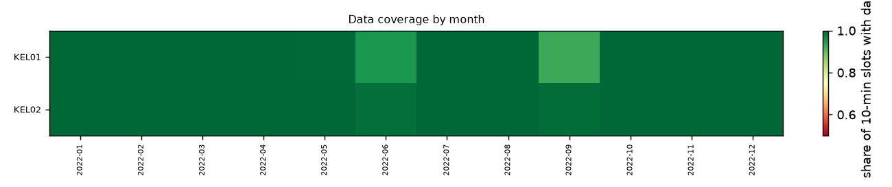
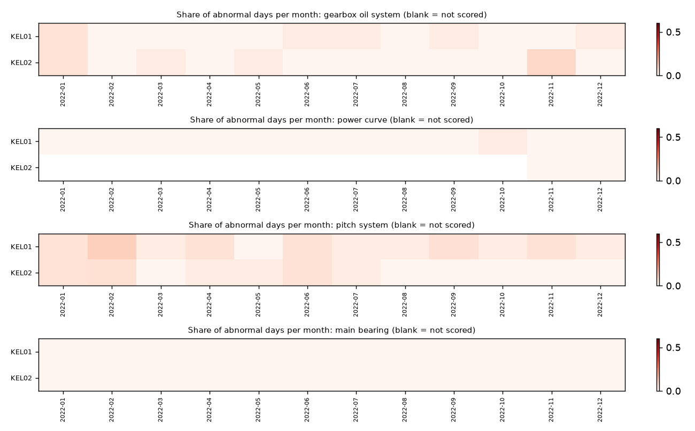
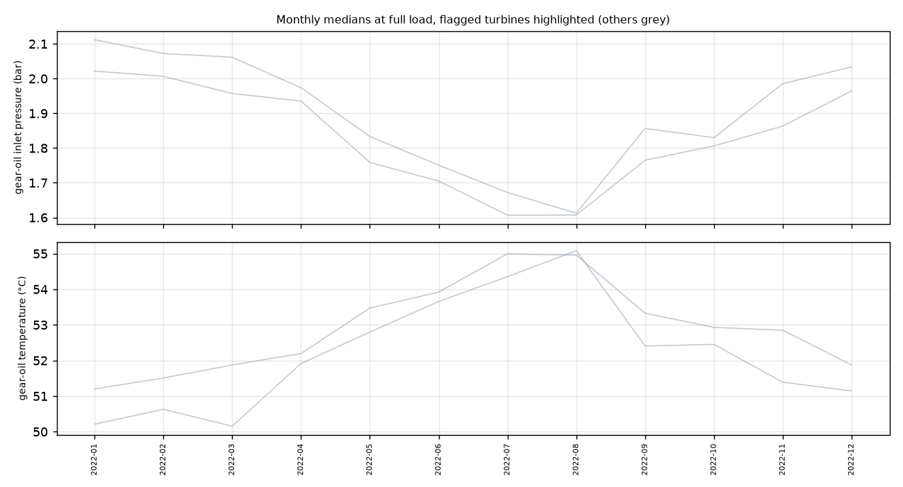
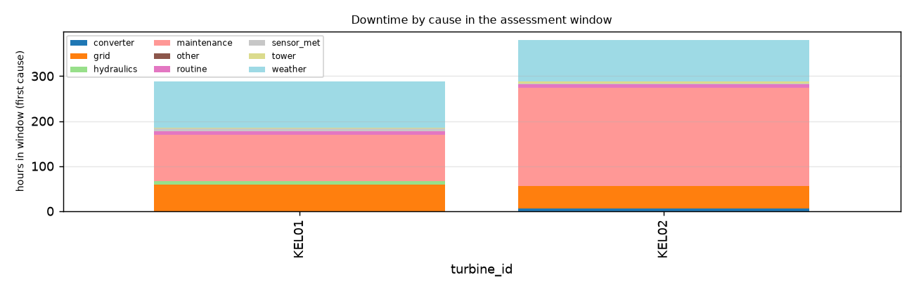

# Fleet condition report: Synthetic ACME-style vendor export generated from Kelmarsh KEL01-02

Synthetic ACME-style vendor export generated from Kelmarsh KEL01-02, 2022. 2 turbines, SCADA 01 Jan 2022 to 31 Dec 2022; assessment window: the last 24 months of each turbine (Jan 2022 to Dec 2022). Generated by `windml report` from the mapping `acme_messy.yaml`.

## Executive summary

**No turbine shows a warning sign** in the last 24 months of data.

**No action needed now:** KEL01, KEL02.

**How sure are we.** Confidence is *High* when the turbine has 3+ years of history, near-complete data, models trained on earlier years and an alarm log; it drops when any of these is missing. A red flag is a reason to look, not a diagnosis.

**What this report could not check:**

- The history is short (under two years), so models were cross-fitted within the record: they spot sudden changes and outliers, but a slow change that started before the data begins is invisible.
- The export has no pitch-motor temperatures, so those components could not be checked.

<h2 class="newpage">1. Data quality</h2>

| Turbine | First data | Last data | Months | Coverage (window) | Longest gap (h) | Signals | Native interval | Frozen rows (window) | Stuck sensors (>= 1%) | Stop/fault labels |
|---|---|---|---|---|---|---|---|---|---|---|
| KEL01 | 2022-01-01 | 2022-12-31 | 12 | 99.0% | 49 | 6 | 10min | 0 | - | alarm log |
| KEL02 | 2022-01-01 | 2022-12-31 | 12 | 99.9% | 5 | 6 | 10min | 0 | - | alarm log |

Signals present in at least one turbine: `ambient_temp_c`, `gear_oil_inlet_pressure_bar`, `gear_oil_temp_c`, `generator_speed_rpm`, `main_bearing_front_temp_c`, `nacelle_position_deg`, `nacelle_temp_c`, `pitch_a_deg`, `power_kw`, `rotor_speed_rpm`, `wind_direction_deg`, `wind_speed_ms`.

<h2 class="newpage">2. Turbine scorecard</h2>

| Turbine | Flag | Confidence | Tech. avail. | Energy avail. | Fault h/yr | Largest fault cause | Oil ep. | Pitch ep. | Abnormal oil days, final yr | Under-perf. days, final yr | Pump pressure: base to last (bar) | Oil-temp model error |
|---|---|---|---|---|---|---|---|---|---|---|---|---|
| KEL01 | **GREEN** | Medium | 98.5% | - | 17 | hydraulics (8 h) | 0 | 1 | 2% | 0% | - | - |
| KEL02 | **GREEN** | Medium | 97.3% | - | 12 | converter (6 h) | 1 | 0 | 2% | 0% | - | - |

### Flags and reasons

- **KEL01** **GREEN** (confidence Medium: 12 months of history, short-history models (cross-fit)). No trigger.
- **KEL02** **GREEN** (confidence Medium: 12 months of history, short-history models (cross-fit)). No trigger.

<h2 class="newpage">3. Model-based health (normal-behaviour residuals)</h2>

Each turbine gets its own models that predict a signal (oil temperature, bearing temperature, pitch angle, power...) from operating conditions. A day is *abnormal* when the turbine's median deviation from its own model is beyond 3 robust standard deviations in the harmful direction. *Chronic* means at least 30% abnormal days in a month.

| Turbine | Training scheme | Models | Window scored | gearbox oil system: abnormal days final yr / chronic months | main bearing: abnormal days final yr / chronic months | pitch system: abnormal days final yr / chronic months | power curve: abnormal days final yr / chronic months |
|---|---|---|---|---|---|---|---|
| KEL01 | cross-fit | 5 | 99% | 2% / 0 | 0% / 0 | 5% / 0 | 0% / 0 |
| KEL02 | cross-fit | 5 | 97% | 2% / 0 | 0% / 0 | 3% / 0 | 0% / 0 |

No turbine has 3 or more consecutive chronic months in the window.

<h2 class="newpage">4. Gearbox oil pressure and temperature trends</h2>

| Turbine | Pump pressure (bar): baseline → last month | Inlet pressure (bar) | Oil temperature (°C) | Baseline months |
|---|---|---|---|---|
| KEL01 | - | 2.0 → 2.0 (+0.0) | 51.3 → 51.1 (-0.1) | 2022-01..2022-06 |
| KEL02 | - | 1.9 → 2.0 (+0.0) | 52.0 → 51.9 (-0.2) | 2022-01..2022-06 |

<h2 class="newpage">5. Sensor drift and stuck sensors</h2>

Fewer than 4 turbines share a drift-check signal, so sensor drift against the fleet could not be checked.

<h2 class="newpage">6. Stop and fault history</h2>

| Turbine | Fault stops | Maintenance | Grid | Weather | Curtailment | Major-fault episodes | Maint. h/yr | Oil / pitch trips |
|---|---|---|---|---|---|---|---|---|
| KEL01 | 75 | 36 | 4 | 12 | 0 | 1 | 102 | 0 / 1 |
| KEL02 | 35 | 30 | 18 | 3 | 0 | 1 | 218 | 1 / 0 |

Most frequent fault stops in the window (all turbines):

| Code | Message | Component | Stops |
|---|---|---|---|
| 6530 | Anemometer defect | sensor_met | 70 |
| 4540 | Tower oscillation X level 2 | tower | 12 |
| 1070 | Drive train monitor level 2 | gearbox | 6 |
| 4510 | Tower oscillation Y level 1 | tower | 6 |
| 6620 | Vane defect | sensor_met | 4 |
| 3110 | Frequency converter error | converter | 4 |
| 5510 | Low hydraulic pressure | hydraulics | 2 |
| 4520 | Tower oscillation X level 1 | tower | 2 |
| 1065 | Drive train monitor level 1 | gearbox | 1 |
| 815 | Rotor overspeed nacelle | rotor | 1 |
| 455 | Repeating error BP52 | pitch | 1 |
| 1800 | Overload gear oil pump | gearbox | 1 |

<h2 class="newpage">7. Methods, thresholds and limits</h2>

- **Pipeline.** `windml report` reads the raw export only through the mapping (`windml.ingest`), cleans and labels each turbine (QC flags, short-gap interpolation, alarm-log stop labels), trains the models, computes the metrics and writes this report. Every number here is reproducible from the mapping and the raw files.
- **Window.** The last 24 months of each turbine; *final year* = its last 12 months.
- **Models.** LightGBM per turbine and signal on healthy operating rows (no stop within 6 h, no fault, not in the 30 days before a major fault, QC clean). With 2+ calendar years, each year is scored by a model trained only on earlier years (3-day embargo, training must cover all 12 months). With 12-23 months, the record is cut into 6 blocks scored by models trained on the other blocks (cross-fit). Under 12 months, no model.
- **RAG rules** (fixed in advance, heuristics, not a calibrated risk): RED for availability < 95%, >= 8 oil or pitch trip episodes, pump pressure >= 2 bar above baseline, or abnormal oil state on >= 30% of final-year days; AMBER for availability < 97%, >= 4 episodes, pump rise >= 1 bar, abnormal oil days >= 10%, oil-temperature model error >= 1.5x its pre-window level, or > 2% missing data; AMBER only for under-performance on >= 20% of final-year days, abnormal main-bearing or pitch residuals on >= 30%, sensor drift (1.5 °C, 5% wind) or a stuck monitored sensor.
- **Confidence.** Points for history (3+ years: 2, 2-3 years: 1), coverage >= 95%, models trained on earlier years, an alarm log, and (for flags) agreement of independent indicators. High >= 4, Medium 2-3, Low <= 1.
- **Limits.** The alarm-log classes come from the mapping's rules; trip detection uses Senvion-style oil/pitch codes and messages (other vendors need `class_rules`). Full-load oil medians assume one oil circuit design across the fleet. Models learn whatever was normal in their training data, including a fault that was already present. Sensor drift is relative to the other turbines, so a fleet-wide drift is invisible.
- **Data.** Derived from Kelmarsh SCADA, CC BY 4.0, Cubico Sustainable Investments, doi:10.5281/zenodo.16807551.
