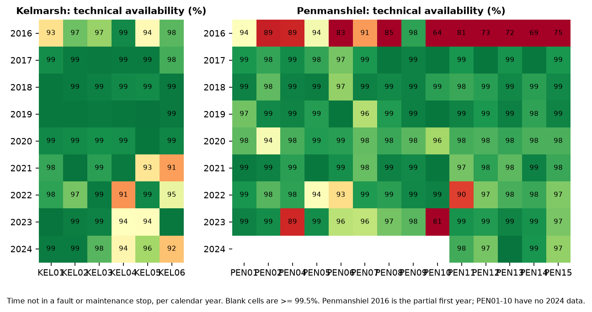
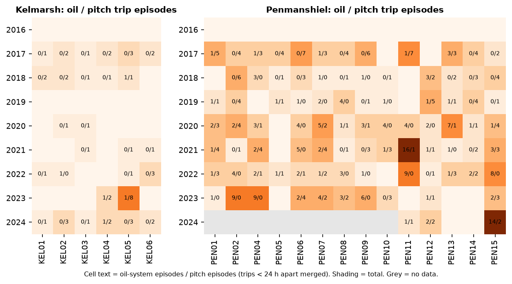
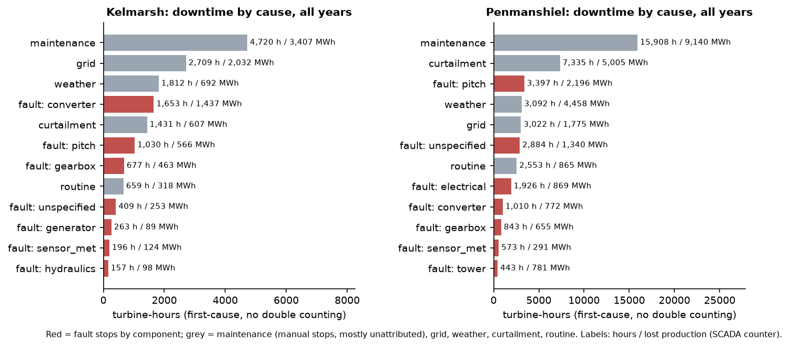
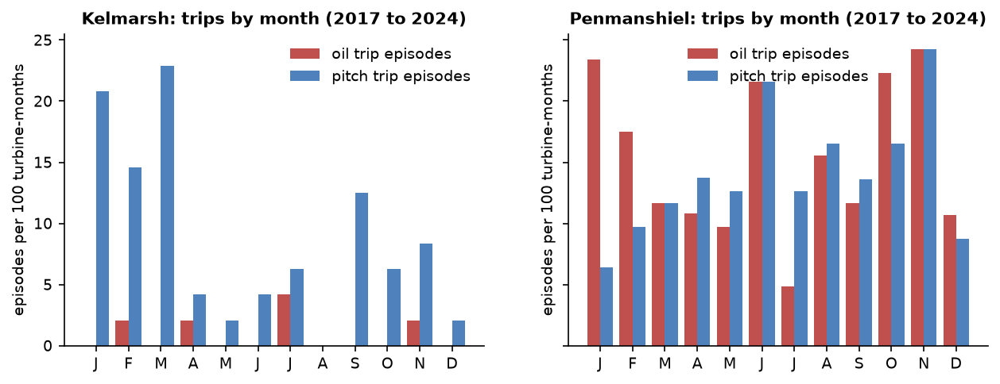
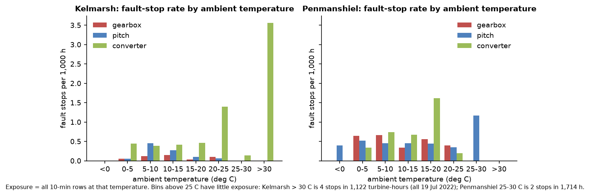
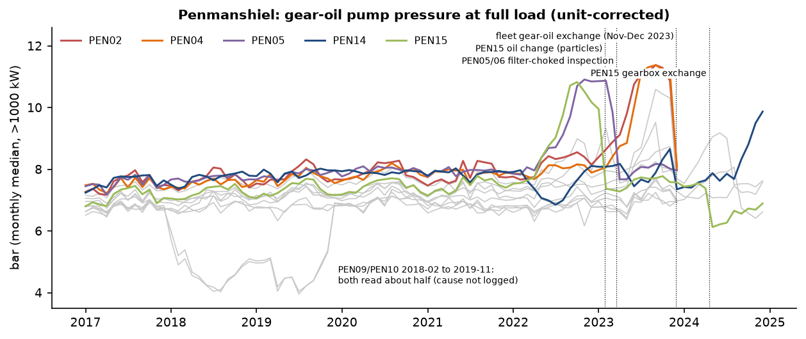
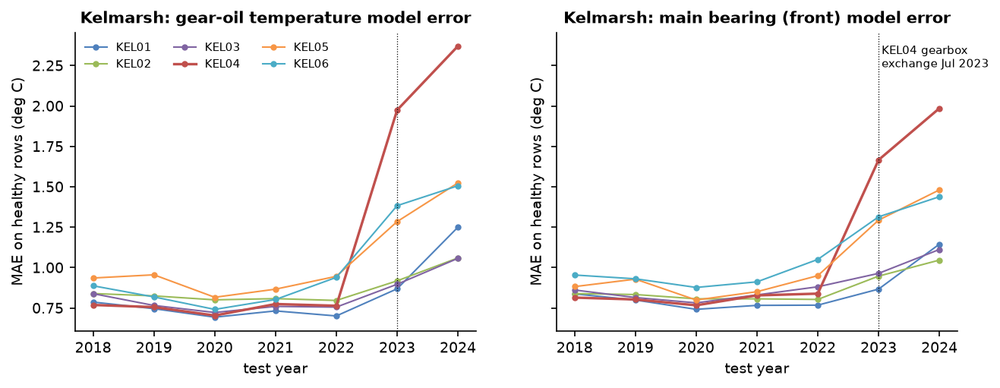

# Wind Farm Condition Report (sample)

**Sites:** Kelmarsh (6 x Senvion MM92, 2,050 kW, KEL01 to KEL06) and Penmanshiel (14 x Senvion MM82, 2,050 kW, PEN01, PEN02, PEN04 to PEN15)

**Data period:**
- Kelmarsh: 2016 to 2024.
- Penmanshiel: mid-2016 to 2023 for PEN01 to PEN10, and to 2024 for PEN11 to PEN15. Penmanshiel 2016 is the partial first operating year and is left out of the farm totals.

**Data:** public 10-minute SCADA and turbine status logs published by Cubico Sustainable Investments on Zenodo (CC BY 4.0). No site visits, no vibration or oil-lab data.

**Status:** this is a sample of a health-assessment product, built on public data. It is a retrospective condition review, **not a failure prediction**.

> This report is not engineering advice. Every number in it is computed from the public data described in Section 5. Any finding should be checked by a qualified engineer, with site records and inspections, before anyone acts on it.

## 1. Executive summary

### Kelmarsh

- **Overall performance:**
  - Time-based technical availability over 2016 to 2024 is 97.9% (time not in a fault or maintenance stop). Energy-based availability is 96.2%.
  - Availability was 99.2% to 99.6% in 2017 to 2020 and fell to 96.5% to 97.6% in 2021 to 2024.
- **Concentration of downtime:** three turbines, KEL04, KEL05 and KEL06, account for 83% of all fault and maintenance downtime since 2021. The operator's log comments for these three record:
  - a generator bearing failure, a gearbox exchange and a busbar failure on KEL04;
  - a gear-oil cooler fan stop of 370 h, repeated pitch errors and converter (IGBT) work on KEL05;
  - two pitch motor replacements and a generator bearing exchange on KEL06.
- **Causes of lost production:** about 10,906 MWh (2016 to 2024). The largest causes are:
  - manual (maintenance) stops: 31.2%;
  - grid stops: 18.6%;
  - converter faults: 13.2%.
- **Gearbox oil-system trips are rare:** 14 trips in 10 episodes over nine years. Pitch trips are more common (131 trips in 69 episodes) and cluster in January to March.
- **Model drift:** the normal-behaviour temperature models fit worse at every Kelmarsh turbine in 2023 and 2024 than in 2018 to 2022.
  - KEL04 has the largest change, after its July 2023 gearbox exchange.
  - The rise at the other five turbines has no logged explanation and should be checked before temperature alarms are trusted.
- **Flags:** RED for KEL04 and KEL05, AMBER for KEL01 and KEL06, GREEN for KEL02 and KEL03.

### Penmanshiel

- **Overall performance:** technical availability over 2017 to 2024 is 98.0%, and energy-based availability is 96.2%. Lost production is about 22,519 MWh. The largest causes are:
  - manual stops: 24.5%;
  - curtailment: 20.6%;
  - weather: 19.6%, mostly high-wind cut-out;
  - pitch faults: 8.2%.
- **Signature issue, gearbox lubrication:** there were 440 oil-system trips in 235 episodes (2016 to 2024), 354 of them "Missing gear oil (high rpm)". Kelmarsh had 14.
- **Gear-oil pump pressure build-ups:** full-load pump pressure built up by 1.8 to 3.7 bar over several months on PEN01, PEN02, PEN04, PEN05, PEN06, PEN07 and PEN15 in 2022 and 2023.
  - Six of these build-ups ended at a logged oil change, a filter-choked inspection or the fleet-wide gear-oil exchange of November and December 2023. PEN07's dropped without a logged service.
  - Oil trips on PEN02 and PEN04 clustered during their build-ups.
- **Open item at the end of the record:** PEN14's pump pressure was rising through the last five months of the data. It read 9.9 bar in December 2024, against 7.4 to 8.1 bar in the same month of each year from 2019 to 2023. This is the clearest open item in the report.
- **Long single outages:**
  - PEN10 busbar replacement: 61 days in 2023;
  - PEN11 sun-pinion retrofit: 29 days in late 2022;
  - PEN04 generator bearing replacement: 17 days in 2023.
- **Flags:** RED for 8 of 14 turbines (PEN01, PEN02, PEN04, PEN06, PEN10, PEN11, PEN14, PEN15), AMBER for 4 (PEN05, PEN07, PEN08, PEN09), GREEN for 2 (PEN12, PEN13).
  - Several RED flags come from conditions the log shows were addressed near the end of the record. The context column in Section 2 says which.

## 2. Per-turbine scorecard

**Assessment window:** each turbine's last two full calendar years of data. That is 2023 to 2024 for Kelmarsh and PEN11 to PEN15, and 2022 to 2023 for PEN01 to PEN10.

**Column definitions:**
- **Tech. avail.:** share of time not in a fault or maintenance stop. Grid, weather, curtailment and routine stops are not counted against the turbine.
- **Energy avail.:** export / (export + SCADA lost production during downtime).
- **Fault h/yr:** fault-stop downtime per year in the window. Overlaps are removed by first-cause attribution (Section 5).
- **Oil and pitch episodes:** trip episodes in the window. Trips of the same type less than 24 h apart are merged into one episode.
- **Repeat share:** the share of all episodes (2016 to 2024) that started within 30 days of the previous episode of the same type.
- **Abnormal oil days:** share of operating days in the window's final year on which any gear-oil signal deviated by more than 3 robust standard deviations from a normal-behaviour model. The signals are oil sump temperature, inlet temperature, inlet pressure and pump pressure. The model is trained only on prior years.
- **Pump pressure:** monthly median gear-oil pump pressure above 1,000 kW (unit-corrected). It compares the 2017 to 2021 median (baseline) with the last month of record.
- **Oil-temp model error:** healthy-period mean absolute error of the gear-oil temperature model in the final year, divided by its 2018 to 2022 mean.

### Kelmarsh

| Turbine | Flag | Tech. avail. | Energy avail. | Fault h/yr | Largest fault cause | Oil episodes | Pitch episodes | Repeat share oil / pitch (30 d, all years) | Abnormal oil days, final yr | Pump pressure: baseline to last month (bar) | Oil-temp model error vs 2018-22 |
|---|---|---|---|---|---|---|---|---|---|---|---|
| KEL01 | **AMBER** | 99.5% | 99.2% | 4 | hydraulics (4 h) | 0 | 1 | - / 25% | 8% | 7.2 to 7.0 | 1.7x |
| KEL02 | **GREEN** | 99.4% | 98.9% | 9 | pitch (10 h) | 0 | 3 | - / 38% | 2% | 6.6 to 7.1 | 1.3x |
| KEL03 | **GREEN** | 98.6% | 98.5% | 71 | control_comm (96 h) | 0 | 1 | - / 22% | 2% | 7.0 to 7.2 | 1.4x |
| KEL04 | **RED** | 93.8% | 92.1% | 330 | converter (407 h) | 2 | 4 | 0% / 22% | 15% | 7.0 to 7.4 | 3.1x |
| KEL05 | **RED** | 95.2% | 96.2% | 354 | gearbox (370 h) | 1 | 11 | 40% / 39% | 5% | 6.9 to 7.4 | 1.7x |
| KEL06 | **AMBER** | 95.8% | 95.7% | 234 | generator (234 h) | 0 | 2 | - / 33% | 6% | 7.0 to 6.9 | 1.8x |

### Penmanshiel

| Turbine | Flag | Tech. avail. | Energy avail. | Fault h/yr | Largest fault cause | Oil episodes | Pitch episodes | Repeat share oil / pitch (30 d, all years) | Abnormal oil days, final yr | Pump pressure: baseline to last month (bar) | Oil-temp model error vs 2018-22 |
|---|---|---|---|---|---|---|---|---|---|---|---|
| PEN01 | **RED** | 99.1% | 97.6% | 39 | pitch (76 h) | 2 | 3 | 10% / 35% | 38% | 7.2 to 7.5 | 1.0x |
| PEN02 | **RED** | 98.4% | 97.5% | 92 | gearbox (108 h) | 13 | 0 | 41% / 48% | 57% | 7.7 to 8.1 | 1.1x |
| PEN04 | **RED** | 93.7% | 94.6% | 262 | unspecified (375 h) | 11 | 1 | 61% / 38% | 56% | 7.7 to 8.0 | 0.9x |
| PEN05 | **AMBER** | 96.6% | 94.6% | 166 | pitch (251 h) | 1 | 1 | 29% / 25% | 12% | 7.8 to 8.0 | 1.0x |
| PEN06 | **RED** | 94.3% | 91.9% | 143 | pitch (257 h) | 4 | 5 | 12% / 45% | 3% | 7.5 to 7.7 | 1.0x |
| PEN07 | **AMBER** | 97.2% | 95.4% | 183 | hydraulics (164 h) | 5 | 4 | 26% / 35% | 14% | 7.1 to 7.8 | 1.2x |
| PEN08 | **AMBER** | 97.9% | 96.5% | 114 | converter (154 h) | 6 | 2 | 36% / 31% | 0% | 6.8 to 6.9 | 0.9x |
| PEN09 | **AMBER** | 98.5% | 97.3% | 87 | gearbox (119 h) | 7 | 0 | 31% / 50% | 1% | 6.8 to 6.9 | 0.9x |
| PEN10 | **RED** | 90.3% | 92.4% | 739 | unspecified (1471 h) | 0 | 3 | 50% / 60% | 0% | 6.7 to 7.0 | 0.9x |
| PEN11 | **RED** | 98.5% | 95.7% | 66 | unspecified (37 h) | 1 | 1 | 50% / 60% | 42% | 6.8 to 6.6 | 1.1x |
| PEN12 | **GREEN** | 98.0% | 95.4% | 116 | pitch (77 h) | 3 | 3 | 25% / 27% | 1% | 7.1 to 7.6 | 1.1x |
| PEN13 | **GREEN** | 99.5% | 97.5% | 6 | tower (11 h) | 0 | 0 | 29% / 38% | 1% | 7.2 to 7.6 | 1.2x |
| PEN14 | **RED** | 98.9% | 97.3% | 38 | electrical (70 h) | 0 | 0 | 0% / 33% | 8% | 7.8 to 9.9 | 1.4x |
| PEN15 | **RED** | 97.0% | 95.4% | 89 | pitch (71 h) | 16 | 5 | 66% / 40% | 22% | 7.3 to 6.9 | 3.1x |

### Flags and reasons

The flag rules were fixed before the per-turbine results were reviewed. They are simple heuristics, not a calibrated risk score.

**RED** if any of:
- availability below 95%;
- 8 or more oil-system or 8 or more pitch trip episodes in the window;
- pump pressure 2.0 bar or more above baseline in the last month;
- abnormal oil state on 30% or more of days in the final year.

**AMBER** if any of:
- availability below 97%;
- 4 or more oil or pitch episodes;
- pump pressure 1.0 bar or more above baseline;
- abnormal oil state on 10% or more of days;
- oil-temperature model error 1.5 times its baseline or more;
- more than 2% of data missing.

**GREEN** otherwise.

The context column summarises the operator's free-text log comments. Those comments exist only from 2022 onward.

| Turbine | Flag | Triggered rules | Context from the status-log comments |
|---|---|---|---|
| KEL01 | AMBER | oil-temperature model error 1.7x | Proactive generator NDE bearing replacement in June 2022 (noise detected). Model error rose at all six Kelmarsh turbines (Section 3.4). |
| KEL02 | GREEN | none | NDE bearing stop in November 2022 (48 h). |
| KEL03 | GREEN | none | NDE bearing replacement in May 2023 (26 h). |
| KEL04 | RED | availability 93.8%; 4 pitch episodes; abnormal oil state on 15% of days in 2024; oil-temperature model error 3.1x | 2022: NDE bearing failure (673 h manual stop). Feb 2023: recurrent oil particle alarms, then endoscope inspection. Jul 2023: gearbox exchange (337 h). Jan 2024: busbar failure (390 h). Jul 2024: gear-oil coupling replaced. Abnormal oil days were mostly in the months right after the exchange. They rose again to 17% in Nov 2024 and 42% in Dec 2024 (Section 3.4). |
| KEL05 | RED | 11 pitch episodes; availability 95.2%; oil-temperature model error 1.7x | Gear-oil cooler fan overload stop of 370 h in 2023. "Repeating error BP52" pitch trips: 17 in Sep 2023, 7 in Mar 2024, 17 in Apr 2024. Converter IGBT and fitboard work in May and June 2024. |
| KEL06 | AMBER | availability 95.8%; oil-temperature model error 1.8x | Pitch motor replaced in March 2022 and again in April 2024. Generator speed-sensor connector fault and generator NDE bearing exchange in September 2024. |
| PEN01 | RED | abnormal oil state on 38% of days in 2023 | Pump pressure rose from 7.6 bar (May 2023) to 10.6 bar (Sep 2023) and was back at 7.5 bar after the gear-oil exchange of 27 Nov 2023. Only one month of data follows the exchange. |
| PEN02 | RED | 13 oil episodes; abnormal oil state on 57% of days in 2023 | Pump pressure reached 11.4 bar in Sep 2023, with oil trips through Nov 2023. Back to 8.1 bar after the 27 Nov 2023 oil exchange. One month of post-service data. |
| PEN04 | RED | availability 93.7%; 11 oil episodes; abnormal oil state on 56% of days in 2023 | Pump pressure reached 11.4 bar, with 10 "Low gearbox oil pressure" trips from Aug to Nov 2023. Back to 8.0 bar after the 29 Nov 2023 oil exchange. Generator DE and NDE bearing replacement in May 2023 (410 h). |
| PEN05 | AMBER | availability 96.6%; abnormal oil state on 12% of days in 2023 | Pump pressure reached 10.9 bar in late 2022 and fell to 7.7 bar after the filter-choked gearbox inspection of 17 Mar 2023. Pitch motor replacement in Oct 2022 (251 h). |
| PEN06 | RED | availability 94.3%; 4 oil and 5 pitch episodes | Pitch fault stop of 455 h in June 2022. Pitch motor faults in 2023. |
| PEN07 | AMBER | 5 oil and 4 pitch episodes; abnormal oil state on 14% of days in 2023 | Pump pressure reached 9.5 bar in Sep 2023 and was 7.9 bar in Oct 2023; no service is logged at that drop. Gearbox endoscope inspection in Apr 2023. Pitch motor replacements in Dec 2022 and Jun 2023. |
| PEN08 | AMBER | 6 oil episodes | Recurrent anemometer fault in 2022. Pitch motor exchange in May 2023. |
| PEN09 | AMBER | 7 oil episodes | Gear-oil leak in Jul 2023; hose replaced in Nov 2023. Pressures read about half of normal from Feb 2018 to Nov 2019 (Section 2.2). |
| PEN10 | RED | availability 90.3% | Busbar replacement: one 61-day outage from Mar to May 2023, then software update. Pressures read about half of normal from Feb 2018 to Nov 2019. |
| PEN11 | RED | abnormal oil state on 42% of days in 2024 | 25 oil episodes in 2021 to 2022, then a sun-pinion retrofit (29 days, Nov 2022). Zero oil trips in 2023. Pump pressure rose to 8.1 bar from Mar to Aug 2024 and dropped to 6.7 bar after the gear-oil hose damage repair on 30 Aug 2024. |
| PEN12 | GREEN | none | NDE bearing replacement in Mar 2024. Foundation repairs in Oct 2022. |
| PEN13 | GREEN | none | Pump pressure rose to 9.2 bar in mid-2024 and was back at 7.5 bar from Aug 2024. No service is logged at that drop. |
| PEN14 | RED | pump pressure +2.0 bar in last month | High-speed bearing replacement in Mar 2022, after which inlet pressure stepped down from about 2.6 to 2.0 bar. Pump pressure rose from 7.7 bar (Aug 2024) to 9.9 bar (Dec 2024), and the model z-score reached 3.7 in Dec 2024. Open at the end of the record. |
| PEN15 | RED | 16 oil and 5 pitch episodes; abnormal oil state on 22% of days in 2024; oil-temperature model error 3.1x | Pump pressure reached 10.8 bar in Oct 2022. Oil changed on 26 Jan 2023 ("particles high from sun pinion circlip"). Particle alarms from Jan to Apr 2024. Gearbox exchange in Apr 2024. Then 7 "Missing gear oil (high rpm)" trips in Dec 2024. |

### 2.1 Availability, stops and trips by year

Full per-turbine, per-year counts are in the CSV tables:
- stops by class and fault stops by component: `tables/stop_counts_<farm>.csv`;
- downtime hours by cause: `tables/downtime_by_cause.csv`;
- trip episodes: `tables/trip_episodes.csv`.

### 2.2 Sensor health

| Turbine | Data missing (window) | Longest gap (window) | Invalid or frozen 10-min values, all years | Oil-pressure unit switches (bar/kPa) |
|---|---|---|---|---|
| KEL01 | 0.20% | 6 h | 81 | 4 |
| KEL02 | 0.17% | 6 h | 478 | 2 |
| KEL03 | 0.36% | 25 h | 51 | 2 |
| KEL04 | 0.61% | 27 h | 5,243 | 2 |
| KEL05 | 0.30% | 6 h | 940 | 2 |
| KEL06 | 1.08% | 28 h | 1,293 | 2 |

| Turbine | Data missing (window) | Longest gap (window) | Invalid or frozen 10-min values, all years | Oil-pressure unit switches (bar/kPa) |
|---|---|---|---|---|
| PEN01 | 0.17% | 8 h | 918 | 5 |
| PEN02 | 0.16% | 7 h | 530 | 5 |
| PEN04 | 0.66% | 27 h | 499 | 7 |
| PEN05 | 0.32% | 23 h | 485 | 5 |
| PEN06 | 0.22% | 8 h | 952 | 5 |
| PEN07 | 1.20% | 115 h | 293 | 5 |
| PEN08 | 0.21% | 7 h | 82 | 5 |
| PEN09 | 0.17% | 8 h | 92 | 5 |
| PEN10 | 0.67% | 51 h | 726 | 5 |
| PEN11 | 0.55% | 16 h | 95 | 7 |
| PEN12 | 1.00% | 50 h | 97 | 7 |
| PEN13 | 0.29% | 10 h | 0 | 3 |
| PEN14 | 0.65% | 22 h | 38 | 7 |
| PEN15 | 0.28% | 9 h | 1,509 | 7 |

**Oil-pressure units:**
- The gear-oil inlet and pump pressures are labelled "bar" but are logged in kPa for most of the record. The unit switches on the same dates across each fleet:
  - Kelmarsh: not logged before mid-2017, then kPa, with a bar period in June and July 2021, plus a short bar period on KEL01 in May 2019.
  - Penmanshiel: bar until April or May 2018, then kPa, with a bar period from June to August 2022.
- This report converts every reading row by row (values above 20 are divided by 100). Any operator alarm or dashboard that uses the raw values will be wrong during part of the record.

**Other sensor issues:**
- **PEN09 and PEN10:** from February 2018 to November 2019, both turbines' pressure readings were about half of normal. Full-load inlet pressure was about 1.2 bar against about 2.5 bar, and pump pressure about 4.6 bar against about 6.9 bar. The ratio differs between the two signals, so this is not a simple unit change. No cause is logged (the comments start in 2022). Treat these two years of pressure data as unreliable.
- **Penmanshiel gear-oil temperature:** missing for all turbines in 2016 and 2017.
- **Invalid or frozen values:** these are physically impossible readings, or readings identical for 6 h or more, on wind, temperature and bearing channels.
  - The largest counts are KEL04 in 2023 (4,794 values) and PEN15 in 2024 (1,462 values). Both fall in the years of their gearbox exchanges.

## 3. Farm-level patterns

### 3.1 What drives lost production

Downtime is estimated from the status logs. Each turbine-minute is assigned to the earliest-starting active stop, so overlapping stops are not double counted. Lost production uses the SCADA lost-production-to-downtime counter.

**Kelmarsh, 2016 to 2024 (54 turbine-years):**

| Cause | Stops | Downtime (turbine-h) | h per turbine-year | Lost production (MWh) | Share of lost production |
|---|---|---|---|---|---|
| maintenance | 1,159 | 4,720 | 87.4 | 3,407 | 31.2% |
| grid | 509 | 2,709 | 50.1 | 2,032 | 18.6% |
| fault: converter | 263 | 1,653 | 30.6 | 1,437 | 13.2% |
| weather | 115 | 1,812 | 33.5 | 692 | 6.3% |
| curtailment | 106 | 1,431 | 26.5 | 607 | 5.6% |
| fault: pitch | 131 | 1,030 | 19.1 | 566 | 5.2% |
| fault: gearbox | 49 | 677 | 12.5 | 463 | 4.2% |
| routine | 3,953 | 659 | 12.2 | 318 | 2.9% |
| no logged stop | 0 | 0 | 0.0 | 275 | 2.5% |
| fault: tower | 316 | 144 | 2.7 | 256 | 2.3% |
| fault: unspecified | 34 | 409 | 7.6 | 253 | 2.3% |
| fault: sensor_met | 298 | 196 | 3.6 | 124 | 1.1% |
| fault: hydraulics | 12 | 157 | 2.9 | 98 | 0.9% |
| fault: generator | 9 | 263 | 4.9 | 89 | 0.8% |
| fault: electrical | 24 | 139 | 2.6 | 88 | 0.8% |
| fault: yaw | 27 | 46 | 0.9 | 72 | 0.7% |
| fault: control_comm | 2 | 96 | 1.8 | 69 | 0.6% |
| fault: brake | 4 | 57 | 1.1 | 35 | 0.3% |
| fault: rotor | 22 | 48 | 0.9 | 26 | 0.2% |

**Penmanshiel, 2017 to 2024 (102 turbine-years):**

| Cause | Stops | Downtime (turbine-h) | h per turbine-year | Lost production (MWh) | Share of lost production |
|---|---|---|---|---|---|
| maintenance | 2,306 | 8,525 | 83.3 | 5,523 | 24.5% |
| curtailment | 1,096 | 6,894 | 67.4 | 4,630 | 20.6% |
| weather | 4,694 | 3,062 | 29.9 | 4,408 | 19.6% |
| fault: pitch | 299 | 2,969 | 29.0 | 1,845 | 8.2% |
| no logged stop | 0 | 0 | 0.0 | 1,161 | 5.2% |
| grid | 275 | 1,417 | 13.9 | 989 | 4.4% |
| fault: unspecified | 57 | 2,062 | 20.2 | 969 | 4.3% |
| fault: tower | 778 | 435 | 4.3 | 772 | 3.4% |
| fault: converter | 602 | 883 | 8.6 | 727 | 3.2% |
| fault: gearbox | 414 | 736 | 7.2 | 545 | 2.4% |
| fault: electrical | 39 | 596 | 5.8 | 464 | 2.1% |
| fault: sensor_met | 558 | 406 | 4.0 | 192 | 0.9% |
| routine | 8,009 | 1,071 | 10.5 | 159 | 0.7% |
| fault: hydraulics | 1 | 164 | 1.6 | 126 | 0.6% |
| fault: brake | 17 | 13 | 0.1 | 8 | 0.0% |
| fault: yaw | 23 | 3 | 0.0 | 2 | 0.0% |
| fault: rotor | 20 | 4 | 0.0 | 1 | 0.0% |

**Kelmarsh:**
- **Maintenance:** manual stops are the largest single cause of downtime: 87 h per turbine-year and 31% of lost production. The status code does not name a component; the free-text comments sometimes do, but only from 2022.
- **Converter:** converter faults are the largest fault category: 1,653 h, of which "Frequency converter error" accounts for 1,577 h. KEL04's 2024 busbar outage alone was 407 h.
- **Pitch and gearbox:** pitch faults total 1,030 h. Gearbox faults total 677 h, of which a single 370 h oil-cooler fan stop on KEL05 is the largest.

**Penmanshiel:**
- **Maintenance:** manual stops are again the largest cause: 83 h per turbine-year.
- **Curtailment and weather:** curtailment ("Park master stop") and weather together take 40% of lost production. The weather share is mostly "Max. wind speed" (high-wind cut-out, 2,047 h) and icing (1,038 h).
- **Faults:**
  - Pitch faults lead with 2,969 h (2017 to 2024), led by "Charging circuit pitch" and "Repeating error BP52".
  - The "unspecified" fault hours are dominated by the PEN10 circuit breaker / busbar outage (1,471 h).
- **Oil-system trips:** these are frequent but short (736 h of gearbox fault downtime over 414 stops), so they cost less energy than their count suggests.

### 3.2 Seasonal trip patterns

Rates are per 100 turbine-months, 2017 to 2024. The first operating year is left out because Penmanshiel's commissioning in 2016 gave 33 pitch episodes in November 2016 alone.

**Kelmarsh pitch trips:**
- Concentrated in winter: 66% of the 50 episodes since 2017 started between November and March (5 of 12 months).
- January to March runs at 15 to 23 per 100 turbine-months, against 0 to 6 from April to August.
- Kelmarsh oil trips (5 since 2017) are too few to show a pattern.

**Penmanshiel oil trips:**
- Highest in October, November and January (22 to 24 per 100 turbine-months).
- June is an exception at 22.
- Lowest in July (5) and April to May (10 to 11).
- The winter excess fits cold, viscous oil at high speed (the dominant code is "Missing gear oil (high rpm)"), but the June peak shows season is not the whole story.
- Penmanshiel pitch trips show no winter peak: 36% fell between November and March.

### 3.3 Weather-related stops

**Heat:**
- On 19 July 2022 (UK heatwave), Kelmarsh logged 4 converter inlet over-temperature stops on KEL03, KEL05 and KEL06, totalling 10 h. Penmanshiel logged none.
- At Kelmarsh, the converter fault-stop rate is 0.4 to 0.5 per 1,000 h at 0 to 20 °C, 1.4 per 1,000 h at 20 to 25 °C, and 3.6 per 1,000 h above 30 °C. The last figure is only 4 stops in 1,122 turbine-hours, all on the heatwave day at 36 to 39 °C ambient.
- At Penmanshiel, the converter rate peaks at 15 to 20 °C (1.6 per 1,000 h), and there is little exposure above 20 °C.
- Heat is a real but small cost at these sites.

**Cold and ice:**
- Kelmarsh logged 1,802 h of weather stops, 1,585 h of them "Icing (anemometer)", mainly in 2020 to 2023.
- Penmanshiel's icing stops total 1,038 h.

**High wind:** Penmanshiel's 4,594 "Max. wind speed" stops (2,047 h) are design behaviour, not faults.

### 3.4 Chronic abnormal states and model drift

**Penmanshiel gear-oil pressure:**
- The "oil-state outliers" found in earlier modelling are mostly gear-oil **pump pressure** at full load sitting well above its normal level for months. Inlet pressure and oil temperatures stayed normal.
- Six turbines built up by 1.8 to 3.7 bar over four to eight months in 2022 and 2023 (figure above). Each returned to about 7.5 to 8 bar at a logged service:
  - PEN15: oil change for particles, 26 January 2023;
  - PEN05 and PEN06: filter-choked inspection, 17 March 2023;
  - PEN01, PEN02 and PEN04: the fleet-wide gear-oil exchange, 27 to 29 November 2023.
- PEN07 dropped in October 2023 and PEN13 in August 2024 without a logged service.
- A pressure rise downstream of the pump with steady inlet pressure fits a loading filter or ageing oil. That is an interpretation for an engineer to confirm, not a finding of this data.

**Other Penmanshiel step changes:**
- PEN09 and PEN10 in 2018 to 2019: a sensor or configuration issue, see Section 2.2.
- PEN14: inlet pressure stepped down after its March 2022 high-speed bearing replacement.

**Kelmarsh drift:**
- The normal-behaviour models were trained each year on all earlier years. Their error on healthy data rose at all six turbines in 2023 and 2024:
  - gear-oil temperature error went from 0.70 to 0.95 °C in 2022 to 1.06 to 1.52 °C in 2024 at five turbines;
  - KEL04 reached 2.37 °C;
  - main-bearing temperatures show the same pattern.
- KEL04's jump starts at its July 2023 gearbox exchange. Its abnormal oil days were 61% in July 2023 and 100% from August to December 2023. They fell to 0 to 4% from May to October 2024 as post-exchange data entered training, then rose again to 17% in November and 42% in December 2024. The 2023 spike reflects a model trained on the old gearbox. The late-2024 rise is not explained by the exchange and is worth a look.
- The farm-wide rise at the other five turbines has no logged cause in this data. Possible causes include a control or software change, sensor recalibration, or different operating conditions, but none can be confirmed here.

## 4. Recommended actions

These follow from the evidence above and are in rough priority order. They are suggestions for an operator's engineering team to assess, not instructions.

| # | Action | Evidence |
|---|---|---|
| 1 | **PEN14: check gear-oil filter condition and take an oil sample.** | Full-load pump pressure was 9.9 bar in Dec 2024, against 7.4 to 8.1 bar in December of each year from 2019 to 2023, and it rose every month from Aug to Dec 2024. The model z-score is 3.7, and the model accounts for oil temperature. Six other turbines showed the same build-up before an oil or filter service (Section 3.4). |
| 2 | **PEN15: investigate the post-exchange oil trips.** | 7 "Missing gear oil (high rpm)" trips in Dec 2024, eight months after the Apr 2024 gearbox exchange. Earlier: particle alarms Jan to Apr 2024, an oil change for circlip particles in Jan 2023, and the highest oil-trip count in the fleet (16 episodes in 2023 to 2024). |
| 3 | **Penmanshiel fleet: trend full-load gear-oil pump pressure as a routine maintenance indicator.** For example, review a turbine when its monthly median is 1.0 bar above its post-service level for two months. | Seven build-ups in 2022 to 2023 lasted months, and six of them ended at a logged oil or filter service. Oil trips on PEN02 and PEN04 clustered inside their build-ups. This is a monitoring rule to evaluate, not a validated predictor: earlier tests found no reliable 24 to 72 h trip warning in these signals. |
| 4 | **PEN01, PEN02, PEN04: confirm that the Nov 2023 oil exchange held.** | All three returned to baseline in Dec 2023, but this record has no 2024 data for PEN01 to PEN10. |
| 5 | **KEL04: re-baseline condition models on post-exchange data, check the late-2024 oil-signal deviations, and review the converter.** | Gear-oil temperature model error was 3.1 times baseline in 2024. Abnormal oil days were 17% in Nov 2024 and 42% in Dec 2024, after being 0 to 4% from May to Oct 2024. 407 h of converter (busbar) downtime in 2024 and 330 fault hours per year in the window. |
| 6 | **KEL05: root-cause the recurring pitch "Repeating error BP52".** | 44 such trips between Sep 2023 and Apr 2024 (17 in Sep 2023 and 17 in Apr 2024 alone), giving 11 pitch episodes in the window, the most at Kelmarsh. KEL05 also had 239 h of converter downtime in 2024. |
| 7 | **KEL06: review the pitch drive.** | Pitch motors replaced in Mar 2022 and Apr 2024. Pitch faults cost 415 h in 2022 and 208 h in 2024. |
| 8 | **Kelmarsh: explain the 2023 to 2024 model drift before relying on temperature alarms.** | Model error rose at all six turbines, not only at KEL04 (Section 3.4). |
| 9 | **Kelmarsh: review icing stop logic and anemometer heating.** | "Icing (anemometer)" stops total 1,585 h. Recurrent anemometer faults are logged on KEL04 and KEL05 in 2023. |
| 10 | **Both farms: fix the data foundations.** Log oil pressures in one unit, and record a component on manual stops. | Unit switches in 2018, 2021 and 2022 (Section 2.2). Manual stops carry 31% (Kelmarsh) and 25% (Penmanshiel) of lost production with no component code. |
| 11 | **PEN10: review spares and logistics for busbar and switchgear faults.** | A single 61-day outage in 2023 (1,471 h), the largest in the record. |
| 12 | **PEN09 and PEN10: confirm what changed in pressure measurement from Feb 2018 to Nov 2019.** | Both turbines read about half of normal for 22 months, then returned together. |

## 5. Methods and limits

**Data:**
- **Source:** public 10-minute SCADA averages (with 10-minute min, max and standard deviation for some channels) and turbine status logs.
- **Kelmarsh:** Cubico Sustainable Investments, Zenodo, DOI 10.5281/zenodo.16807551, licensed CC BY 4.0.
- **Penmanshiel:** Cubico Sustainable Investments, Zenodo, DOI 10.5281/zenodo.16807304, licensed CC BY 4.0.
- **Not available:** vibration, oil-lab results, inspection reports and a full work-order history. The only maintenance context is the free-text comments in the status logs, which exist from 2022 onward.

**Labels:**
- "Stops", "faults", "trips" and their components all come from status-log codes and the operator's service categories.
- A trip is a fault stop. Oil-system trips are gearbox lubrication codes (missing gear oil, low oil pressure, oil-pump and cooler-fan overload, particle alarm). Pitch trips are fault stops on the pitch system.
- These labels record what the controller did. They do not confirm a physical failure.

**Availability and downtime:**
- Time-based technical availability counts fault and maintenance stops against the turbine. It is not a contractual availability figure.
- Downtime by cause uses first-cause attribution. Ties are broken fault first, then maintenance, then external causes.
- Lost production uses the SCADA counter and inherits its power-curve assumptions.

**Condition signals:**
- **Normal-behaviour models:** gradient-boosted models, one per turbine and signal. They predict each signal from operating conditions, train only on healthy data from earlier years, and are scored on the next year.
- **Abnormal day:** a day whose median robust z-score exceeds 3 in absolute value for any gear-oil signal.
- **Pump pressure figures:** use producing rows above 1,000 kW only, after the unit correction.

**Not a failure prediction:**
- Earlier work on the same data tested whether these signals give advance warning of oil-system or pitch trips. It found no reliable warning at 24 to 72 hours or at 30 days once seasonal and turbine-level chance rates were accounted for.
- The flags in this report describe recent condition and history. They are not probabilities of failure.

**Known limits:**
- **Rule thresholds:** the RAG rules are heuristics set by the analyst.
- **Repeat share:** uses all years, so early-life trips count.
- **Data gaps:** PEN01 to PEN10 have no 2024 data, and their January 2023 file is missing.
- **Pump pressure "last month" metric:** an initial 3-month version straddled the November 2023 oil exchange. It was changed to the final month before flags were finalised, and that change removed the pump-pressure trigger for PEN01, PEN02 and PEN04, whose December 2023 values were back near baseline. Their RED flags come from other rules.
- **Weather analysis:** uses nacelle-measured ambient temperature.
- **Not checked:** blade, tower and foundation condition cannot be assessed from SCADA.

**Credits:** Kelmarsh and Penmanshiel wind farm data by Cubico Sustainable Investments, published on Zenodo under CC BY 4.0 (DOIs above). This report is an independent analysis and is not endorsed by Cubico.

**Reproducibility:** the scripts that build this report are in `projects/windml/scripts/`: `condition_metrics.py`, `condition_scorecard.py`, `condition_tables.py`, `condition_figures.py` and `build_condition_report.py`. The computed tables are in `reports/condition_report/tables/`.

*This report is not engineering advice.*
