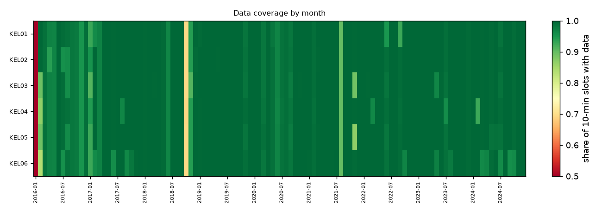
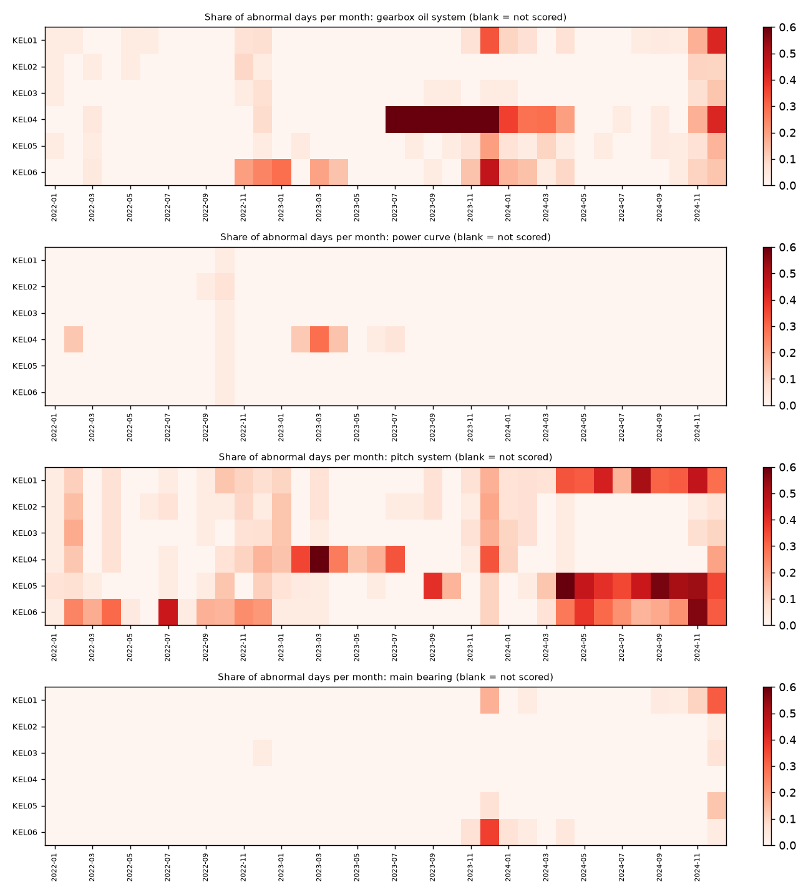
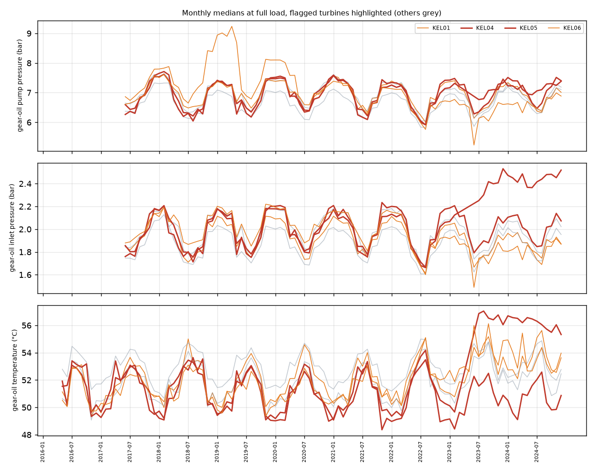
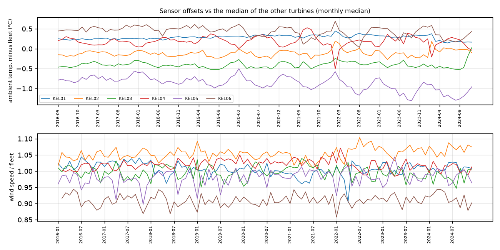
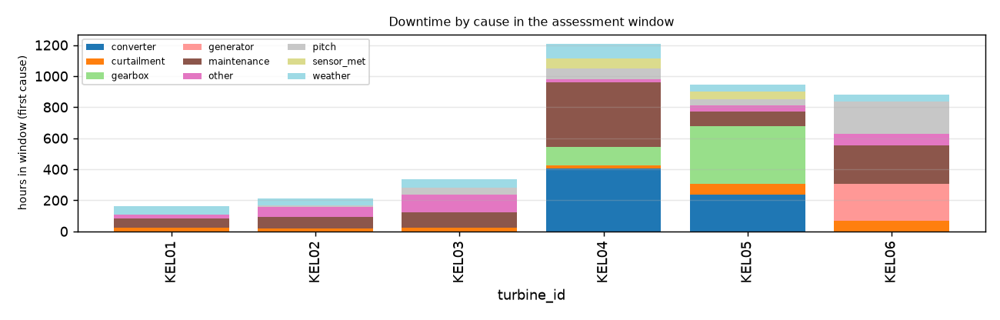

# Fleet condition report: Kelmarsh wind farm

Kelmarsh wind farm (6x Senvion MM92, UK), Cubico, Greenbyte export. 6 turbines, SCADA 21 Jan 2016 to 31 Dec 2024; assessment window: the last 24 months of each turbine (Jan 2023 to Dec 2024). Generated by `windml report` from the mapping `kelmarsh_all_years.yaml`.

## Executive summary

**4 of 6 turbines need attention** (2 red, 2 amber). The rest show no warning sign in the data we have.

| Turbine | Flag | Why | Confidence | Suggested next step |
|---|---|---|---|---|
| KEL04 | **RED** | It was down for faults or maintenance 6.2% of the time; it tripped on pitch faults in 4 separate episodes in two years; it behaved abnormally in the gearbox oil system on 15% of days last year; and more (see scorecard). | High | Review the fault history below and the open work orders; inspect pitch drives, batteries and slip ring. |
| KEL05 | **RED** | It tripped on pitch faults in 11 separate episodes in two years; it was down for faults or maintenance 4.8% of the time; it gear-oil temperature has become 1.7x harder to predict than before; and more (see scorecard). | High | Inspect pitch drives, batteries and slip ring; review the fault history below and the open work orders. |
| KEL06 | **AMBER** | It was down for faults or maintenance 4.2% of the time; it gear-oil temperature has become 1.8x harder to predict than before. | High | Review the fault history below and the open work orders; check the oil cooler fan and thermostat. |
| KEL01 | **AMBER** | It gear-oil temperature has become 1.7x harder to predict than before. | High | Check the oil cooler fan and thermostat. |

**No action needed now:** KEL02, KEL03.

**How sure are we.** Confidence is *High* when the turbine has 3+ years of history, near-complete data, models trained on earlier years and an alarm log; it drops when any of these is missing. A red flag is a reason to look, not a diagnosis.

<h2 class="newpage">1. Data quality</h2>

| Turbine | First data | Last data | Months | Coverage (window) | Longest gap (h) | Signals | Native interval | Frozen rows (window) | Stuck sensors (>= 1%) | Stop/fault labels |
|---|---|---|---|---|---|---|---|---|---|---|
| KEL01 | 2016-01-23 | 2024-12-31 | 107 | 99.8% | 6 | 9 | 10min | 0 | - | alarm log |
| KEL02 | 2016-01-21 | 2024-12-31 | 107 | 99.8% | 6 | 9 | 10min | 0 | - | alarm log |
| KEL03 | 2016-01-27 | 2024-12-31 | 107 | 99.6% | 25 | 9 | 10min | 0 | - | alarm log |
| KEL04 | 2016-02-04 | 2024-12-31 | 107 | 99.4% | 27 | 9 | 10min | 3,196 | gear_oil_inlet_temp_c, gear_oil_temp_c | alarm log |
| KEL05 | 2016-01-24 | 2024-12-31 | 107 | 99.7% | 6 | 9 | 10min | 0 | - | alarm log |
| KEL06 | 2016-02-05 | 2024-12-31 | 107 | 98.9% | 28 | 9 | 10min | 0 | - | alarm log |

Signals present in at least one turbine: `ambient_temp_c`, `available_capacity_kw`, `converter_inlet_temp_c`, `data_availability`, `energy_export_kwh`, `gear_oil_inlet_pressure_bar`, `gear_oil_inlet_temp_c`, `gear_oil_pump_pressure_bar`, `gear_oil_temp_c`, `gen_bearing_front_temp_c`, `gen_bearing_rear_temp_c`, `generator_speed_rpm`, `hub_temp_c`, `lost_prod_curtail_total_kwh`, `lost_prod_downtime_kwh`, `main_bearing_front_temp_c`, `main_bearing_rear_temp_c`, `nacelle_position_deg`, `nacelle_temp_c`, `pitch_a_deg`, `pitch_b_deg`, `pitch_c_deg`, `pitch_motor_temp_1_c`, `pitch_motor_temp_2_c`, `pitch_motor_temp_3_c`, `power_kw`, `power_setpoint_kw`, `rotor_bearing_temp_c`, `rotor_speed_rpm`, `wind_direction_deg`, `wind_speed_1_ms`, `wind_speed_2_ms`, `wind_speed_ms`, `yaw_bearing_angle_deg`.

<h2 class="newpage">2. Turbine scorecard</h2>

| Turbine | Flag | Confidence | Tech. avail. | Energy avail. | Fault h/yr | Largest fault cause | Oil ep. | Pitch ep. | Abnormal oil days, final yr | Under-perf. days, final yr | Pump pressure: base to last (bar) | Oil-temp model error |
|---|---|---|---|---|---|---|---|---|---|---|---|---|
| KEL01 | **AMBER** | High | 99.5% | 99.2% | 4 | hydraulics (4 h) | 0 | 1 | 8% | 0% | 7.2 to 7.0 | 1.7x |
| KEL02 | **GREEN** | High | 99.4% | 98.9% | 9 | pitch (10 h) | 0 | 3 | 2% | 0% | 6.6 to 7.1 | 1.3x |
| KEL03 | **GREEN** | High | 98.6% | 98.5% | 71 | control_comm (96 h) | 0 | 1 | 2% | 0% | 7.0 to 7.2 | 1.4x |
| KEL04 | **RED** | High | 93.8% | 92.1% | 330 | converter (407 h) | 2 | 4 | 15% | 0% | 7.0 to 7.4 | 3.1x |
| KEL05 | **RED** | High | 95.2% | 96.2% | 354 | gearbox (370 h) | 1 | 11 | 5% | 0% | 6.9 to 7.4 | 1.7x |
| KEL06 | **AMBER** | High | 95.8% | 95.7% | 234 | generator (234 h) | 0 | 2 | 6% | 0% | 7.0 to 6.9 | 1.8x |

### Flags and reasons

- **KEL01** **AMBER** (confidence High: 107 months of history, models trained on earlier years). oil-temp model error 1.7x baseline
- **KEL02** **GREEN** (confidence High: 107 months of history, models trained on earlier years). No trigger.
- **KEL03** **GREEN** (confidence High: 107 months of history, models trained on earlier years). No trigger.
- **KEL04** **RED** (confidence High: 107 months of history, models trained on earlier years, several independent indicators agree). RED: technical availability 93.8%; 4 pitch trip episodes; abnormal oil state 15% of final-year days; oil-temp model error 3.1x baseline; stuck sensor(s): gear_oil_inlet_temp_c, gear_oil_temp_c
- **KEL05** **RED** (confidence High: 107 months of history, models trained on earlier years, several independent indicators agree). RED: 11 pitch trip episodes; technical availability 95.2%; oil-temp model error 1.7x baseline; abnormal pitch system residuals 37% of final-year days
- **KEL06** **AMBER** (confidence High: 107 months of history, models trained on earlier years, several independent indicators agree). technical availability 95.8%; oil-temp model error 1.8x baseline

<h2 class="newpage">3. Model-based health (normal-behaviour residuals)</h2>

Each turbine gets its own models that predict a signal (oil temperature, bearing temperature, pitch angle, power...) from operating conditions. A day is *abnormal* when the turbine's median deviation from its own model is beyond 3 robust standard deviations in the harmful direction. *Chronic* means at least 30% abnormal days in a month.

| Turbine | Training scheme | Models | Window scored | gearbox oil system: abnormal days final yr / chronic months | main bearing: abnormal days final yr / chronic months | pitch system: abnormal days final yr / chronic months | power curve: abnormal days final yr / chronic months |
|---|---|---|---|---|---|---|---|
| KEL01 | walk-forward | 14 | 99% | 8% / 2 | 4% / 1 | 28% / 7 | 0% / 0 |
| KEL02 | walk-forward | 14 | 99% | 2% / 0 | 0% / 0 | 2% / 0 | 0% / 0 |
| KEL03 | walk-forward | 14 | 99% | 2% / 0 | 1% / 0 | 3% / 0 | 0% / 0 |
| KEL04 | walk-forward | 14 | 94% | 15% / 8 | 0% / 0 | 3% / 4 | 0% / 0 |
| KEL05 | walk-forward | 14 | 96% | 5% / 0 | 1% / 0 | 37% / 10 | 0% / 0 |
| KEL06 | walk-forward | 14 | 96% | 6% / 1 | 1% / 1 | 23% / 4 | 0% / 0 |

**Chronic abnormal turbines** (3+ consecutive months with >= 30% abnormal days): KEL01 pitch system (4 months); KEL04 gearbox oil system (7 months); KEL05 pitch system (9 months).

<h2 class="newpage">4. Gearbox oil pressure and temperature trends</h2>

| Turbine | Pump pressure (bar): baseline → last month | Inlet pressure (bar) | Oil temperature (°C) | Baseline months |
|---|---|---|---|---|
| KEL01 | 7.2 → 7.0 (-0.2) | 1.9 → 1.9 (-0.1) | 51.8 → 53.6 (+1.8) | 2017-06..2022-12 |
| KEL02 | 6.6 → 7.1 (+0.5) | 1.9 → 2.0 (+0.1) | 53.0 → 52.8 (-0.2) | 2017-06..2022-12 |
| KEL03 | 7.0 → 7.2 (+0.2) | 2.0 → 2.0 (-0.0) | 51.2 → 52.5 (+1.3) | 2017-06..2022-12 |
| KEL04 | 7.0 → 7.4 (+0.4) | 2.0 → 2.5 (+0.5) | 51.1 → 55.3 (+4.2) | 2017-06..2022-12 |
| KEL05 | 6.9 → 7.4 (+0.5) | 2.0 → 2.1 (+0.1) | 51.3 → 50.9 (-0.4) | 2017-06..2022-12 |
| KEL06 | 7.0 → 6.9 (-0.1) | 2.0 → 1.9 (-0.2) | 51.2 → 54.0 (+2.7) | 2017-06..2022-12 |

<h2 class="newpage">5. Sensor drift and stuck sensors</h2>

Drift = change of a turbine's offset to the median of the other turbines, last 3 months vs before the window (thresholds: 1.5 °C, 5% wind speed).

| Turbine | drift ambient_temp_c | drift wind_speed_ms | Stuck sensors |
|---|---|---|---|
| KEL01 | -0.12 °C | 0.7% | - |
| KEL02 | +0.10 °C | 2.3% | - |
| KEL03 | +0.22 °C | 0.6% | - |
| KEL04 | -0.16 °C | -1.8% | gear_oil_inlet_temp_c, gear_oil_temp_c |
| KEL05 | -0.28 °C | 0.5% | - |
| KEL06 | -0.12 °C | -0.8% | - |

<h2 class="newpage">6. Stop and fault history</h2>

| Turbine | Fault stops | Maintenance | Grid | Weather | Curtailment | Major-fault episodes | Maint. h/yr | Oil / pitch trips |
|---|---|---|---|---|---|---|---|---|
| KEL01 | 25 | 36 | 15 | 4 | 4 | 1 | 31 | 0 / 6 |
| KEL02 | 34 | 36 | 28 | 2 | 4 | 3 | 35 | 0 / 3 |
| KEL03 | 7 | 56 | 14 | 3 | 4 | 1 | 50 | 0 / 1 |
| KEL04 | 43 | 50 | 27 | 4 | 4 | 4 | 207 | 5 / 4 |
| KEL05 | 236 | 47 | 14 | 2 | 4 | 10 | 47 | 1 / 47 |
| KEL06 | 36 | 54 | 19 | 1 | 4 | 2 | 125 | 0 / 7 |

Most frequent fault stops in the window (all turbines):

| Code | Message | Component | Stops |
|---|---|---|---|
| 6530 | Anemometer defect | sensor_met | 175 |
| 455 | Repeating error BP52 | pitch | 56 |
| 3110 | Frequency converter error | converter | 31 |
| 4540 | Tower oscillation X level 2 | tower | 26 |
| 4510 | Tower oscillation Y level 1 | tower | 20 |
| 4520 | Tower oscillation X level 1 | tower | 18 |
| 1070 | Drive train monitor level 2 | gearbox | 6 |
| 1620 | Implausible gear speed | gearbox | 5 |
| 2500 | Maximum generator speed | generator | 4 |
| 4530 | Tower oscillation Y level 2 | tower | 4 |
| 570 | Pitch too slow BP180 | pitch | 3 |
| 1510 | Low gearbox oil pressure | gearbox | 3 |

<h2 class="newpage">7. Methods, thresholds and limits</h2>

- **Pipeline.** `windml report` reads the raw export only through the mapping (`windml.ingest`), cleans and labels each turbine (QC flags, short-gap interpolation, alarm-log stop labels), trains the models, computes the metrics and writes this report. Every number here is reproducible from the mapping and the raw files.
- **Window.** The last 24 months of each turbine; *final year* = its last 12 months.
- **Models.** LightGBM per turbine and signal on healthy operating rows (no stop within 6 h, no fault, not in the 30 days before a major fault, QC clean). With 2+ calendar years, each year is scored by a model trained only on earlier years (3-day embargo, training must cover all 12 months). With 12-23 months, the record is cut into 6 blocks scored by models trained on the other blocks (cross-fit). Under 12 months, no model.
- **RAG rules** (fixed in advance, heuristics, not a calibrated risk): RED for availability < 95%, >= 8 oil or pitch trip episodes, pump pressure >= 2 bar above baseline, or abnormal oil state on >= 30% of final-year days; AMBER for availability < 97%, >= 4 episodes, pump rise >= 1 bar, abnormal oil days >= 10%, oil-temperature model error >= 1.5x its pre-window level, or > 2% missing data; AMBER only for under-performance on >= 20% of final-year days, abnormal main-bearing or pitch residuals on >= 30%, sensor drift (1.5 °C, 5% wind) or a stuck monitored sensor.
- **Confidence.** Points for history (3+ years: 2, 2-3 years: 1), coverage >= 95%, models trained on earlier years, an alarm log, and (for flags) agreement of independent indicators. High >= 4, Medium 2-3, Low <= 1.
- **Limits.** The alarm-log classes come from the mapping's rules; trip detection uses Senvion-style oil/pitch codes and messages (other vendors need `class_rules`). Full-load oil medians assume one oil circuit design across the fleet. Models learn whatever was normal in their training data, including a fault that was already present. Sensor drift is relative to the other turbines, so a fleet-wide drift is invisible.
- **Data.** CC BY 4.0, Cubico Sustainable Investments, doi:10.5281/zenodo.16807551.
