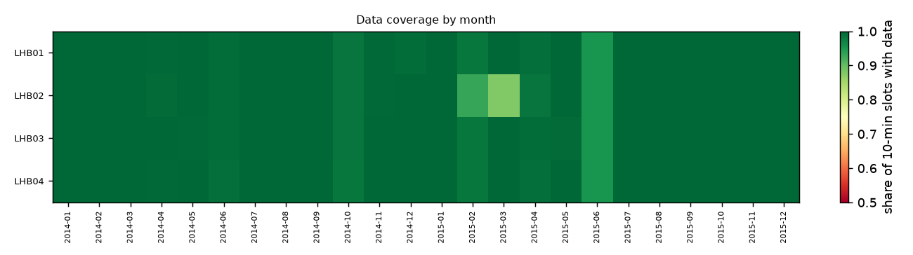
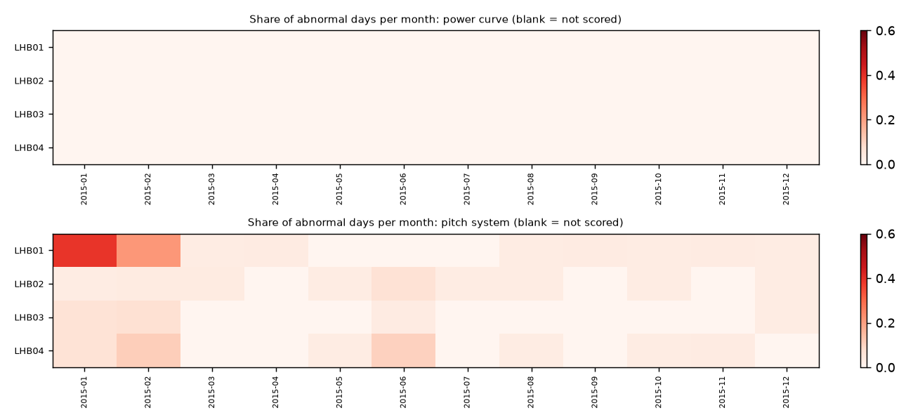
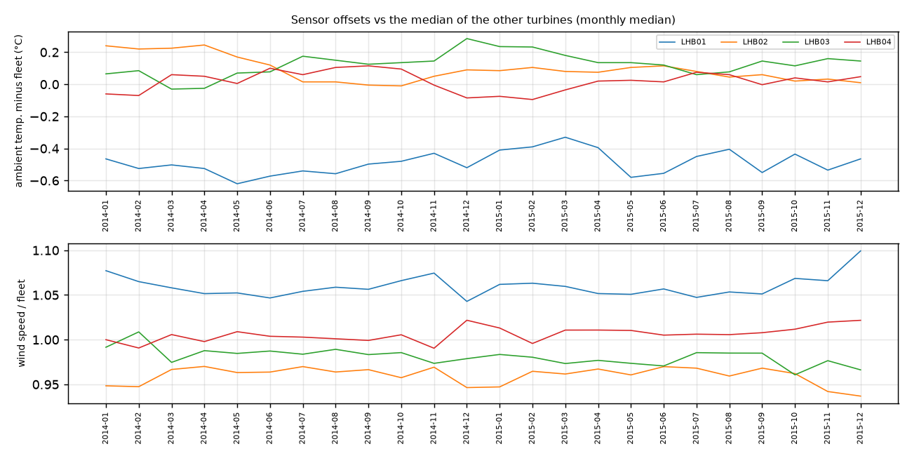

# Fleet condition report: La Haute Borne wind farm

La Haute Borne wind farm (4x Senvion MM82 2050 kW, France), ENGIE open data via NREL OpenOA. 4 turbines, SCADA 01 Jan 2014 to 31 Dec 2015; assessment window: the last 24 months of each turbine (Jan 2014 to Dec 2015). Generated by `windml report` from the mapping `la_haute_borne.yaml`.

## Executive summary

**All 4 turbines are green**: no validated warning sign in the data up to 31 Dec 2015. Green is not a guarantee; see the notes and limits below.

**Green:** LHB01, LHB02, LHB03, LHB04.

**How the ratings work.** A turbine is amber only for a specific, unusual pattern: gear-oil pump pressure building up far beyond its sister turbines, repeated oil-system or pitch trips, or a faulty sensor. It is red when the pattern is strong (e.g. a pump pressure rise of 2 bar or more) or persistent and still active. Thresholds were chosen on 2017-2020 data from two UK wind farms and checked on 2021-2024: amber or red turbine-months were followed by a logged fault, trip or long service stop within 90 days 76% of the time, against 50% for random turbines in the same months; but only 19% of the turbine-months before such an event carried a flag. Ratings help decide where to look first; most faults still arrive without a warning sign in SCADA data. This export has no alarm log, so the trip rules could not run.

**How sure are we.** Confidence is *High* when the turbine has 3+ years of history, near-complete data, models trained on earlier years, an alarm log and at least 3 sister turbines to compare with; it drops when any of these is missing. A red rating is a reason to look, not a diagnosis.

**What this report could not check:**

- There is **no alarm log**, so we cannot see faults, trips or availability. Stops are inferred from SCADA (no power while the wind blows), and the trip rules cannot run.
- With neither an alarm log nor gear-oil pump pressure, only the sensor checks can change a rating for this fleet: green here mostly means 'no sensor problem found'. Model alerts are still shown as notes.
- The export has no gearbox oil temperatures, no oil pressures, no main-bearing temperatures, no pitch-motor temperatures, so those components could not be checked.
- Models scored only about 50% of the window (the first year of a record is needed to train them).

<h2 class="newpage">1. Data quality</h2>

| Turbine | First data | Last data | Months | Coverage (window) | Longest gap (h) | Signals | Native interval | Frozen rows (window) | Stuck sensors (>= 1%) | Stop/fault labels |
|---|---|---|---|---|---|---|---|---|---|---|
| LHB01 | 2014-01-01 | 2015-12-31 | 24 | 99.5% | 34 | 3 | 10min | 0 | - | inferred from SCADA (no alarm log) |
| LHB02 | 2014-01-01 | 2015-12-31 | 24 | 98.8% | 133 | 3 | 10min | 146 | - | inferred from SCADA (no alarm log) |
| LHB03 | 2014-01-01 | 2015-12-31 | 24 | 99.6% | 34 | 3 | 10min | 42 | - | inferred from SCADA (no alarm log) |
| LHB04 | 2014-01-01 | 2015-12-31 | 24 | 99.6% | 34 | 3 | 10min | 0 | - | inferred from SCADA (no alarm log) |

Signals present in at least one turbine: `ambient_temp_c`, `nacelle_position_deg`, `pitch_a_deg`, `power_kw`, `wind_direction_deg`, `wind_speed_ms`.

<h2 class="newpage">2. Turbine scorecard</h2>

| Turbine | Flag | Confidence | Non-production at wind (inferred) | Abnormal oil days, final yr | Under-perf. days, final yr | Pump pressure: base to last (bar) | Oil-temp model error |
|---|---|---|---|---|---|---|---|
| LHB01 | **GREEN** | Medium | 0.8% | - | 0% | - | - |
| LHB02 | **GREEN** | Medium | 0.6% | - | 0% | - | - |
| LHB03 | **GREEN** | Medium | 0.5% | - | 0% | - | - |
| LHB04 | **GREEN** | Medium | 1.2% | - | 0% | - | - |

### Ratings, reasons and notes

- **LHB01** **GREEN** (confidence Medium: 24 months of history, models trained on earlier years, no alarm log (trip rules unavailable)). No rating trigger.
- **LHB02** **GREEN** (confidence Medium: 24 months of history, models trained on earlier years, no alarm log (trip rules unavailable)). No rating trigger.
- **LHB03** **GREEN** (confidence Medium: 24 months of history, models trained on earlier years, no alarm log (trip rules unavailable)). No rating trigger.
- **LHB04** **GREEN** (confidence Medium: 24 months of history, models trained on earlier years, no alarm log (trip rules unavailable)). No rating trigger.

<h2 class="newpage">3. Model-based health (normal-behaviour residuals)</h2>

Each turbine gets its own models that predict a signal (oil temperature, bearing temperature, pitch angle, power...) from operating conditions. A day is *abnormal* when the turbine's median deviation from its own model is beyond 3 robust standard deviations in the harmful direction. *Chronic* means at least 30% abnormal days in a month.

| Turbine | Training scheme | Models | Window scored | pitch system: abnormal days final yr / chronic months | power curve: abnormal days final yr / chronic months |
|---|---|---|---|---|---|
| LHB01 | walk-forward | 2 | 50% | 7% / 1 | 0% / 0 |
| LHB02 | walk-forward | 2 | 49% | 3% / 0 | 0% / 0 |
| LHB03 | walk-forward | 2 | 50% | 2% / 0 | 0% / 0 |
| LHB04 | walk-forward | 2 | 50% | 3% / 0 | 0% / 0 |

No turbine has 3 or more consecutive chronic months in the window.

<h2 class="newpage">5. Sensor drift and stuck sensors</h2>

Drift = change of a turbine's offset to the median of the other turbines, last 3 months vs before the window (thresholds: 1.5 °C, 5% wind speed).

| Turbine | drift ambient_temp_c | drift wind_speed_ms | Stuck sensors |
|---|---|---|---|
| LHB01 | +0.06 °C | 1.3% | - |
| LHB02 | -0.20 °C | -2.1% | - |
| LHB03 | +0.08 °C | -2.1% | - |
| LHB04 | +0.01 °C | 1.8% | - |

<h2 class="newpage">6. Stop and fault history</h2>

The export has no alarm or status log. Stops were inferred from SCADA: power below 1% of rated while the wind is between 4.5 and 25 m/s. That catches downtime, but cannot tell a fault from a grid outage, maintenance or curtailment, so no stop/fault history, availability or trip analysis is possible.

<h2 class="newpage">7. Methods, thresholds and limits</h2>

- **Pipeline.** `windml report` reads the raw export only through the mapping (`windml.ingest`), cleans and labels each turbine (QC flags, short-gap interpolation, alarm-log stop labels), trains the models, computes the metrics and writes this report. Every number here is reproducible from the mapping and the raw files.
- **Window.** The last 24 months of each turbine; *final year* = its last 12 months.
- **Models.** LightGBM per turbine and signal on healthy operating rows (no stop within 6 h, no fault, not in the 30 days before a major fault, QC clean). With 2+ calendar years, each year is scored by a model trained only on earlier years (3-day embargo, training must cover all 12 months). With 12-23 months, the record is cut into 6 blocks scored by models trained on the other blocks (cross-fit). Under 12 months, no model.
- **Ratings.** Computed at each month-end from data up to that date (latest month-end shown here). AMBER when: the full-load gear-oil pump pressure (median of the last 15 days) is >= 1 bar above the turbine's own baseline (days 60-365 before) AND >= 5 robust standard deviations above the other turbines' rise that month; >= 3 oil-system trip episodes in 6 months; >= 6 pitch trip episodes in 6 months; an ambient-temperature or wind-speed sensor drifting vs the fleet over the last 3 months (1.5 °C, 5%); or a monitored sensor frozen on more than 2% of the last 90 days. RED when the pump rise is >= 2 bar; or a trip rule has held 2 month-ends in a row with >= 3x the amber count and a trip in the last 30 days; or two independent systems are amber at once. Shown as notes but never colour-setting, because they had no reliable lead on events in the validation: low availability (it describes the past), model-based abnormal-day rates (oil, pitch, main bearing, power curve) and missing data. A trip episode merges trips less than 24 h apart.
- **Validation.** Retrospective check on Kelmarsh and Penmanshiel (21 turbines). Thresholds selected on 2017-2020, checked on 2021-2024 (792 turbine-months): pump build-up → oil trip or service stop: 58% of 12 flagged turbine-months vs 55% by chance; repeat oil trips → further oil trips: 63% of 75 flagged turbine-months vs 32% by chance; repeat pitch trips → further pitch trips: 67% of 6 flagged turbine-months vs 36% by chance. Any amber or red: 76% followed by a logged event within 90 days vs 50% by chance (recall 19%); red alone 65% vs 58% on only 17 turbine-months, so red marks strength and persistence more than a higher probability. Held-out ratings: 89% green, 9% amber, 2% red. Consecutive months overlap, so the effective sample is much smaller than the row counts; details in `reports/fleet_proof/calibration.md`.
- **Confidence.** Points for history (3+ years: 2, 2-3 years: 1), coverage >= 95%, models trained on earlier years, an alarm log, and a fleet of 4+ turbines (peer comparison). High >= 5, Medium 3-4, Low <= 2.
- **Limits.** The alarm-log classes come from the mapping's rules; trip detection uses Senvion-style oil/pitch codes and messages (other vendors need `class_rules`). Full-load oil medians assume one oil circuit design across the fleet. Models learn whatever was normal in their training data, including a fault that was already present. Sensor drift is relative to the other turbines, so a fleet-wide drift is invisible. The rating thresholds were calibrated on two UK farms of one turbine family (Senvion MM92/MM82); on other fleets the peer-relative logic still applies but the hit rates are unknown. Ratings look back up to 6 months and only at what SCADA and the alarm log show: inspections, oil analyses, vibration (CMS) data and work orders are not used, so a recent repair or a fault the sensors cannot see changes nothing here.
- **Data.** Licence Ouverte / Open Licence 2.0 (Etalab; compatible with CC BY 4.0), ENGIE Group.
