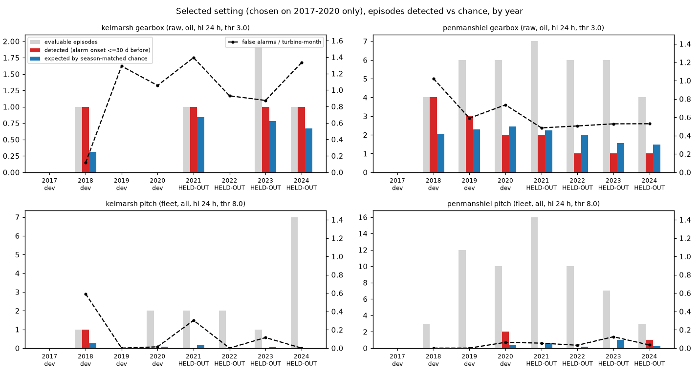
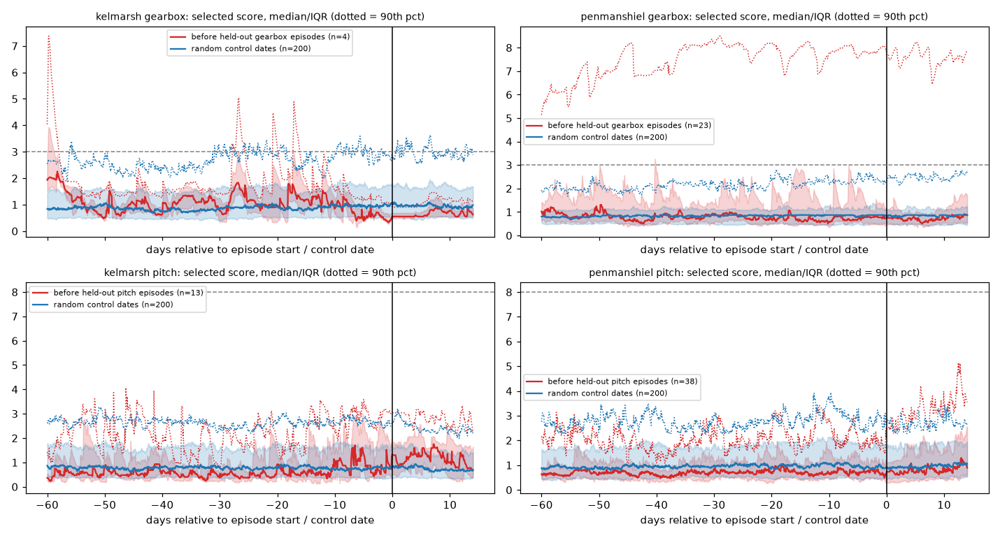
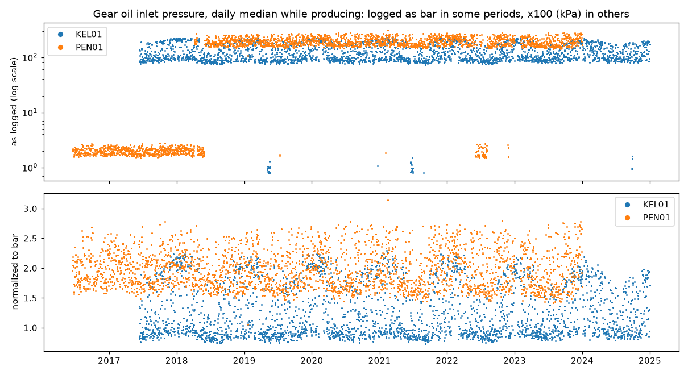
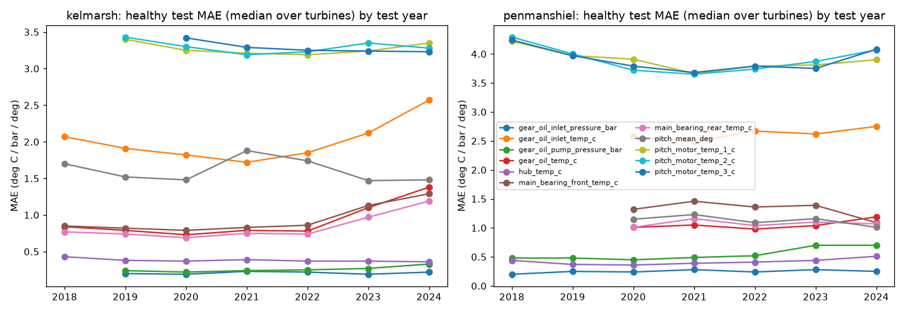

# All-years normal-behaviour models: gearbox oil-system and pitch faults (Kelmarsh + Penmanshiel, 2016–2024)

**Bottom line.** I trained the models walk-forward by year on 9 years of SCADA from 20 turbines. They fit healthy behaviour well (Table 7), but **neither fault type gets a real early warning on the held-out years (2021–2024).**

* **Gearbox (oil-system) faults.** The setting chosen in advance (2017–2020 only) catches **8 of 27** held-out episodes at Kelmarsh and Penmanshiel combined, within 30 days before the fault. Season-matched chance expects **9.57** (p = 0.82). False alarms run at 0.72 per turbine-month.
* **Pitch faults.** The setting chosen in advance catches **1 of 48** held-out episodes, against 2.22 expected by chance (p = 0.91), with 0.078 false alarms per turbine-month.
* **The whole grid.** Across all 168 settings tried per farm and fault type, the held-out years produce fewer settings with p < 0.05 than chance alone would (Table 5).
* **Ranking turbines.** Time spent in alarm also does not predict which turbines will have more faults later (Table 6).

Every number below was computed by the scripts listed in §8.

## 1. Data

* **Inputs.** `data/processed/all_years/{kelmarsh,penmanshiel}_scada_labeled.parquet` (cleaned, labelled 10-min SCADA; git-ignored).
  * Kelmarsh: KEL01–06, 2016-01 to 2024-12.
  * Penmanshiel: PEN01–15 without PEN03, 2016-06/08 to 2023-12 (PEN01–10) or 2024-12 (PEN11–15).
* **Extra raw signals.** The cleaning step dropped some columns, so I re-read them from the Greenbyte CSVs already on the box (`scripts/extract_extra_signals.py`, no new downloads). This produced `<farm>_extra_<TID>.parquet` with:
  * pitch-motor temperatures, axes 1–3
  * hub temperature
  * gear-oil **pump** pressure
* **Signals that don't exist or can't be used:**
  * There is no gearbox bearing or high-speed-shaft temperature in these exports. As the "related" bearing temperatures I used the main-bearing front and rear (closest to the gearbox input).
  * There is no pitch-cabinet temperature. Hub temperature is the nearest proxy.
  * I didn't use the three per-blade pitch std columns, believing they were copies of each other. *Correction (trip_shortterm.md): their summary statistics match, but row by row the values differ in about 44% of rows.*
  * Pitch-motor currents have different zero offsets per axis, so I didn't use them either.
* **Gaps in early data:**
  * Penmanshiel exports before about May 2018 lack gear-oil temperature, bearing temperatures and pitch angles. Models for those targets start scoring in **2020** (they need a training history covering all 12 months).
  * Kelmarsh oil pressures start in June 2017, so they score from 2019.
  * Pitch-motor temperature axis 3 on KEL01 scores from 2020.
* **Oil pressure units.** The inlet and pump pressures are labelled "bar", but they are **logged in bar in some periods and ×100 (kPa) in others**. The switches happen on the same dates across each fleet:
  * Penmanshiel was in bar until 2018-04/05, switched to kPa, and briefly flipped back in June–July 2022.
  * Kelmarsh has short bar periods in 2019, 2021 and 2024.
  * While a turbine is running, bar readings never exceed about 3.7 (inlet) or 12 (pump), and kPa readings are never below about 43 or 211. So every reading above 20 is divided by 100 (`nbm_years.normalize_pressure`; figure `figures/nbmy_oil_pressure_units.png`). After the fix, inlet pressure while producing is about 0.8–2.8 bar.
  * My first attempt used a day-level rule. It left z-scores up to about 1000 on days where the unit switched, so I replaced it.
* **Fault episodes** come from the labelling step. Consecutive major-fault events are merged into episodes, and each episode is classified by the component of its first event. That gives:

| | gearbox episodes | pitch episodes |
|---|---|---|
| Kelmarsh total | 8 | 21 |
| Kelmarsh dev years 2017–20 / held-out 2021–24 | 1 / 4 | 3 / 13 |
| Penmanshiel total | 46 | 108 |
| Penmanshiel dev / held-out | 19 / 23 | 46 / 38 |

  * Episodes in 2016 are never scored, because there is no prior full year to train on.
  * The brief's counts (Penmanshiel 52 gearbox episodes, Kelmarsh 23 pitch) count episodes that *contain* a fault of that type. Mine classify each episode by its first event, so mixed episodes land elsewhere.
  * Penmanshiel gearbox faults are mostly code 1550 "Missing gear oil (high rpm)" and 1510 "Low gearbox oil pressure". PEN04 alone has 14 of the 52 episodes in the brief's count.

## 2. Models (`src/windml/nbm_years.py`, `scripts/run_nbm_years.py`)

* **Walk-forward by calendar year.** The model that scores year Y is trained on all healthy rows before 1 January Y minus 3 days (embargo). It is only used if that history covers every calendar month with at least 300 rows, so every model has seen all seasons. One LightGBM model per turbine, target and test year: 1,231 LightGBM fits, plus 216 robust-scale fits for the two model-free pitch signals, in about 23 minutes on 8 CPU cores. Rows are read one turbine at a time, with only the needed columns, as float32.
* **Healthy (training) rows:**
  * not in any stop, and not within 6 h after one
  * not in any fault or major fault
  * not in the 30 days before any major fault
  * QC 0 on the target and on power and wind
  * sensor not stuck (3-h std < 1e-6)
  * operating features present
* **Scored rows** are the same, but *including* fault and pre-fault periods.
* **Targets:**
  * Gearbox: gear-oil temperature, gear-oil inlet temperature, gear-oil inlet pressure, gear-oil pump pressure, and main-bearing front and rear temperature.
  * Pitch: pitch-motor temperatures (axes 1–3), hub temperature, and **mean blade pitch angle predicted from wind only**. That last one is the pitch-versus-wind relationship. Power is left out of its inputs because pitch controls power.
* **Features:** power, wind speed, ambient and nacelle temperature, rotor and generator speed. Each gets lags of 10/30/60/180 min and trailing means of 1/6/24 h. Also included: 1-h std of power and wind, and hour-of-day and day-of-year sine/cosine. No target lags.
* **Residual z.** Each residual is centred and scaled by the median and 1.4826·MAD of the validation residuals (the last 20% of training rows in time), with a small floor on the scale. Residuals are heavy-tailed, so an sd-based z shrank everything. A first sd-based run gave the pitch-curve score no alarms at all.
* **Model-free pitch signals:**
  * blade pitch-angle spread (max − min of the three 10-min mean angles)
  * pitch-motor temperature spread (max − min across axes)
  * Both are robust-z-scored against each turbine's training years.

## 3. Scores, settings and selection (`scripts/eval_nbm_years.py`)

* **Score.** A per-target EWMA of z, updated only on scored rows and held through stops. It uses the high side for temperatures and spreads, and both sides (|EWMA|) for pressures and the pitch curve. The turbine score is the max over the targets in a signal subgroup.
* **Fleet variant.** The farm median z per timestamp is subtracted first. This needs at least 3 turbines with data at that timestamp.
* **Alarm events.** Score > threshold, with runs merged across gaps < 24 h and lasting ≥ 1 h.
* **Detection.** An alarm event **starts** within H days before the episode start. H = 30 days is the primary horizon; 7 days is secondary. Lead time = episode start − first such onset. An episode counts only if at least half the days in its window were scored.
* **False alarms.** Alarm onsets that are *not* within H days before an episode of that fault type on that turbine, per scored turbine-month (a day counts as scored if it has ≥ 6 h of scored rows).
* **Season-matched chance.** For each episode, the fraction of H-day windows that contain an alarm onset, over all turbines of the farm, for windows ending within ±30 days of the episode date (same year). Expected count = sum of these; p = Poisson-binomial upper tail. This treats episodes as independent, which they are not, so the p-values are if anything optimistic.
* **Grid per fault type:** 168 settings = variant {raw, fleet} × EWMA half-life {6, 24, 72 h} × 4 signal subgroups × threshold {2, 3, 4, 5, 6, 8, 10}.
  * Gearbox subgroups: temps, pressure, oil (both oil temperatures + both pressures), all.
  * Pitch subgroups: motor_temps (incl. hub), asymmetry (the two spreads), pitch_curve, all.
* **Correcting for many settings.** Settings were chosen **only on the dev years 2017–2020**, pooled over both farms, at H = 30 days. Among settings with ≤ 1 false alarm per turbine-month and ≥ 3 detections, I took the lowest season-matched p.
  * Gearbox: **raw / oil / 24 h / threshold 3** (28 of 168 settings qualified).
  * Pitch: **fleet / all / 24 h / threshold 8** (42 qualified).
  * Each was then scored **once** on the held-out years 2021–2024. That is 2 primary tests (pooled per fault type), so the Bonferroni level is 0.025, with per-farm results secondary.
  * Neither chosen setting was convincing even on the dev years: pooled dev p = 0.11 for gearbox and 0.021 for pitch (3/28 detected).

## 4. Results on held-out years 2021–2024 (selected settings)

| Fault | Farm | Episodes | Detected (≤30 d) | Season-matched expected | p | Median lead | False alarms / turbine-month |
|---|---|---|---|---|---|---|---|
| Gearbox | Kelmarsh | 4 | 3 | 2.29 | 0.41 | 17.3 d | 1.13 |
| Gearbox | Penmanshiel | 23 | 5 | 7.28 | 0.92 | 9.3 d | 0.51 |
| Gearbox | **Pooled** | **27** | **8** | **9.57** | **0.82** | 14.2 d | 0.72 |
| Pitch | Kelmarsh | 12 | 0 | 0.19 | 1.0 | – | 0.10 |
| Pitch | Penmanshiel | 36 | 1 | 2.03 | 0.89 | 27.5 d | 0.065 |
| Pitch | **Pooled** | **48** | **1** | **2.22** | **0.91** | 27.5 d | 0.078 |

* **7-day horizon** (same settings): gearbox 3/27 vs 3.29 expected (p = 0.67); pitch 0/49 vs 0.73.
* **"Isolated" episodes only** (no earlier major fault on that turbine in the preceding 60 days, so the window is not just the aftermath of the last fault): gearbox 6/19 vs 6.62 expected (p = 0.72); pitch 1/37 vs 1.75 (p = 0.85).
* **By year** (Table 4; `figures/nbmy_detection_by_year.png`): no held-out year beats chance. The best per-year p is 0.24 (Penmanshiel pitch 2024, 1/3). Penmanshiel gearbox detected 2/7, 1/6, 1/6 and 1/4 in 2021–2024, against 2.24, 2.00, 1.55 and 1.48 expected.
* **Superposed epochs** (`figures/nbmy_superposed_epoch_heldout.png`): the median selected score over the 60 days before held-out episodes is flat and sits at or below the median for random control dates, for both fault types at both farms.
  * The 90th-percentile trace before Penmanshiel gearbox episodes stays high (about 5–8) for the whole 74-day span, including the 14 days after. That is a few turbines in a chronic abnormal oil state (repeat offenders), not a build-up before a fault.
* **Whole-grid check** (Table 5): on held-out years, the settings reaching p < 0.05 are 2/168 (Kelmarsh gearbox), 3/168 (Kelmarsh pitch), 0/168 (Penmanshiel gearbox) and 1/168 (Penmanshiel pitch). About 8.4 would be expected from noise alone. The post-hoc best held-out settings (for example Kelmarsh gearbox raw/temps/6 h/threshold 3, 3/4 vs 0.87 expected) differ from the best dev settings, which is what overfitting to noise looks like.
* **Turbine-level ranking** (Table 6): the share of dev-year time a turbine spends in alarm has rank correlation −0.04 to −0.44 with its held-out episode count. Simply counting dev-year episodes does about as well or as badly: −0.30 to +0.28. Neither has useful predictive value.

## 5. What the models do well

* **Healthy-period accuracy** (Table 7, `figures/nbmy_mae_by_year.png`), median healthy MAE over turbines in the held-out years:
  * gear-oil temperature: 0.78–1.38 °C at Kelmarsh, 0.98–1.19 °C at Penmanshiel
  * inlet pressure: 0.19–0.23 bar and 0.24–0.28 bar
  * hub temperature: 0.36–0.51 °C
  * pitch-motor temperatures: 3.2–4.1 °C
* **Kelmarsh drift in 2023–2024.** Drivetrain temperature errors rise in those years (gear oil 0.78 °C in 2022 → 1.10 in 2023 → 1.38 in 2024; main bearings similar). Something changed in operation or the sensors that the prior-year models never saw. It is worth checking before trusting late-year alarms.
* **Fitting well isn't enough.** The models describe healthy behaviour accurately, but the faults labelled here mostly don't show up as slow deviations in these 10-min averages before the trip. Oil-pressure and "missing oil" trips, and pitch communication, charging-circuit and BP52 repeat errors, look like abrupt events, at least at this resolution.

## 6. Negative results and caveats

* **No early warning on held-out years** for either fault type with the pre-chosen settings, and no hidden signal in the rest of the grid.
* **CUSUM was not used.** It fired in nearly every window in the one-year baseline. EWMA with fleet-relative scoring was the better baseline.
* **Fleet-relative scoring** cut false alarms in the one-year baseline, and was picked for pitch here (0.078 per turbine-month), but it did not produce detections.
* **Small dev set for Kelmarsh.** Kelmarsh has only 1 gearbox and 3 pitch episodes in the dev years, so selection was effectively driven by Penmanshiel.
* **Late scoring at Penmanshiel.** Temperature targets don't score until 2020, so many 2018–2019 pitch episodes are not evaluable.
* **Labels are status-log stops, not maintenance records.** A "gearbox" episode here is an oil-system *trip*, which may not be a gearbox *failure*. Several turbines (PEN04, PEN11, PEN15) trip repeatedly.
* **Optimistic p-values.** Episodes are not independent (repeat offenders, shared weather), so the p-values are optimistic. Since nothing is significant anyway, this does not change the conclusion.

## 7. Recommended next steps

1. **Get labels closer to true failures.** Service or work-order records, or component replacements, rather than SCADA trips. With trip labels, "prediction" mostly means predicting the next trip on a turbine that is already tripping.
2. **Use higher-resolution or event-level data.** 1-s or 1-min data, and the 10-min min/max/std columns already in the raw CSVs (for example `Gear oil inlet pressure, Min`, and pitch-motor current max/std). Oil-pressure and pitch trips may show up as short transients that 10-min means wash out. That is the next cheap experiment with data already on the box.
3. **Try short-horizon or "trip-risk" models.** A supervised classifier for "trip in the next 24–72 h" using the min/max/std features, evaluated with the same walk-forward year split and season-matched baseline.
4. **Investigate chronic-state turbines** (the high 90th-percentile Penmanshiel gearbox traces, and the Kelmarsh 2023–2024 temperature drift) as a condition-monitoring report rather than an alarm.
5. **Keep this evaluation harness** (walk-forward years, selection on dev years only, season-matched chance, isolated-episode subset) as the standard for any new model.

## 8. Reproduce

```
cd projects/windml
.venv/bin/python scripts/extract_extra_signals.py                       # extra raw signals -> data/processed/all_years/*_extra_*.parquet (cached)
nohup .venv/bin/python scripts/run_nbm_years.py > /workspace/logs/nbm_years.log 2>&1 &   # ~23 min, cached per turbine -> data/nbm_years/
.venv/bin/python scripts/eval_nbm_years.py                              # grid, selection, held-out results -> reports/nbmy_*.csv
.venv/bin/python scripts/report_nbm_years.py                            # figures + reports/nbmy_tables.md
```

Figures:
* `figures/nbmy_detection_by_year.png`
* `figures/nbmy_superposed_epoch_heldout.png`
* `figures/nbmy_mae_by_year.png`
* `figures/nbmy_oil_pressure_units.png`






## Appendix: generated tables

### Table 1. Selected settings (chosen on 2017-2020, pooled farms, H = 30 d)

|         | variant   |   halflife_h | subgroup   |   thr |   n_candidates |   n_eligible |
|:--------|:----------|-------------:|:-----------|------:|---------------:|-------------:|
| gearbox | raw       |           24 | oil        |     3 |            168 |           28 |
| pitch   | fleet     |           24 | all        |     8 |            168 |           42 |

### Table 2. Selected setting, H = 30 days

| fault   | farm        | split   | subset   |   episodes |   detected |   expected_chance |   p_value |   median_lead_days |   fa_per_turbine_month |   turbine_months |
|:--------|:------------|:--------|:---------|-----------:|-----------:|------------------:|----------:|-------------------:|-----------------------:|-----------------:|
| gearbox | kelmarsh    | dev     | all      |          1 |          1 |              0.31 |    0.3087 |              28.86 |                  0.826 |            211.8 |
| gearbox | kelmarsh    | dev     | isolated |          1 |          1 |              0.31 |    0.3087 |              28.86 |                  0.826 |            211.8 |
| gearbox | penmanshiel | dev     | all      |         16 |          9 |              6.79 |    0.1804 |              23.19 |                  0.745 |            422.6 |
| gearbox | penmanshiel | dev     | isolated |         13 |          7 |              5.35 |    0.2417 |              23.19 |                  0.745 |            422.6 |
| gearbox | pooled      | dev     | all      |         17 |         10 |              7.1  |    0.1078 |              23.73 |                  0.772 |            634.4 |
| gearbox | pooled      | dev     | isolated |         14 |          8 |              5.65 |    0.1437 |              23.73 |                  0.772 |            634.4 |
| gearbox | kelmarsh    | heldout | all      |          4 |          3 |              2.29 |    0.4141 |              17.32 |                  1.128 |            273.9 |
| gearbox | kelmarsh    | heldout | isolated |          2 |          2 |              1.06 |    0.2618 |              14.64 |                  1.128 |            273.9 |
| gearbox | penmanshiel | heldout | all      |         23 |          5 |              7.28 |    0.9164 |               9.31 |                  0.508 |            537.5 |
| gearbox | penmanshiel | heldout | isolated |         17 |          4 |              5.56 |    0.879  |              11.52 |                  0.508 |            537.5 |
| gearbox | pooled      | heldout | all      |         27 |          8 |              9.57 |    0.8212 |              14.15 |                  0.717 |            811.3 |
| gearbox | pooled      | heldout | isolated |         19 |          6 |              6.62 |    0.7173 |              14.15 |                  0.717 |            811.3 |
| pitch   | kelmarsh    | dev     | all      |          3 |          1 |              0.34 |    0.3203 |               4.11 |                  0.199 |            211.6 |
| pitch   | kelmarsh    | dev     | isolated |          3 |          1 |              0.34 |    0.3203 |               4.11 |                  0.199 |            211.6 |
| pitch   | penmanshiel | dev     | all      |         25 |          2 |              0.35 |    0.0422 |              14.41 |                  0.024 |            422.5 |
| pitch   | penmanshiel | dev     | isolated |         15 |          1 |              0.23 |    0.2149 |              26.85 |                  0.024 |            422.5 |
| pitch   | pooled      | dev     | all      |         28 |          3 |              0.69 |    0.0213 |               4.11 |                  0.082 |            634   |
| pitch   | pooled      | dev     | isolated |         18 |          2 |              0.57 |    0.096  |              15.48 |                  0.082 |            634   |
| pitch   | kelmarsh    | heldout | all      |         12 |          0 |              0.19 |    1      |             nan    |                  0.102 |            273.8 |
| pitch   | kelmarsh    | heldout | isolated |          8 |          0 |              0.19 |    1      |             nan    |                  0.102 |            273.8 |
| pitch   | penmanshiel | heldout | all      |         36 |          1 |              2.03 |    0.8869 |              27.47 |                  0.065 |            537.3 |
| pitch   | penmanshiel | heldout | isolated |         29 |          1 |              1.56 |    0.8119 |              27.47 |                  0.065 |            537.3 |
| pitch   | pooled      | heldout | all      |         48 |          1 |              2.22 |    0.9078 |              27.47 |                  0.078 |            811.1 |
| pitch   | pooled      | heldout | isolated |         37 |          1 |              1.75 |    0.8465 |              27.47 |                  0.078 |            811.1 |

### Table 3. Selected setting, H = 7 days

| fault   | farm        | split   | subset   |   episodes |   detected |   expected_chance |   p_value |   median_lead_days |   fa_per_turbine_month |   turbine_months |
|:--------|:------------|:--------|:---------|-----------:|-----------:|------------------:|----------:|-------------------:|-----------------------:|-----------------:|
| gearbox | kelmarsh    | dev     | all      |          1 |          0 |              0.06 |    1      |             nan    |                  0.831 |            211.8 |
| gearbox | penmanshiel | dev     | all      |         14 |          2 |              2.26 |    0.7021 |               2.71 |                  0.774 |            422.6 |
| gearbox | pooled      | dev     | all      |         15 |          2 |              2.31 |    0.7152 |               2.71 |                  0.793 |            634.4 |
| gearbox | kelmarsh    | heldout | all      |          4 |          0 |              0.73 |    1      |             nan    |                  1.143 |            273.9 |
| gearbox | penmanshiel | heldout | all      |         23 |          3 |              2.56 |    0.4846 |               3.7  |                  0.515 |            537.5 |
| gearbox | pooled      | heldout | all      |         27 |          3 |              3.29 |    0.6662 |               3.7  |                  0.727 |            811.3 |
| pitch   | kelmarsh    | dev     | all      |          3 |          1 |              0.1  |    0.0948 |               4.11 |                  0.199 |            211.6 |
| pitch   | penmanshiel | dev     | all      |         25 |          1 |              0.07 |    0.065  |               1.97 |                  0.026 |            422.5 |
| pitch   | pooled      | dev     | all      |         28 |          2 |              0.16 |    0.0088 |               3.04 |                  0.084 |            634   |
| pitch   | kelmarsh    | heldout | all      |         13 |          0 |              0.12 |    1      |             nan    |                  0.102 |            273.8 |
| pitch   | penmanshiel | heldout | all      |         36 |          0 |              0.61 |    1      |             nan    |                  0.067 |            537.3 |
| pitch   | pooled      | heldout | all      |         49 |          0 |              0.73 |    1      |             nan    |                  0.079 |            811.1 |

### Table 4. By test year (selected setting, H = 30 d)

| fault   | farm        | split   |   year |   episodes |   detected |   expected_chance |   p_value |   median_lead_days |   fa_per_turbine_month |
|:--------|:------------|:--------|-------:|-----------:|-----------:|------------------:|----------:|-------------------:|-----------------------:|
| gearbox | kelmarsh    | dev     |   2017 |          0 |          0 |            nan    |  nan      |             nan    |                nan     |
| gearbox | kelmarsh    | dev     |   2018 |          1 |          1 |              0.31 |    0.3087 |              28.86 |                  0.115 |
| gearbox | kelmarsh    | dev     |   2019 |          0 |          0 |            nan    |  nan      |             nan    |                  1.29  |
| gearbox | kelmarsh    | dev     |   2020 |          0 |          0 |            nan    |  nan      |             nan    |                  1.055 |
| gearbox | penmanshiel | dev     |   2017 |          0 |          0 |            nan    |  nan      |             nan    |                nan     |
| gearbox | penmanshiel | dev     |   2018 |          4 |          4 |              2.06 |    0.0468 |              20.09 |                  1.022 |
| gearbox | penmanshiel | dev     |   2019 |          6 |          3 |              2.28 |    0.4152 |              23.19 |                  0.59  |
| gearbox | penmanshiel | dev     |   2020 |          6 |          2 |              2.45 |    0.7914 |              23.46 |                  0.735 |
| gearbox | kelmarsh    | heldout |   2021 |          1 |          1 |              0.84 |    0.8352 |              27.91 |                  1.393 |
| gearbox | kelmarsh    | heldout |   2022 |          0 |          0 |            nan    |  nan      |             nan    |                  0.929 |
| gearbox | kelmarsh    | heldout |   2023 |          2 |          1 |              0.78 |    0.6304 |              17.32 |                  0.873 |
| gearbox | kelmarsh    | heldout |   2024 |          1 |          1 |              0.67 |    0.6749 |              11.96 |                  1.332 |
| gearbox | penmanshiel | heldout |   2021 |          7 |          2 |              2.24 |    0.7533 |               4.86 |                  0.484 |
| gearbox | penmanshiel | heldout |   2022 |          6 |          1 |              2    |    0.9235 |               6.7  |                  0.505 |
| gearbox | penmanshiel | heldout |   2023 |          6 |          1 |              1.55 |    0.8381 |              16.34 |                  0.528 |
| gearbox | penmanshiel | heldout |   2024 |          4 |          1 |              1.48 |    0.8925 |              25.57 |                  0.529 |
| pitch   | kelmarsh    | dev     |   2017 |          0 |          0 |            nan    |  nan      |             nan    |                nan     |
| pitch   | kelmarsh    | dev     |   2018 |          1 |          1 |              0.26 |    0.2596 |               4.11 |                  0.592 |
| pitch   | kelmarsh    | dev     |   2019 |          0 |          0 |            nan    |  nan      |             nan    |                  0     |
| pitch   | kelmarsh    | dev     |   2020 |          2 |          0 |              0.08 |    1      |             nan    |                  0.014 |
| pitch   | penmanshiel | dev     |   2017 |          0 |          0 |            nan    |  nan      |             nan    |                nan     |
| pitch   | penmanshiel | dev     |   2018 |          3 |          0 |              0    |    1      |             nan    |                  0     |
| pitch   | penmanshiel | dev     |   2019 |         12 |          0 |              0    |    1      |             nan    |                  0     |
| pitch   | penmanshiel | dev     |   2020 |         10 |          2 |              0.35 |    0.0422 |              14.41 |                  0.063 |
| pitch   | kelmarsh    | heldout |   2021 |          2 |          0 |              0.14 |    1      |             nan    |                  0.303 |
| pitch   | kelmarsh    | heldout |   2022 |          2 |          0 |              0    |    1      |             nan    |                  0     |
| pitch   | kelmarsh    | heldout |   2023 |          1 |          0 |              0.05 |    1      |             nan    |                  0.115 |
| pitch   | kelmarsh    | heldout |   2024 |          7 |          0 |              0    |    1      |             nan    |                  0     |
| pitch   | penmanshiel | heldout |   2021 |         16 |          0 |              0.58 |    1      |             nan    |                  0.054 |
| pitch   | penmanshiel | heldout |   2022 |         10 |          0 |              0.2  |    1      |             nan    |                  0.031 |
| pitch   | penmanshiel | heldout |   2023 |          7 |          0 |              0.99 |    1      |             nan    |                  0.124 |
| pitch   | penmanshiel | heldout |   2024 |          3 |          1 |              0.25 |    0.2382 |              27.47 |                  0.034 |

### Table 5. Whole grid (168 settings per farm and fault, H = 30 d): how many settings reach p < 0.05

| farm        | fault   | split   |   configs |   n_p_below_005 |   expected_by_chance_if_independent |   min_p | best_config                  | best_detected     |
|:------------|:--------|:--------|----------:|----------------:|------------------------------------:|--------:|:-----------------------------|:------------------|
| kelmarsh    | gearbox | dev     |       126 |               0 |                                 6.3 |  0.3087 | raw/oil/hl24/thr3.0          | 1/1 (exp 0.31)    |
| kelmarsh    | gearbox | heldout |       168 |               2 |                                 8.4 |  0.0178 | raw/temps/hl6/thr3.0         | 3/4 (exp 0.87)    |
| kelmarsh    | pitch   | dev     |       168 |               0 |                                 8.4 |  0.288  | raw/all/hl72/thr2.0          | 3/3 (exp 2.01)    |
| kelmarsh    | pitch   | heldout |       168 |               3 |                                 8.4 |  0.019  | raw/all/hl24/thr2.0          | 12/12 (exp 9.03)  |
| penmanshiel | gearbox | dev     |       168 |               0 |                                 8.4 |  0.0506 | raw/pressure/hl6/thr4.0      | 15/16 (exp 12.21) |
| penmanshiel | gearbox | heldout |       168 |               0 |                                 8.4 |  0.0582 | raw/pressure/hl24/thr8.0     | 3/23 (exp 0.93)   |
| penmanshiel | pitch   | dev     |       168 |              12 |                                 8.4 |  0.0306 | raw/all/hl72/thr6.0          | 3/25 (exp 0.86)   |
| penmanshiel | pitch   | heldout |       168 |               1 |                                 8.4 |  0.041  | fleet/motor_temps/hl6/thr5.0 | 1/36 (exp 0.04)   |

### Table 6. Turbine-level ranking check (Spearman rank correlation)

| farm        | fault   |   turbines |   spearman_alarmtime_dev_vs_episodes_heldout |   spearman_episodes_dev_vs_episodes_heldout |
|:------------|:--------|-----------:|---------------------------------------------:|--------------------------------------------:|
| kelmarsh    | gearbox |          6 |                                       -0.062 |                                       0.283 |
| kelmarsh    | pitch   |          6 |                                       -0.441 |                                      -0.302 |
| penmanshiel | gearbox |         14 |                                       -0.04  |                                       0.089 |
| penmanshiel | pitch   |         14 |                                       -0.072 |                                      -0.021 |

### Table 7. Healthy test-period MAE by test year (median over turbines; deg C, bar, or deg)

| farm        | target                      |   2018 |   2019 |   2020 |   2021 |   2022 |   2023 |   2024 |
|:------------|:----------------------------|-------:|-------:|-------:|-------:|-------:|-------:|-------:|
| kelmarsh    | gear_oil_inlet_pressure_bar | nan    |   0.2  |   0.19 |   0.23 |   0.22 |   0.19 |   0.22 |
| kelmarsh    | gear_oil_inlet_temp_c       |   2.07 |   1.91 |   1.82 |   1.72 |   1.85 |   2.12 |   2.57 |
| kelmarsh    | gear_oil_pump_pressure_bar  | nan    |   0.24 |   0.22 |   0.24 |   0.25 |   0.27 |   0.33 |
| kelmarsh    | gear_oil_temp_c             |   0.84 |   0.79 |   0.73 |   0.79 |   0.78 |   1.1  |   1.38 |
| kelmarsh    | hub_temp_c                  |   0.43 |   0.38 |   0.37 |   0.39 |   0.37 |   0.37 |   0.36 |
| kelmarsh    | main_bearing_front_temp_c   |   0.85 |   0.82 |   0.79 |   0.83 |   0.86 |   1.13 |   1.29 |
| kelmarsh    | main_bearing_rear_temp_c    |   0.77 |   0.74 |   0.69 |   0.75 |   0.74 |   0.97 |   1.19 |
| kelmarsh    | pitch_mean_deg              |   1.7  |   1.52 |   1.48 |   1.88 |   1.74 |   1.47 |   1.48 |
| kelmarsh    | pitch_motor_temp_1_c        | nan    |   3.4  |   3.25 |   3.21 |   3.19 |   3.24 |   3.35 |
| kelmarsh    | pitch_motor_temp_2_c        | nan    |   3.43 |   3.3  |   3.19 |   3.23 |   3.35 |   3.28 |
| kelmarsh    | pitch_motor_temp_3_c        | nan    | nan    |   3.42 |   3.29 |   3.25 |   3.24 |   3.23 |
| penmanshiel | gear_oil_inlet_pressure_bar |   0.2  |   0.25 |   0.24 |   0.28 |   0.24 |   0.28 |   0.25 |
| penmanshiel | gear_oil_inlet_temp_c       | nan    | nan    |   2.57 |   2.49 |   2.67 |   2.62 |   2.75 |
| penmanshiel | gear_oil_pump_pressure_bar  |   0.48 |   0.48 |   0.45 |   0.49 |   0.52 |   0.7  |   0.7  |
| penmanshiel | gear_oil_temp_c             | nan    | nan    |   1.01 |   1.05 |   0.98 |   1.04 |   1.19 |
| penmanshiel | hub_temp_c                  |   0.44 |   0.37 |   0.36 |   0.39 |   0.41 |   0.44 |   0.51 |
| penmanshiel | main_bearing_front_temp_c   | nan    | nan    |   1.32 |   1.46 |   1.36 |   1.39 |   1.09 |
| penmanshiel | main_bearing_rear_temp_c    | nan    | nan    |   1.01 |   1.16 |   1.04 |   1.1  |   1.07 |
| penmanshiel | pitch_mean_deg              | nan    | nan    |   1.15 |   1.23 |   1.09 |   1.16 |   1.01 |
| penmanshiel | pitch_motor_temp_1_c        |   4.22 |   3.97 |   3.91 |   3.66 |   3.79 |   3.81 |   3.9  |
| penmanshiel | pitch_motor_temp_2_c        |   4.29 |   4    |   3.72 |   3.65 |   3.74 |   3.87 |   4.07 |
| penmanshiel | pitch_motor_temp_3_c        |   4.24 |   3.97 |   3.79 |   3.68 |   3.79 |   3.75 |   4.08 |
