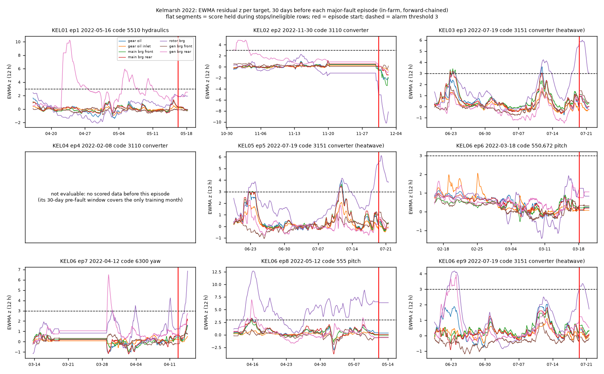
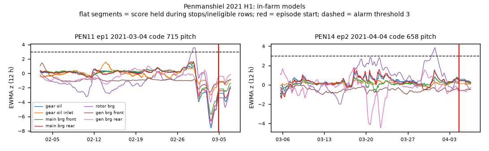
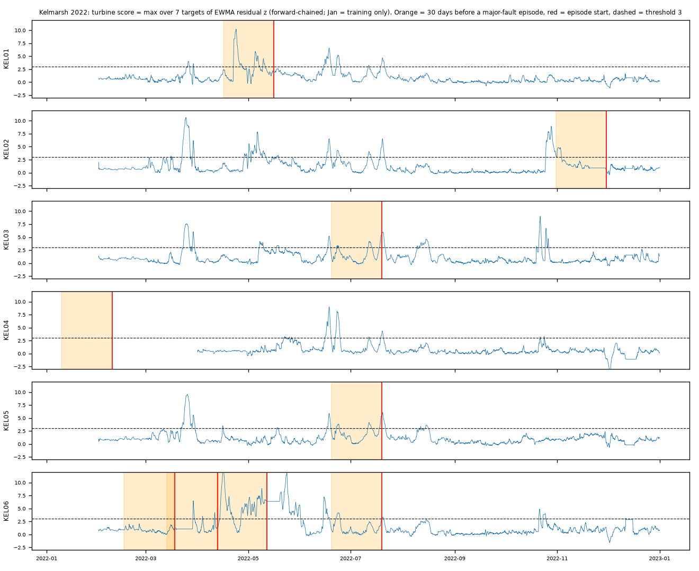

# Normal-behaviour model (NBM) baseline: drivetrain temperatures vs. major faults

**Bottom line (one year of data per farm).** The models learn healthy drivetrain temperatures well. Mean healthy-test MAE is 1.54 °C at Kelmarsh and 2.12 °C at Penmanshiel, and LightGBM beats a Ridge baseline on 6 of 7 targets. But this baseline **does not show convincing early warning of the labelled major faults.** The headline in-farm alarm rate before faults (6/8 Kelmarsh episodes within 30 days) matches what season-matched chance predicts (6.05 expected, p = 0.72). The fault classes (pitch, converter, hydraulics, yaw) are not drivetrain-temperature faults. The one statistically striking variant, fleet-relative scoring, leans on two turbine-specific deviations that were already present outside any pre-fault window. Every number below was computed by the scripts listed at the end. Nothing is estimated or rounded up.

## 1. Data and setup

* Inputs: `data/processed/{kelmarsh,penmanshiel}_scada_labeled.parquet`, the cleaned and labelled 10-min SCADA from the labeling step. Kelmarsh covers 2022 for KEL01–06 (Senvion MM92). Penmanshiel covers Jan–Jun 2021 for PEN11–15 (Senvion MM82; the subset downloaded under the size cap).
* Targets (7 per turbine): gear oil, gear oil inlet, main bearing front/rear, rotor bearing, generator bearing front/rear temperatures.
* Features use operating conditions only, with no target lags: power, wind speed, ambient and nacelle temperature, rotor and generator speed. Each has lags of 1/3/6/18 steps and rolling means over 1 h, 6 h, and 24 h. Also included: 1-h power std and hour-of-day sin/cos. Leaving out autoregressive target lags is deliberate, so a slow drift cannot be "explained away" by the previous value.
* **Healthy training mask:** the model trains only on rows that pass all of these:
  * no stop (`in_any_stop`), and not within 6 h after a stop (cool-down)
  * QC flag 0
  * no fault or major fault
  * not inside the 30 days before a major fault (`pre_fault_30d`)
  * no stuck sensor (rolling 3-h std < 1e-6 on that target)
  * all base features present
* **Time-ordered splits (no leakage):** forward chaining by calendar month.
  * The model scoring month *m* trains on healthy rows ending 3 days before *m* starts (embargo).
  * The last 20% of that training history (by time) is the validation set. It is used for early stopping and for the residual mean/sd that turns residuals into z-scores.
  * The first month of each farm is training-only.
  * Each (turbine, target, month) is its own model: 1,246 trained, 14 skipped.
* Models: LightGBM (600 trees max, lr 0.05, 31 leaves, min 50 rows per leaf, early stopping 50), plus a standardized Ridge baseline. CPU only. A full run takes about 7 minutes on 8 cores.
* **Anomaly score:**
  * Per-target z is smoothed with a time-based EWMA (12 h half-life), only over eligible rows. The value is held across stops.
  * The turbine score is the max over targets (hot side).
  * A one-sided CUSUM (k = 0.5, leak 0.995) was also tested.
  * Alarm events are runs above threshold, merged across gaps < 24 h, lasting ≥ 1 h.
* **Fault episodes:** the user brief says 14 major faults (12 Kelmarsh + 2 Penmanshiel). Those are fault *events*. Consecutive events merge into **9 Kelmarsh and 2 Penmanshiel episodes**, and each episode is scored once. KEL04's only episode (2022-02-08) **cannot be evaluated**: its 30-day pre-fault window covers almost all of January, the only possible training month. That leaves 8 + 2 = 10 evaluable episodes. The four 2022-07-19 heatwave converter stops (code 3151) are 4 events in 3 Kelmarsh episodes: KEL03 (2 events), KEL05, and KEL06 ep9. The "no heatwave" subset drops these 3 episodes.
* **Metrics:**
  * *Onset detection*: an alarm event **starts** within H days before the episode start (H = 7 or 30). Lead time = episode start − alarm start.
  * *Active detection*: any alarm is active in that window.
  * *False alarms* per turbine-month: alarm events starting outside every 30-day pre-fault window and outside stops, per scored turbine-month.
  * *Chance baselines*:
    * Flat chance: the probability that a random H-day window on the same turbine contains an alarm onset.
    * **Season-matched chance**: the same probability over every turbine of the farm, for windows ending within ±30 days of the episode date.
    * Expected counts and Poisson-binomial tail p-values follow from these.
  * The season-matched baseline matters because alarms cluster in spring and summer (Section 4).
* Settings: in-farm; **fleet-relative** (subtract the farm-median z per timestamp and target to remove weather and season effects common to all turbines); and **cross-farm** (Kelmarsh → Penmanshiel). For cross-farm, one model per target is trained on all Kelmarsh healthy rows and applied to Penmanshiel. Per-turbine offset and sd are calibrated on Penmanshiel January healthy residuals, and Feb–Jun is scored.

## 2. How well the NBM fits healthy data

Forward-chained healthy-test MAE (°C), averaged over turbines (Table D below):

* Kelmarsh: LightGBM **1.54** vs Ridge 2.18. Penmanshiel: **2.12** vs 2.71.
* Best-modelled Kelmarsh targets: main bearing rear 1.13, main bearing front 1.18, gear oil 1.21.
* Hardest: gear oil inlet 2.28, gen bearing rear 2.00.
* **Negative result:** the rotor bearing is fitted better by **Ridge** (Kelmarsh 0.67 vs 1.20; Penmanshiel 0.97 vs 1.49). Trees cannot extrapolate. Early-year models never see summer temperatures, and the rotor bearing tracks ambient temperature almost linearly.

## 3. Detection results

Primary setting, fixed before looking at the sensitivity grid: EWMA > 3, 30-day horizon.

| Setting | Episodes | Onset detected | Season-matched expected (p) | Median lead | False alarms / turbine-month |
|---|---|---|---|---|---|
| Kelmarsh in-farm, all | 8 | 6 (active 7) | 6.05 (0.72) | 26.9 d | 0.64 |
| Kelmarsh in-farm, no heatwave | 5 | 3 (active 4) | 3.09 (0.74) | 24.0 d | 0.64 |
| Kelmarsh fleet-relative, all | 8 | 4 | 1.49 (0.043) | 24.8 d | 0.19 |
| Kelmarsh fleet-relative, no heatwave | 5 | 3 | 0.99 (0.054) | 24.0 d | 0.19 |
| Penmanshiel in-farm | 2 | 2 | 0.63 (0.076) | 4.5 d | 1.26 |
| Penmanshiel fleet-relative | 2 | 0 | 0.18 (1.0) | – | 0.57 |
| Cross-farm Kel → Pen | 2 | 1 | 0.14 (0.135) | 30.0 d | 0.49 |

With a 7-day horizon, Kelmarsh in-farm detects 5/8 (2/5 without the heatwave), against 1.95 (0.83) expected. Penmanshiel in-farm detects 2/2, against 0.32 expected (p = 0.024). Cross-farm detects 0/2.

How to read this honestly:

1. **Heatwave.** Taking out the three 2022-07-19 heatwave stops makes Kelmarsh in-farm no better than chance (3/5 vs 3.09 expected). The heatwave "detections" are the heat itself. Drivetrain temperatures ran above what the model had learned, days before the converters tripped on temperature. That is real, but it is not a fault precursor.
2. **Fleet-relative.** This variant cuts false alarms by 3.4× (0.64 → 0.19 per turbine-month). At threshold 4 it flags 4/8 Kelmarsh episodes (KEL01, KEL02, KEL06 ep7, KEL06 ep8), against 0.55 season-matched expected (p = 0.0003; about 0.008 after Bonferroni over the 24 Kelmarsh score × threshold × horizon × setting configurations). Looking at the alarm events themselves (`reports/nbm_alarm_events_kelmarsh_fleetrel.csv`) weakens this a lot:
   * KEL02's detection (alarm 29.4 d before a converter fault, gen bearing rear) continues a gen-bearing-rear deviation that also fired on 1 May, 6 May, and 25–30 Oct with no fault following. It is a recurring turbine-specific behaviour, caught by the window edge.
   * KEL06 ep8's detection starts 14 April, 2 days *after* the ep7 yaw fault. KEL06's rotor bearing then stays hot relative to the fleet from mid-April through May, straight through the ep8 pitch fault on 12 May. That is aftermath or a persistent offset, not a precursor. KEL06 ep7 (8.95 d lead) belongs to the same rotor-bearing deviation.
   * KEL01's alarm (gen bearing rear, 24 d before a *hydraulic* fault) has no obvious physical link to the fault.
   * In short, two turbines with drifting sensors or components inflate the count, and KEL06 supplies 2 of the 4 hits. The p-value assumes independent episodes, so it overstates the evidence.
3. **Penmanshiel 2/2 at ~4.5 days** (PEN11 4.46 d, PEN14 4.61 d) is the most "precursor-like" result. But it is n = 2 (both pitch faults), with a high false-alarm rate (1.26 per turbine-month), and it disappears under fleet-relative scoring (0/2). That suggests a farm-wide shift around those dates rather than something turbine-specific.
4. **Cross-farm.** The single hit (PEN11) has a lead of 29.96 d, at the edge of the 30-day window, so it is almost certainly unrelated. PEN14 is missed. Kelmarsh-trained models carry over poorly (Table E): raw MAE 4.08 °C, 3.07 °C after per-turbine offset calibration, vs 2.12 °C in-farm. Main bearing rear is worst (6.20 °C raw), consistent with MM92 vs MM82 being different turbine models.
5. **CUSUM is uninformative.** At every threshold it fires in 85–100% of all 30-day windows (season-matched expected 6.5–7.6 of 8 at Kelmarsh), with 1.2–3.8 false alarms per turbine-month. Its detections are no better than chance in any setting.
6. **Physics mismatch.** None of the labelled major faults is a gearbox or bearing failure. Across the 11 episodes they are pitch (4: KEL06 ep6 and ep8, PEN11, PEN14), converter (5: KEL02, KEL04, and the 3 heatwave episodes), hydraulics (1: KEL01), and yaw (1: KEL06 ep7). A drivetrain-temperature NBM is the wrong instrument for most of them. The fact that it can't see them is expected, and it is a useful negative result for picking targets.

## 4. Seasonal confound (why the season-matched baseline is needed)

Early models only see cooler months, so residuals drift positive as the year warms. Mean healthy z by month at Kelmarsh runs from +0.61 (Feb) to +0.24–0.49 through summer, and falls negative in autumn (Sep −0.20, Nov −0.68, Dec −0.18). Kelmarsh in-farm alarm onsets cluster in Mar–Jul (7, 7, 10, 12, and 11 per month). The score timeline (`figures/nbm_score_timeline_kelmarsh.png`) shows farm-wide simultaneous spikes in late March, mid-June, and late October. Comparing against a flat per-turbine baseline would have made Kelmarsh in-farm look significant (6/8 vs 2.91 expected, p = 0.025). The season-matched baseline (6.05 expected, p = 0.72) shows that the effect is the season. Fleet-relative scoring and a full prior year of training are the two fixes.

## 5. Caveats

* Tiny sample: 10 evaluable episodes, 3 of them the same heatwave day, and 4 of the 8 Kelmarsh episodes on one turbine (KEL06). They are not independent.
* Multiple comparisons: 3 settings × 2 scores × 3 thresholds × 2 horizons × 2 subsets were examined. Only the primary setting was fixed in advance. Treat any p between 0.02 and 0.08 as noise.
* One year at Kelmarsh and six months at Penmanshiel. The first months are training-only, and every model extrapolates seasonally.
* The episode labels come from status logs (stop categories plus duration), not maintenance records. Component labels follow the status-code text.

## 6. Figures

* `figures/nbm_prefault_residuals_kelmarsh.png`: EWMA residual z per target over the 30 days before each Kelmarsh episode (in-farm). KEL04 is marked not evaluable.
* `figures/nbm_prefault_residuals_penmanshiel.png`: the same for PEN11 and PEN14.
* `figures/nbm_prefault_residuals_crossfarm.png`: the Kelmarsh-trained model on Penmanshiel before PEN11 and PEN14.
* `figures/nbm_score_timeline_kelmarsh.png`: the full-year turbine score per Kelmarsh turbine with episode markers, showing the farm-wide seasonal spikes.





## 7. Recommendation

**Yes, more years are needed before this can say anything about early warning.** The open Zenodo releases cover Kelmarsh 2016–2024 and Penmanshiel 2016–2021. Not downloaded in this task.

1. A full prior year of training removes the seasonal extrapolation that dominates the current residuals.
2. Eight or more turbine-years per farm should yield tens of major-fault episodes rather than 10. That includes, hopefully, actual gearbox, bearing, and generator events, which are the faults a temperature NBM should catch.
3. Fleet-relative scoring is worth keeping as the default: it gave the lowest false-alarm rate (0.13–0.19 per turbine-month at Kelmarsh).
4. Pick NBM targets to match the fault classes: pitch motor and converter temperatures and currents, and hydraulic pressure, wherever the SCADA has them. Use Ridge or a linear-plus-trees hybrid for ambient-tracking targets like the rotor bearing.
5. Re-run the cross-farm test only after per-model calibration. MM92 and MM82 differ too much for a shared model without it.

## 8. Reproduce

```
cd projects/windml
.venv/bin/python scripts/run_nbm.py        # train all forward-chained models (~7 min, CPU), writes data/nbm/ (git-ignored)
.venv/bin/python scripts/eval_nbm.py       # episodes, chance baselines, false alarms -> reports/nbm_*.csv
.venv/bin/python scripts/report_nbm.py     # figures + reports/nbm_tables.md
.venv/bin/python scripts/inspect_alarms.py 4   # fleet-relative alarm events with driving target
```

Output files: `reports/nbm_mae.csv`, `nbm_crossfarm_mae.csv`, `nbm_summary.csv`, `nbm_episode_detection.csv`, `nbm_false_alarms.csv`, `nbm_episodes_{kelmarsh,penmanshiel}.csv`, `nbm_alarm_events_kelmarsh_fleetrel.csv`.

## Appendix: full tables (generated)

### Table A. Primary setting: EWMA (12 h half-life) of residual z, alarm when max over targets > 3

| farm        | setting                |   horizon | subset      |   episodes |   detected (onset) |   chance (flat) |   chance (season-matched) |   p (season-matched) |   detected (any active alarm) |   median lead (d) |   false alarms / turbine-month |
|:------------|:-----------------------|----------:|:------------|-----------:|-------------------:|----------------:|--------------------------:|---------------------:|------------------------------:|------------------:|-------------------------------:|
| kelmarsh    | in_farm                |         7 | all         |          8 |                  5 |            1.08 |                      1.95 |                0.019 |                             6 |             1.59  |                           0.78 |
| kelmarsh    | in_farm                |         7 | no_heatwave |          5 |                  2 |            0.67 |                      0.83 |                0.194 |                             3 |             4.22  |                           0.78 |
| kelmarsh    | in_farm                |        30 | all         |          8 |                  6 |            2.91 |                      6.05 |                0.721 |                             7 |            26.89  |                           0.64 |
| kelmarsh    | in_farm                |        30 | no_heatwave |          5 |                  3 |            1.68 |                      3.09 |                0.739 |                             4 |            24.03  |                           0.64 |
| kelmarsh    | in_farm_fleet_relative |         7 | all         |          8 |                  1 |            0.7  |                      0.49 |                0.401 |                             2 |             1.97  |                           0.3  |
| kelmarsh    | in_farm_fleet_relative |         7 | no_heatwave |          5 |                  1 |            0.5  |                      0.34 |                0.296 |                             2 |             1.97  |                           0.3  |
| kelmarsh    | in_farm_fleet_relative |        30 | all         |          8 |                  4 |            2.31 |                      1.49 |                0.043 |                             5 |            24.78  |                           0.19 |
| kelmarsh    | in_farm_fleet_relative |        30 | no_heatwave |          5 |                  3 |            1.65 |                      0.99 |                0.054 |                             4 |            24.01  |                           0.19 |
| penmanshiel | cross_farm_kel_to_pen  |         7 | all         |          2 |                  0 |            0.34 |                      0.15 |                1     |                             0 |           nan     |                           0.53 |
| penmanshiel | cross_farm_kel_to_pen  |         7 | no_heatwave |          2 |                  0 |            0.34 |                      0.15 |                1     |                             0 |           nan     |                           0.53 |
| penmanshiel | cross_farm_kel_to_pen  |        30 | all         |          2 |                  1 |            1.09 |                      0.14 |                0.135 |                             1 |            29.96  |                           0.49 |
| penmanshiel | cross_farm_kel_to_pen  |        30 | no_heatwave |          2 |                  1 |            1.09 |                      0.14 |                0.135 |                             1 |            29.96  |                           0.49 |
| penmanshiel | in_farm                |         7 | all         |          2 |                  2 |            0.83 |                      0.32 |                0.024 |                             2 |             4.535 |                           1.26 |
| penmanshiel | in_farm                |         7 | no_heatwave |          2 |                  2 |            0.83 |                      0.32 |                0.024 |                             2 |             4.535 |                           1.26 |
| penmanshiel | in_farm                |        30 | all         |          2 |                  2 |            1.75 |                      0.63 |                0.076 |                             2 |             4.535 |                           1.26 |
| penmanshiel | in_farm                |        30 | no_heatwave |          2 |                  2 |            1.75 |                      0.63 |                0.076 |                             2 |             4.535 |                           1.26 |
| penmanshiel | in_farm_fleet_relative |         7 | all         |          2 |                  0 |            0.31 |                      0.17 |                1     |                             0 |           nan     |                           0.57 |
| penmanshiel | in_farm_fleet_relative |         7 | no_heatwave |          2 |                  0 |            0.31 |                      0.17 |                1     |                             0 |           nan     |                           0.57 |
| penmanshiel | in_farm_fleet_relative |        30 | all         |          2 |                  0 |            1.06 |                      0.18 |                1     |                             0 |           nan     |                           0.57 |
| penmanshiel | in_farm_fleet_relative |        30 | no_heatwave |          2 |                  0 |            1.06 |                      0.18 |                1     |                             0 |           nan     |                           0.57 |

### Table B. Sensitivity: all score types and thresholds, 30-day horizon, all episodes

| farm        | setting                | score       |   thr |   episodes |   detected_onset |   expected_seasonal_onset |   p_value_seasonal_onset |   false_alarms_per_turbine_month |
|:------------|:-----------------------|:------------|------:|-----------:|-----------------:|--------------------------:|-------------------------:|---------------------------------:|
| kelmarsh    | in_farm                | score_cusum |    25 |          8 |                6 |                      7.35 |                    0.983 |                             2.61 |
| kelmarsh    | in_farm                | score_cusum |    50 |          8 |                6 |                      7.49 |                    0.991 |                             2.35 |
| kelmarsh    | in_farm                | score_cusum |   100 |          8 |                6 |                      7.6  |                    0.996 |                             1.64 |
| kelmarsh    | in_farm                | score_ewma  |     2 |          8 |                8 |                      6.85 |                    0.275 |                             0.97 |
| kelmarsh    | in_farm                | score_ewma  |     3 |          8 |                6 |                      6.05 |                    0.721 |                             0.64 |
| kelmarsh    | in_farm                | score_ewma  |     4 |          8 |                7 |                      5.07 |                    0.088 |                             0.44 |
| kelmarsh    | in_farm_fleet_relative | score_cusum |    25 |          8 |                7 |                      7.44 |                    0.896 |                             2.77 |
| kelmarsh    | in_farm_fleet_relative | score_cusum |    50 |          8 |                7 |                      7.65 |                    0.956 |                             2.02 |
| kelmarsh    | in_farm_fleet_relative | score_cusum |   100 |          8 |                8 |                      6.49 |                    0.181 |                             1.19 |
| kelmarsh    | in_farm_fleet_relative | score_ewma  |     2 |          8 |                5 |                      3.9  |                    0.333 |                             0.53 |
| kelmarsh    | in_farm_fleet_relative | score_ewma  |     3 |          8 |                4 |                      1.49 |                    0.043 |                             0.19 |
| kelmarsh    | in_farm_fleet_relative | score_ewma  |     4 |          8 |                4 |                      0.55 |                    0     |                             0.13 |
| penmanshiel | cross_farm_kel_to_pen  | score_cusum |    25 |          2 |                2 |                      1.97 |                    0.965 |                             2.47 |
| penmanshiel | cross_farm_kel_to_pen  | score_cusum |    50 |          2 |                2 |                      1.98 |                    0.975 |                             3.37 |
| penmanshiel | cross_farm_kel_to_pen  | score_cusum |   100 |          2 |                2 |                      1.97 |                    0.966 |                             2.88 |
| penmanshiel | cross_farm_kel_to_pen  | score_ewma  |     2 |          2 |                0 |                      1.08 |                    1     |                             1.18 |
| penmanshiel | cross_farm_kel_to_pen  | score_ewma  |     3 |          2 |                1 |                      0.14 |                    0.135 |                             0.49 |
| penmanshiel | cross_farm_kel_to_pen  | score_ewma  |     4 |          2 |                0 |                      0.14 |                    1     |                             0.24 |
| penmanshiel | in_farm                | score_cusum |    25 |          2 |                2 |                      1.98 |                    0.975 |                             2.31 |
| penmanshiel | in_farm                | score_cusum |    50 |          2 |                2 |                      2    |                    1     |                             2.35 |
| penmanshiel | in_farm                | score_cusum |   100 |          2 |                2 |                      2    |                    1     |                             2.11 |
| penmanshiel | in_farm                | score_ewma  |     2 |          2 |                2 |                      1.97 |                    0.971 |                             2.39 |
| penmanshiel | in_farm                | score_ewma  |     3 |          2 |                2 |                      0.63 |                    0.076 |                             1.26 |
| penmanshiel | in_farm                | score_ewma  |     4 |          2 |                0 |                      0.35 |                    1     |                             0.65 |
| penmanshiel | in_farm_fleet_relative | score_cusum |    25 |          2 |                2 |                      1.98 |                    0.975 |                             3.77 |
| penmanshiel | in_farm_fleet_relative | score_cusum |    50 |          2 |                2 |                      1.99 |                    0.985 |                             2.31 |
| penmanshiel | in_farm_fleet_relative | score_cusum |   100 |          2 |                2 |                      1.78 |                    0.79  |                             1.7  |
| penmanshiel | in_farm_fleet_relative | score_ewma  |     2 |          2 |                0 |                      0.89 |                    1     |                             1.1  |
| penmanshiel | in_farm_fleet_relative | score_ewma  |     3 |          2 |                0 |                      0.18 |                    1     |                             0.57 |
| penmanshiel | in_farm_fleet_relative | score_ewma  |     4 |          2 |                0 |                      0.18 |                    1     |                             0.32 |

### Table C. Per-episode result (EWMA > 3, 30-day horizon)

| setting                | turbine_id   |   episode | start                     |   codes | component   | heatwave   |   window_scored_days | detected_onset   |   lead_onset_days | detected_active   |
|:-----------------------|:-------------|----------:|:--------------------------|--------:|:------------|:-----------|---------------------:|:-----------------|------------------:|:------------------|
| in_farm                | KEL01        |         1 | 2022-05-16 05:46:21+00:00 |    5510 | hydraulics  | False      |                   30 | True             |             24.03 | True              |
| in_farm                | KEL02        |         2 | 2022-11-30 10:21:28+00:00 |    3110 | converter   | False      |                   30 | False            |            nan    | True              |
| in_farm                | KEL03        |         3 | 2022-07-19 13:51:34+00:00 |    3151 | converter   | True       |                   30 | True             |             26.81 | True              |
| in_farm                | KEL04        |         4 | 2022-02-08 22:56:57+00:00 |    3110 | converter   | False      |                    0 | False            |            nan    | False             |
| in_farm                | KEL05        |         5 | 2022-07-19 12:36:00+00:00 |    3151 | converter   | True       |                   30 | True             |             26.97 | True              |
| in_farm                | KEL06        |         6 | 2022-03-18 04:13:32+00:00 | 550,672 | pitch       | False      |                   30 | False            |            nan    | False             |
| in_farm                | KEL06        |         7 | 2022-04-12 16:46:52+00:00 |    6300 | yaw         | False      |                   30 | True             |             14.66 | True              |
| in_farm                | KEL06        |         8 | 2022-05-12 02:37:43+00:00 |     555 | pitch       | False      |                   30 | True             |             28.08 | True              |
| in_farm                | KEL06        |         9 | 2022-07-19 13:17:02+00:00 |    3151 | converter   | True       |                   30 | True             |             27.41 | True              |
| in_farm                | PEN11        |         1 | 2021-03-04 22:24:34+00:00 |     715 | pitch       | False      |                   30 | True             |              4.46 | True              |
| in_farm                | PEN14        |         2 | 2021-04-04 14:05:17+00:00 |     658 | pitch       | False      |                   30 | True             |              4.61 | True              |
| cross_farm_kel_to_pen  | PEN11        |         1 | 2021-03-04 22:24:34+00:00 |     715 | pitch       | False      |                   30 | True             |             29.96 | True              |
| cross_farm_kel_to_pen  | PEN14        |         2 | 2021-04-04 14:05:17+00:00 |     658 | pitch       | False      |                   30 | False            |            nan    | False             |
| in_farm_fleet_relative | KEL01        |         1 | 2022-05-16 05:46:21+00:00 |    5510 | hydraulics  | False      |                   30 | True             |             24.01 | True              |
| in_farm_fleet_relative | KEL02        |         2 | 2022-11-30 10:21:28+00:00 |    3110 | converter   | False      |                   30 | False            |            nan    | True              |
| in_farm_fleet_relative | KEL03        |         3 | 2022-07-19 13:51:34+00:00 |    3151 | converter   | True       |                   30 | False            |            nan    | False             |
| in_farm_fleet_relative | KEL04        |         4 | 2022-02-08 22:56:57+00:00 |    3110 | converter   | False      |                    0 | False            |            nan    | False             |
| in_farm_fleet_relative | KEL05        |         5 | 2022-07-19 12:36:00+00:00 |    3151 | converter   | True       |                   30 | False            |            nan    | False             |
| in_farm_fleet_relative | KEL06        |         6 | 2022-03-18 04:13:32+00:00 | 550,672 | pitch       | False      |                   30 | False            |            nan    | False             |
| in_farm_fleet_relative | KEL06        |         7 | 2022-04-12 16:46:52+00:00 |    6300 | yaw         | False      |                   30 | True             |             14.42 | True              |
| in_farm_fleet_relative | KEL06        |         8 | 2022-05-12 02:37:43+00:00 |     555 | pitch       | False      |                   30 | True             |             27.92 | True              |
| in_farm_fleet_relative | KEL06        |         9 | 2022-07-19 13:17:02+00:00 |    3151 | converter   | True       |                   30 | True             |             25.55 | True              |
| in_farm_fleet_relative | PEN11        |         1 | 2021-03-04 22:24:34+00:00 |     715 | pitch       | False      |                   30 | False            |            nan    | False             |
| in_farm_fleet_relative | PEN14        |         2 | 2021-04-04 14:05:17+00:00 |     658 | pitch       | False      |                   30 | False            |            nan    | False             |

### Table D. Healthy test-period MAE (deg C), forward-chained, mean over turbines

| farm        | target                    |   lgbm |   ridge |
|:------------|:--------------------------|-------:|--------:|
| kelmarsh    | gear_oil_inlet_temp_c     |   2.28 |    3.47 |
| kelmarsh    | gear_oil_temp_c           |   1.21 |    2.31 |
| kelmarsh    | gen_bearing_front_temp_c  |   1.79 |    2.08 |
| kelmarsh    | gen_bearing_rear_temp_c   |   2    |    2.26 |
| kelmarsh    | main_bearing_front_temp_c |   1.18 |    2.43 |
| kelmarsh    | main_bearing_rear_temp_c  |   1.13 |    2.07 |
| kelmarsh    | rotor_bearing_temp_c      |   1.2  |    0.67 |
| penmanshiel | gear_oil_inlet_temp_c     |   3.46 |    5.13 |
| penmanshiel | gear_oil_temp_c           |   1.43 |    2.35 |
| penmanshiel | gen_bearing_front_temp_c  |   3.49 |    3.58 |
| penmanshiel | gen_bearing_rear_temp_c   |   2.12 |    2.37 |
| penmanshiel | main_bearing_front_temp_c |   1.51 |    2.31 |
| penmanshiel | main_bearing_rear_temp_c  |   1.34 |    2.28 |
| penmanshiel | rotor_bearing_temp_c      |   1.49 |    0.97 |

### Table E. Cross-farm MAE on Penmanshiel healthy rows Feb-Jun (deg C), Kelmarsh-trained model, mean over turbines

| target                    |   mae_raw |   mae_after_offset |   calib_offset |   in_farm_lgbm_mae |
|:--------------------------|----------:|-------------------:|---------------:|-------------------:|
| gear_oil_inlet_temp_c     |      4.73 |               5.08 |           1.31 |               3.46 |
| gear_oil_temp_c           |      4.02 |               3.36 |           3.42 |               1.43 |
| gen_bearing_front_temp_c  |      4.7  |               3.59 |           3.55 |               3.49 |
| gen_bearing_rear_temp_c   |      2.01 |               1.95 |           0.21 |               2.12 |
| main_bearing_front_temp_c |      5.02 |               3.26 |          -2.69 |               1.51 |
| main_bearing_rear_temp_c  |      6.2  |               3.09 |          -5.7  |               1.34 |
| rotor_bearing_temp_c      |      1.88 |               1.17 |           1.71 |               1.49 |
