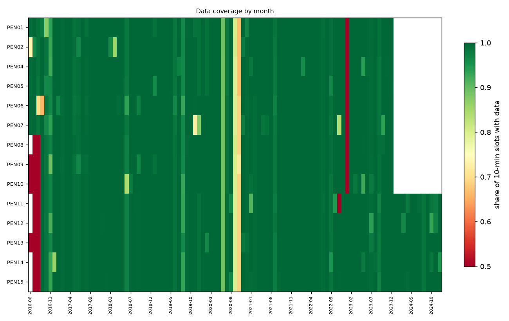
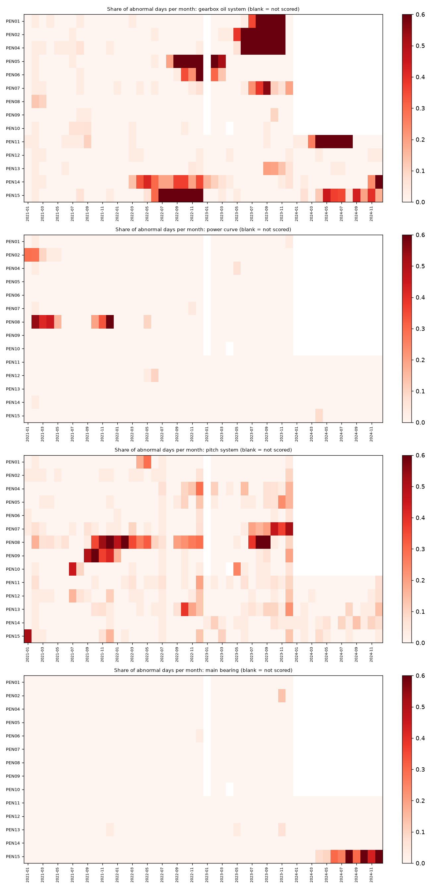
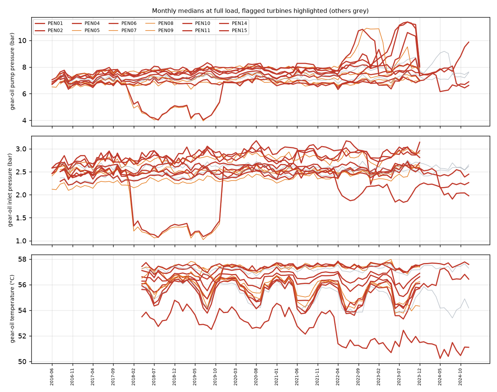
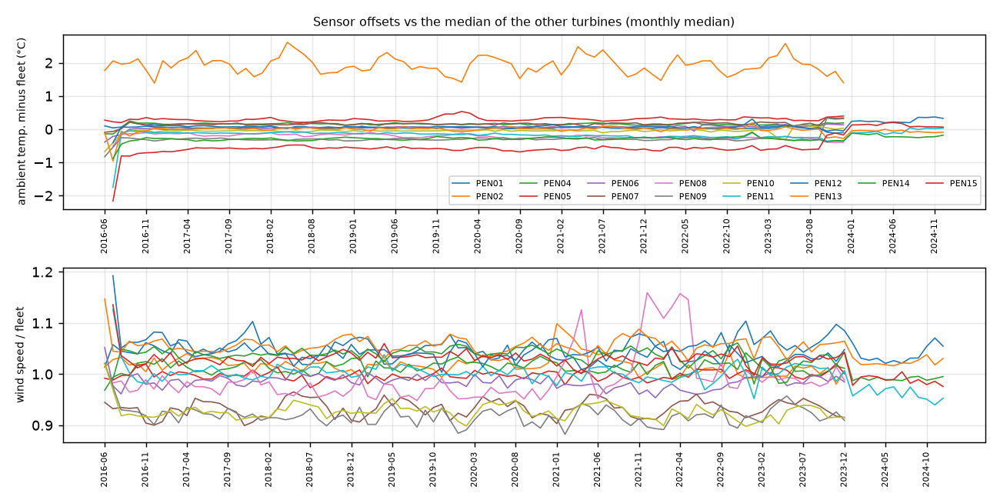
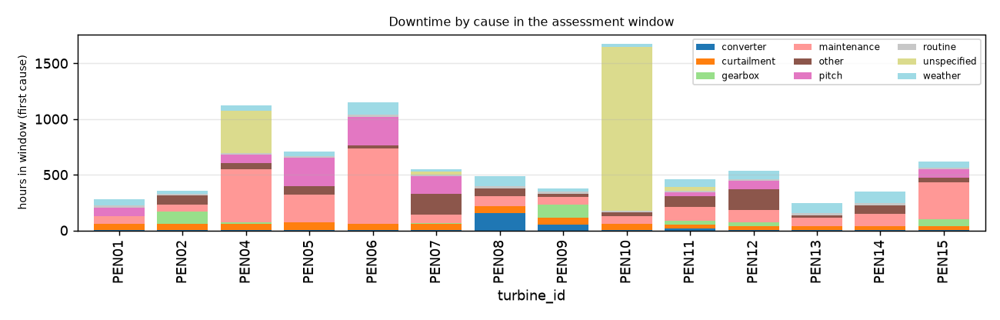

# Fleet condition report: Penmanshiel wind farm

Penmanshiel wind farm (14x Senvion MM82, UK), Cubico, Greenbyte export. 14 turbines, SCADA 02 Jun 2016 to 31 Dec 2024; assessment window: the last 24 months of each turbine (Jan 2022 to Dec 2024). Generated by `windml report` from the mapping `penmanshiel_all_years.yaml`.

## Executive summary

**12 of 14 turbines need attention** (8 red, 4 amber). The rest show no warning sign in the data we have.

| Turbine | Flag | Why | Confidence | Suggested next step |
|---|---|---|---|---|
| PEN15 | **RED** | It tripped on oil-system faults in 16 separate episodes in two years; it was down for faults or maintenance 3.0% of the time; it tripped on pitch faults in 5 separate episodes in two years; and more (see scorecard). | High | Inspect the oil circuit (filter, pump, cooler, level); review the fault history below and the open work orders. |
| PEN04 | **RED** | It was down for faults or maintenance 5.8% of the time; it tripped on oil-system faults in 11 separate episodes in two years; it behaved abnormally in the gearbox oil system on 56% of days last year; and more (see scorecard). | High | Review the fault history below and the open work orders; inspect the oil circuit (filter, pump, cooler, level). |
| PEN06 | **RED** | It was down for faults or maintenance 5.5% of the time; it tripped on oil-system faults in 4 separate episodes in two years; it tripped on pitch faults in 5 separate episodes in two years; and more (see scorecard). | High | Review the fault history below and the open work orders; inspect the oil circuit (filter, pump, cooler, level). |
| PEN02 | **RED** | It tripped on oil-system faults in 13 separate episodes in two years; it behaved abnormally in the gearbox oil system on 57% of days last year; it has 4.4% of its SCADA data missing. | High | Inspect the oil circuit (filter, pump, cooler, level); trend oil temperature and pressure against the sister turbines; take an oil sample. |
| PEN01 | **RED** | It behaved abnormally in the gearbox oil system on 38% of days last year; it has 4.4% of its SCADA data missing. | High | Trend oil temperature and pressure against the sister turbines; take an oil sample; ask the scada provider about the gaps (communication or logger problems hide faults). |
| PEN10 | **RED** | It was down for faults or maintenance 8.9% of the time; it has 4.9% of its SCADA data missing. | High | Review the fault history below and the open work orders; ask the scada provider about the gaps (communication or logger problems hide faults). |
| PEN11 | **RED** | It behaved abnormally in the gearbox oil system on 42% of days last year; it has a wind speed sensor that drifted -5% away from the other turbines. | High | Trend oil temperature and pressure against the sister turbines; take an oil sample; recalibrate or replace the sensor (models and power-curve checks rely on it). |
| PEN14 | **RED** | It needs 2.1 bar more gear-oil pump pressure at full load than earlier in its life. | High | Check the oil filter differential pressure and cooler; take an oil sample. |
| PEN07 | **AMBER** | It tripped on oil-system faults in 5 separate episodes in two years; it tripped on pitch faults in 4 separate episodes in two years; it behaved abnormally in the gearbox oil system on 14% of days last year; and more (see scorecard). | High | Inspect the oil circuit (filter, pump, cooler, level); inspect pitch drives, batteries and slip ring. |
| PEN05 | **AMBER** | It was down for faults or maintenance 3.4% of the time; it behaved abnormally in the gearbox oil system on 12% of days last year; it has 4.6% of its SCADA data missing. | High | Review the fault history below and the open work orders; trend oil temperature and pressure against the sister turbines; take an oil sample. |
| PEN08 | **AMBER** | It tripped on oil-system faults in 6 separate episodes in two years; it has 4.5% of its SCADA data missing. | High | Inspect the oil circuit (filter, pump, cooler, level); ask the scada provider about the gaps (communication or logger problems hide faults). |
| PEN09 | **AMBER** | It tripped on oil-system faults in 7 separate episodes in two years; it has 4.4% of its SCADA data missing. | High | Inspect the oil circuit (filter, pump, cooler, level); ask the scada provider about the gaps (communication or logger problems hide faults). |

**No action needed now:** PEN12, PEN13.

**How sure are we.** Confidence is *High* when the turbine has 3+ years of history, near-complete data, models trained on earlier years and an alarm log; it drops when any of these is missing. A red flag is a reason to look, not a diagnosis.

<h2 class="newpage">1. Data quality</h2>

| Turbine | First data | Last data | Months | Coverage (window) | Longest gap (h) | Signals | Native interval | Frozen rows (window) | Stuck sensors (>= 1%) | Stop/fault labels |
|---|---|---|---|---|---|---|---|---|---|---|
| PEN01 | 2016-06-06 | 2023-12-31 | 91 | 95.6% | 744 | 9 | 10min | 0 | - | alarm log |
| PEN02 | 2016-06-03 | 2023-12-31 | 91 | 95.6% | 744 | 9 | 10min | 0 | - | alarm log |
| PEN04 | 2016-06-13 | 2023-12-31 | 91 | 95.1% | 744 | 9 | 10min | 661 | - | alarm log |
| PEN05 | 2016-06-15 | 2023-12-31 | 90 | 95.4% | 744 | 9 | 10min | 0 | - | alarm log |
| PEN06 | 2016-06-02 | 2023-12-31 | 91 | 95.5% | 744 | 9 | 10min | 0 | - | alarm log |
| PEN07 | 2016-06-02 | 2023-12-31 | 91 | 94.6% | 744 | 9 | 10min | 0 | - | alarm log |
| PEN08 | 2016-07-27 | 2023-12-31 | 89 | 95.5% | 744 | 9 | 10min | 0 | - | alarm log |
| PEN09 | 2016-06-24 | 2023-12-31 | 90 | 95.6% | 744 | 9 | 10min | 0 | - | alarm log |
| PEN10 | 2016-06-27 | 2023-12-31 | 90 | 95.1% | 744 | 9 | 10min | 0 | - | alarm log |
| PEN11 | 2016-07-19 | 2024-12-31 | 101 | 99.4% | 16 | 9 | 10min | 0 | - | alarm log |
| PEN12 | 2016-07-02 | 2024-12-31 | 102 | 99.0% | 50 | 9 | 10min | 2 | - | alarm log |
| PEN13 | 2016-06-30 | 2024-12-31 | 102 | 99.7% | 10 | 9 | 10min | 0 | - | alarm log |
| PEN14 | 2016-07-09 | 2024-12-31 | 102 | 99.4% | 22 | 9 | 10min | 0 | - | alarm log |
| PEN15 | 2016-07-14 | 2024-12-31 | 102 | 99.7% | 9 | 9 | 10min | 1,233 | - | alarm log |

Signals present in at least one turbine: `ambient_temp_c`, `available_capacity_kw`, `converter_inlet_temp_c`, `data_availability`, `energy_export_kwh`, `gear_oil_inlet_pressure_bar`, `gear_oil_inlet_temp_c`, `gear_oil_pump_pressure_bar`, `gear_oil_temp_c`, `gen_bearing_front_temp_c`, `gen_bearing_rear_temp_c`, `generator_speed_rpm`, `hub_temp_c`, `lost_prod_curtail_total_kwh`, `lost_prod_downtime_kwh`, `main_bearing_front_temp_c`, `main_bearing_rear_temp_c`, `nacelle_position_deg`, `nacelle_temp_c`, `pitch_a_deg`, `pitch_b_deg`, `pitch_c_deg`, `pitch_motor_temp_1_c`, `pitch_motor_temp_2_c`, `pitch_motor_temp_3_c`, `power_kw`, `power_setpoint_kw`, `rotor_bearing_temp_c`, `rotor_speed_rpm`, `wind_direction_deg`, `wind_speed_1_ms`, `wind_speed_2_ms`, `wind_speed_ms`, `yaw_bearing_angle_deg`.

<h2 class="newpage">2. Turbine scorecard</h2>

| Turbine | Flag | Confidence | Tech. avail. | Energy avail. | Fault h/yr | Largest fault cause | Oil ep. | Pitch ep. | Abnormal oil days, final yr | Under-perf. days, final yr | Pump pressure: base to last (bar) | Oil-temp model error |
|---|---|---|---|---|---|---|---|---|---|---|---|---|
| PEN01 | **RED** | High | 99.1% | 97.6% | 39 | pitch (76 h) | 2 | 3 | 38% | 0% | 7.2 to 7.5 | 1.1x |
| PEN02 | **RED** | High | 98.5% | 97.5% | 92 | gearbox (108 h) | 13 | 0 | 57% | 0% | 7.7 to 8.1 | 1.1x |
| PEN04 | **RED** | High | 94.2% | 94.6% | 262 | unspecified (375 h) | 11 | 1 | 56% | 0% | 7.7 to 8.0 | 0.9x |
| PEN05 | **AMBER** | High | 96.6% | 94.6% | 166 | pitch (251 h) | 1 | 1 | 12% | 0% | 7.8 to 8.0 | 0.9x |
| PEN06 | **RED** | High | 94.5% | 91.9% | 143 | pitch (257 h) | 4 | 5 | 3% | 0% | 7.5 to 7.7 | 1.0x |
| PEN07 | **AMBER** | High | 97.4% | 95.4% | 183 | hydraulics (164 h) | 5 | 4 | 14% | 0% | 7.0 to 7.8 | 1.2x |
| PEN08 | **AMBER** | High | 98.0% | 96.5% | 114 | converter (154 h) | 6 | 2 | 0% | 0% | 6.8 to 6.9 | 0.9x |
| PEN09 | **AMBER** | High | 98.6% | 97.3% | 87 | gearbox (119 h) | 7 | 0 | 1% | 0% | 6.8 to 6.9 | 0.9x |
| PEN10 | **RED** | High | 91.1% | 92.4% | 739 | unspecified (1471 h) | 0 | 3 | 0% | 0% | 6.7 to 7.0 | 0.9x |
| PEN11 | **RED** | High | 98.5% | 95.7% | 66 | unspecified (37 h) | 1 | 1 | 42% | 0% | 6.8 to 6.6 | 1.1x |
| PEN12 | **GREEN** | High | 98.0% | 95.4% | 116 | pitch (77 h) | 3 | 3 | 1% | 0% | 7.1 to 7.6 | 1.1x |
| PEN13 | **GREEN** | High | 99.5% | 97.5% | 6 | tower (11 h) | 0 | 0 | 1% | 0% | 7.3 to 7.6 | 1.2x |
| PEN14 | **RED** | High | 98.9% | 97.3% | 38 | electrical (70 h) | 0 | 0 | 8% | 0% | 7.8 to 9.9 | 1.4x |
| PEN15 | **RED** | High | 97.0% | 95.4% | 89 | pitch (71 h) | 16 | 5 | 22% | 1% | 7.4 to 6.9 | 3.1x |

### Flags and reasons

- **PEN01** **RED** (confidence High: 91 months of history, models trained on earlier years, several independent indicators agree). RED: abnormal oil state 38% of final-year days; data missing 4.4%
- **PEN02** **RED** (confidence High: 91 months of history, models trained on earlier years, several independent indicators agree). RED: 13 oil-system trip episodes; RED: abnormal oil state 57% of final-year days; data missing 4.4%
- **PEN04** **RED** (confidence High: 91 months of history, models trained on earlier years, several independent indicators agree). RED: technical availability 94.2%; RED: 11 oil-system trip episodes; RED: abnormal oil state 56% of final-year days; data missing 4.9%
- **PEN05** **AMBER** (confidence High: 90 months of history, models trained on earlier years, several independent indicators agree). technical availability 96.6%; abnormal oil state 12% of final-year days; data missing 4.6%
- **PEN06** **RED** (confidence High: 91 months of history, models trained on earlier years, several independent indicators agree). RED: technical availability 94.5%; 4 oil-system trip episodes; 5 pitch trip episodes; data missing 4.5%
- **PEN07** **AMBER** (confidence High: 91 months of history, only 95% data coverage, models trained on earlier years, several independent indicators agree). 5 oil-system trip episodes; 4 pitch trip episodes; abnormal oil state 14% of final-year days; data missing 5.4%
- **PEN08** **AMBER** (confidence High: 89 months of history, models trained on earlier years, several independent indicators agree). 6 oil-system trip episodes; data missing 4.5%
- **PEN09** **AMBER** (confidence High: 90 months of history, models trained on earlier years, several independent indicators agree). 7 oil-system trip episodes; data missing 4.4%
- **PEN10** **RED** (confidence High: 90 months of history, models trained on earlier years, several independent indicators agree). RED: technical availability 91.1%; data missing 4.9%
- **PEN11** **RED** (confidence High: 101 months of history, models trained on earlier years, several independent indicators agree). RED: abnormal oil state 42% of final-year days; wind speed sensor drift -5% vs fleet
- **PEN12** **GREEN** (confidence High: 102 months of history, models trained on earlier years). No trigger.
- **PEN13** **GREEN** (confidence High: 102 months of history, models trained on earlier years). No trigger.
- **PEN14** **RED** (confidence High: 102 months of history, models trained on earlier years). RED: pump pressure +2.1 bar vs baseline
- **PEN15** **RED** (confidence High: 102 months of history, models trained on earlier years, several independent indicators agree). RED: 16 oil-system trip episodes; technical availability 97.0%; 5 pitch trip episodes; abnormal oil state 22% of final-year days; oil-temp model error 3.1x baseline; wind speed sensor drift -5% vs fleet

<h2 class="newpage">3. Model-based health (normal-behaviour residuals)</h2>

Each turbine gets its own models that predict a signal (oil temperature, bearing temperature, pitch angle, power...) from operating conditions. A day is *abnormal* when the turbine's median deviation from its own model is beyond 3 robust standard deviations in the harmful direction. *Chronic* means at least 30% abnormal days in a month.

| Turbine | Training scheme | Models | Window scored | gearbox oil system: abnormal days final yr / chronic months | main bearing: abnormal days final yr / chronic months | pitch system: abnormal days final yr / chronic months | power curve: abnormal days final yr / chronic months |
|---|---|---|---|---|---|---|---|
| PEN01 | walk-forward | 14 | 95% | 38% / 5 | 0% / 0 | 0% / 0 | 0% / 0 |
| PEN02 | walk-forward | 14 | 94% | 57% / 7 | 1% / 0 | 1% / 0 | 0% / 0 |
| PEN04 | walk-forward | 14 | 90% | 56% / 6 | 0% / 0 | 6% / 0 | 0% / 0 |
| PEN05 | walk-forward | 14 | 92% | 12% / 6 | 0% / 0 | 6% / 0 | 0% / 0 |
| PEN06 | walk-forward | 14 | 91% | 3% / 3 | 0% / 0 | 1% / 0 | 0% / 0 |
| PEN07 | walk-forward | 14 | 94% | 14% / 2 | 0% / 0 | 18% / 3 | 0% / 0 |
| PEN08 | walk-forward | 14 | 95% | 0% / 0 | 0% / 0 | 18% / 7 | 0% / 0 |
| PEN09 | walk-forward | 14 | 95% | 1% / 0 | 0% / 0 | 3% / 0 | 0% / 0 |
| PEN10 | walk-forward | 14 | 87% | 0% / 0 | 0% / 0 | 3% / 0 | 0% / 0 |
| PEN11 | walk-forward | 14 | 99% | 42% / 5 | 0% / 0 | 1% / 0 | 0% / 0 |
| PEN12 | walk-forward | 14 | 99% | 1% / 0 | 0% / 0 | 1% / 0 | 0% / 0 |
| PEN13 | walk-forward | 14 | 100% | 1% / 0 | 0% / 0 | 3% / 0 | 0% / 0 |
| PEN14 | walk-forward | 14 | 99% | 8% / 1 | 0% / 0 | 5% / 0 | 0% / 0 |
| PEN15 | walk-forward | 14 | 98% | 22% / 5 | 29% / 6 | 2% / 0 | 1% / 0 |

**Chronic abnormal turbines** (3+ consecutive months with >= 30% abnormal days): PEN01 gearbox oil system (5 months); PEN02 gearbox oil system (7 months); PEN04 gearbox oil system (6 months); PEN05 gearbox oil system (6 months); PEN07 pitch system (3 months); PEN08 pitch system (3 months); PEN11 gearbox oil system (5 months); PEN15 gearbox oil system (3 months); PEN15 main bearing (5 months).

<h2 class="newpage">4. Gearbox oil pressure and temperature trends</h2>

| Turbine | Pump pressure (bar): baseline → last month | Inlet pressure (bar) | Oil temperature (°C) | Baseline months |
|---|---|---|---|---|
| PEN01 | 7.2 → 7.5 (+0.3) | 2.5 → 2.7 (+0.2) | 57.0 → 56.9 (-0.1) | 2016-06..2021-12 |
| PEN02 | 7.7 → 8.1 (+0.4) | 2.8 → 3.0 (+0.1) | 55.8 → 55.7 (-0.1) | 2016-06..2021-12 |
| PEN04 | 7.7 → 8.0 (+0.3) | 2.9 → 3.1 (+0.3) | 56.6 → 56.6 (+0.0) | 2016-06..2021-12 |
| PEN05 | 7.8 → 8.0 (+0.2) | 2.8 → 2.9 (+0.1) | 56.1 → 56.2 (+0.1) | 2016-06..2021-12 |
| PEN06 | 7.5 → 7.7 (+0.2) | 2.8 → 2.8 (+0.0) | 56.1 → 56.1 (+0.0) | 2016-06..2021-12 |
| PEN07 | 7.0 → 7.8 (+0.8) | 2.3 → 2.6 (+0.3) | 56.0 → 54.3 (-1.7) | 2016-06..2021-12 |
| PEN08 | 6.8 → 6.9 (+0.1) | 2.5 → 2.6 (+0.1) | 57.4 → 57.4 (+0.0) | 2016-08..2021-12 |
| PEN09 | 6.8 → 6.9 (+0.1) | 2.5 → 2.6 (+0.1) | 57.2 → 57.4 (+0.2) | 2016-08..2021-12 |
| PEN10 | 6.7 → 7.0 (+0.3) | 2.5 → 2.6 (+0.1) | 57.2 → 57.5 (+0.3) | 2016-09..2021-12 |
| PEN11 | 6.8 → 6.6 (-0.2) | 2.5 → 2.4 (-0.0) | 57.4 → 57.6 (+0.1) | 2016-08..2022-12 |
| PEN12 | 7.1 → 7.6 (+0.5) | 2.6 → 2.6 (+0.0) | 57.2 → 57.3 (+0.1) | 2016-08..2022-12 |
| PEN13 | 7.3 → 7.6 (+0.4) | 2.4 → 2.6 (+0.2) | 55.4 → 54.2 (-1.3) | 2016-08..2022-12 |
| PEN14 | 7.8 → 9.9 (+2.1) | 2.6 → 2.0 (-0.6) | 53.2 → 51.1 (-2.1) | 2016-08..2022-12 |
| PEN15 | 7.4 → 6.9 (-0.5) | 2.4 → 2.3 (-0.1) | 55.6 → 56.4 (+0.8) | 2016-08..2022-12 |

<h2 class="newpage">5. Sensor drift and stuck sensors</h2>

Drift = change of a turbine's offset to the median of the other turbines, last 3 months vs before the window (thresholds: 1.5 °C, 5% wind speed).

| Turbine | drift ambient_temp_c | drift wind_speed_ms | Stuck sensors |
|---|---|---|---|
| PEN01 | -0.17 °C | 0.1% | - |
| PEN02 | -0.36 °C | -1.5% | - |
| PEN04 | +0.03 °C | -0.1% | - |
| PEN05 | +0.10 °C | 0.9% | - |
| PEN06 | +0.10 °C | -0.1% | - |
| PEN07 | +0.19 °C | -1.6% | - |
| PEN08 | -0.20 °C | 1.7% | - |
| PEN09 | +0.62 °C | -0.3% | - |
| PEN10 | +0.08 °C | -1.1% | - |
| PEN11 | +0.17 °C | -5.0% | - |
| PEN12 | +0.29 °C | 0.3% | - |
| PEN13 | -0.10 °C | -2.5% | - |
| PEN14 | +0.06 °C | -4.9% | - |
| PEN15 | +0.66 °C | -5.2% | - |

<h2 class="newpage">6. Stop and fault history</h2>

| Turbine | Fault stops | Maintenance | Grid | Weather | Curtailment | Major-fault episodes | Maint. h/yr | Oil / pitch trips |
|---|---|---|---|---|---|---|---|---|
| PEN01 | 24 | 45 | 1 | 102 | 15 | 2 | 34 | 2 / 12 |
| PEN02 | 90 | 44 | 1 | 93 | 15 | 2 | 33 | 16 / 0 |
| PEN04 | 89 | 44 | 0 | 80 | 15 | 4 | 236 | 12 / 2 |
| PEN05 | 78 | 45 | 0 | 104 | 15 | 1 | 122 | 1 / 2 |
| PEN06 | 54 | 49 | 1 | 111 | 16 | 3 | 336 | 4 / 9 |
| PEN07 | 47 | 35 | 1 | 84 | 15 | 4 | 40 | 8 / 17 |
| PEN08 | 205 | 46 | 2 | 115 | 14 | 7 | 44 | 9 / 3 |
| PEN09 | 51 | 47 | 3 | 92 | 16 | 3 | 32 | 25 / 0 |
| PEN10 | 25 | 34 | 27 | 94 | 16 | 1 | 35 | 0 / 4 |
| PEN11 | 45 | 43 | 36 | 167 | 13 | 3 | 59 | 10 / 2 |
| PEN12 | 99 | 46 | 4 | 173 | 14 | 2 | 56 | 6 / 3 |
| PEN13 | 21 | 36 | 15 | 161 | 14 | 0 | 37 | 0 / 0 |
| PEN14 | 33 | 38 | 3 | 196 | 14 | 0 | 56 | 0 / 0 |
| PEN15 | 105 | 52 | 4 | 132 | 13 | 6 | 165 | 34 / 6 |

Most frequent fault stops in the window (all turbines):

| Code | Message | Component | Stops |
|---|---|---|---|
| 6530 | Anemometer defect | sensor_met | 269 |
| 4530 | Tower oscillation Y level 2 | tower | 154 |
| 1550 | Missing gear oil (high rpm) | gearbox | 95 |
| 4510 | Tower oscillation Y level 1 | tower | 91 |
| 3000 | Frequency converter not ready | converter | 86 |
| 3110 | Frequency converter error | converter | 45 |
| 3555 | Current asymmetry | unspecified | 31 |
| 4540 | Tower oscillation X level 2 | tower | 19 |
| 1510 | Low gearbox oil pressure | gearbox | 18 |
| 4520 | Tower oscillation X level 1 | tower | 16 |
| 650 | Pitch controller communication error | pitch | 15 |
| 715 | Charging circuit pitch | pitch | 11 |

<h2 class="newpage">7. Methods, thresholds and limits</h2>

- **Pipeline.** `windml report` reads the raw export only through the mapping (`windml.ingest`), cleans and labels each turbine (QC flags, short-gap interpolation, alarm-log stop labels), trains the models, computes the metrics and writes this report. Every number here is reproducible from the mapping and the raw files.
- **Window.** The last 24 months of each turbine; *final year* = its last 12 months.
- **Models.** LightGBM per turbine and signal on healthy operating rows (no stop within 6 h, no fault, not in the 30 days before a major fault, QC clean). With 2+ calendar years, each year is scored by a model trained only on earlier years (3-day embargo, training must cover all 12 months). With 12-23 months, the record is cut into 6 blocks scored by models trained on the other blocks (cross-fit). Under 12 months, no model.
- **RAG rules** (fixed in advance, heuristics, not a calibrated risk): RED for availability < 95%, >= 8 oil or pitch trip episodes, pump pressure >= 2 bar above baseline, or abnormal oil state on >= 30% of final-year days; AMBER for availability < 97%, >= 4 episodes, pump rise >= 1 bar, abnormal oil days >= 10%, oil-temperature model error >= 1.5x its pre-window level, or > 2% missing data; AMBER only for under-performance on >= 20% of final-year days, abnormal main-bearing or pitch residuals on >= 30%, sensor drift (1.5 °C, 5% wind) or a stuck monitored sensor.
- **Confidence.** Points for history (3+ years: 2, 2-3 years: 1), coverage >= 95%, models trained on earlier years, an alarm log, and (for flags) agreement of independent indicators. High >= 4, Medium 2-3, Low <= 1.
- **Limits.** The alarm-log classes come from the mapping's rules; trip detection uses Senvion-style oil/pitch codes and messages (other vendors need `class_rules`). Full-load oil medians assume one oil circuit design across the fleet. Models learn whatever was normal in their training data, including a fault that was already present. Sensor drift is relative to the other turbines, so a fleet-wide drift is invisible.
- **Data.** CC BY 4.0, Cubico Sustainable Investments, doi:10.5281/zenodo.5946808 (H1-2021) / 10.5281/zenodo.16807304.
