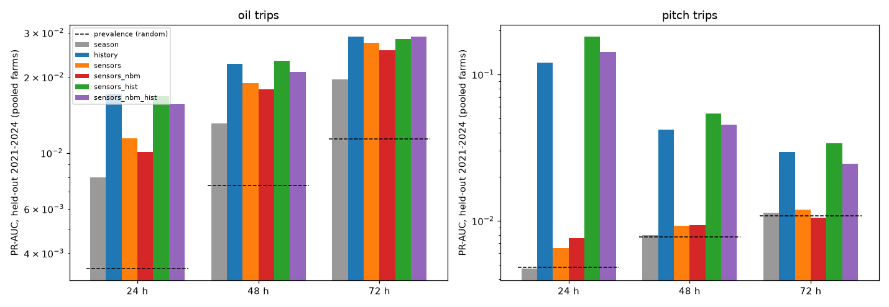
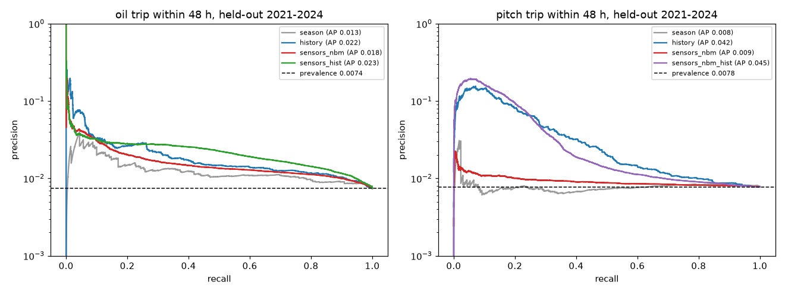
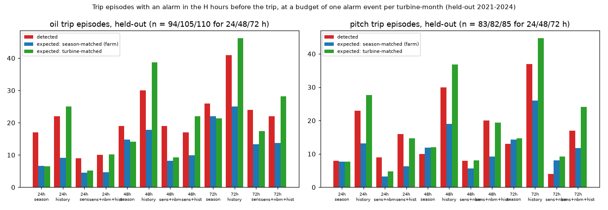
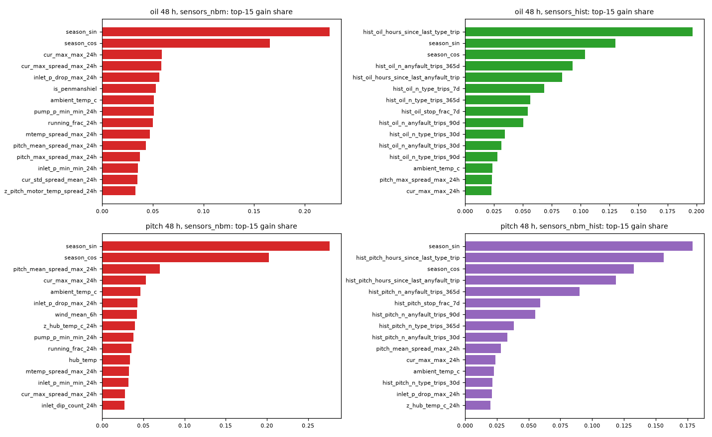
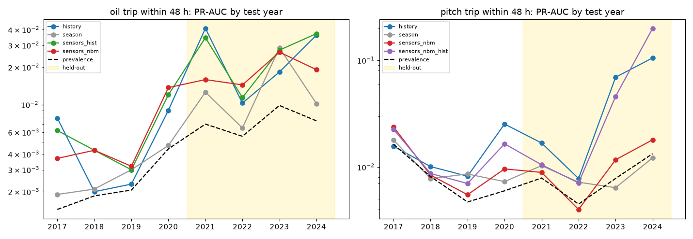

# Short-term trip prediction (24 / 48 / 72 h): gearbox oil-system and pitch trips, 2016–2024

**Bottom line.** None of the 12 pre-registered held-out tests passes the multiple-testing correction. So there is **no reliable short-term warning** from the 10-minute min/max/std sensor features or the NBM residuals beyond simple baselines.

* **Oil-system trips.** The sensor models rank hours a little better than a season-only model (held-out PR-AUC 0.011–0.027 vs 0.008–0.020, prevalence 0.003–0.011). None of the three tests passes the correction; the best is p = 0.006 at 72 h, against a threshold of 0.0042.
  * At a budget of one alarm per turbine-month, the best sensor model catches 19–20 of 105 held-out trip episodes within 48 h, about twice the turbine-matched chance (9.3–10.7). But a season-only model catches 19, and **about 97% of alarms are false** (event precision 3%).
* **Pitch trips.** Sensors add nothing measurable over chance. All of the predictability comes from **repeat tripping**: a model that only knows recent trip history reaches PR-AUC 0.12 at 24 h (prevalence 0.005). Adding sensors raises that to 0.18, but the gain fails the correction (p = 0.046) and is driven by Kelmarsh's repeat trips.

Every number below was computed by the scripts in §7.

## 1. Data, labels and features

* **New raw statistics.** `scripts/extract_stat_signals.py` reads the 10-min **Min / Max / StdDev** columns from the Greenbyte CSVs already on the box (no downloads) into `data/processed/all_years/<farm>_stats_<TID>.parquet` (git-ignored):
  * gear-oil inlet and pump pressure (mean/min/max/std)
  * gear-oil and inlet temperature (max/std)
  * pitch-motor current axes 1–3 (mean/min/max/std)
  * pitch-motor temperature max
  * blade pitch angle A/B/C (min/max/std)
  * rotor-speed std
* **Oil-pressure unit fix**, same as before: a row whose 10-min mean (or max, if the mean is missing) is above 20 is in kPa, and its mean/min/max/std are all divided by 100.
* **Correction to the earlier report.** `nbm_all_years.md` said the per-blade pitch std columns were copies of each other. That was wrong. Their summary statistics match, but row by row the values differ in about 44% of 2022 KEL01 rows. They are used here.
* **Trips** are fault-stop events from the status logs:
  * **Oil-system:** codes 1550 missing gear oil, 1510 low gearbox oil pressure, 1800 gear-oil pump overload, 1815 oil-cooler fan overload, 1924 particle gear alarm.
  * **Pitch:** component = pitch.
  * Counts: Kelmarsh 14 oil and 131 pitch trips; Penmanshiel 440 oil and 426 pitch trips.
* **Trip episodes** are trips less than 24 h apart, merged; the first trip's time is kept. Counts: Kelmarsh 10 oil and 69 pitch episodes; Penmanshiel 235 oil and 248 pitch.
  * Repeat trippers dominate: PEN04, PEN11 and PEN15 each have 32–33 oil episodes, and KEL05 has 18 pitch episodes.
  * Kelmarsh has only 4 held-out oil episodes, so the oil results are essentially a Penmanshiel result.
* **Rows:** one per hour, excluding hours in a stop or fault. That gives 1.43 M rows from 20 turbines, of which 590,366 fall in the held-out years 2021–2024.
* **Label** for fault type *k* and horizon H: a trip of type *k* starts in (t, t+H]. Held-out prevalence:

| | 24 h | 48 h | 72 h |
|---|---|---|---|
| Oil | 0.35% | 0.74% | 1.14% |
| Pitch | 0.48% | 0.78% | 1.08% |

* **Feature groups** (all causal; `src/windml/trip_features.py`):
  * **Sensors (113).**
    * Current 10-min statistics: inlet/pump pressure min, max, std and mean−min drop; oil temperature max/std; per-blade pitch min/max/std/range; spreads across blades (of max, min, std and mean); pitch-current max/std per axis plus max and spread; motor-temperature max and spread; hub temperature.
    * Rolling 1 h / 6 h / 24 h: minimum pressure, maximum drop, mean std, maximum spreads.
    * Dip counts: inlet or pump minimum below 60% of its trailing 7-day median, over 6 h and 24 h.
    * Time below thresholds: inlet minimum < 0.5 bar; blade spread > 1°; current spread > 3 A.
    * Variability trends: 24 h mean ÷ 7-day mean for pressure std, current std and pitch spreads; pressure relative to its 7-day median.
    * Operating context: power, wind, ambient, rotor speed, share of the last 24 h running.
    * All rolling features use **operating rows only** (values are masked during stops), so the sensor group does not encode stop or trip history.
  * **NBM (26):** 6-h and 24-h means of the 13 walk-forward NBM residual z-scores from `nbm_all_years.md`, which are out-of-sample for every year.
  * **History (14):** hours since the last trip of that type and since the last fault stop of any kind; counts of each over the last 1, 7, 30, 90 and 365 days; share of time stopped over 24 h and 7 days. Only trips that started before t are used.
  * **Season (3):** day-of-year sine/cosine and a farm flag.

## 2. Models and protocol

* **Models.** LightGBM classifiers with fixed hyperparameters (300 trees, learning rate 0.05, 31 leaves, min 50 rows per leaf, 0.8 row / 0.7 column subsampling). There is one model per fault type × horizon × feature set, trained on both farms together. 288 fits in about 13 minutes on CPU.
* **Walk-forward by year.** The model for test year Y trains on all rows that end H hours before 1 January Y, so no label reaches into Y. Negatives are subsampled to 20% (with a fixed seed); all positives are kept. Predictions for 2017–2024 are cached in `data/trip_preds/` (git-ignored).
* **Feature sets:**
  * Baselines: `season` and `history` (recent trip history only).
  * Without trip history: `sensors`, `sensors_nbm`.
  * With trip history: `sensors_hist`, `sensors_nbm_hist`.
  * The "with" and "without" variants answer the repeat-tripper question.
* **Selection on dev years only (2017–2020, both farms together).** For each fault × horizon, I took the better of the two no-history sets and the better of the two with-history sets by dev PR-AUC.
  * No-history picks: oil `sensors` / `sensors_nbm` / `sensors` and pitch `sensors_nbm` for all three horizons.
  * With-history picks: oil `sensors_nbm_hist` / `sensors_hist` / `sensors_nbm_hist` and pitch `sensors_hist` / `sensors_nbm_hist` / `sensors_nbm_hist`.
  * Everything was then scored **once** on 2021–2024.
* **Primary tests (12, fixed before looking at held-out numbers).** For each fault × horizon:
  * the no-history pick vs the `season` model (do sensors carry any information?)
  * the with-history pick vs the `history` model (do sensors add anything beyond repeat tripping?)
  * Each uses the held-out PR-AUC difference with a one-sided block bootstrap over turbine-months (1,000 resamples), at a Bonferroni level of 0.05/12 = 0.0042.
* **Alarm budget: one alarm event per turbine-month.** In each farm-year, the score threshold is set so that the number of alarm events (flagged hours merged when less than 24 h apart) matches the number of turbine-months. This uses scores only, never labels.
  * **Event precision** = the share of alarm events with a trip within H hours of one of their flagged hours.
  * **Episode detection** = a flagged hour falls in the H hours before the episode starts. Lead time is measured from the first such hour.
* **Chance for episode detection:**
  * *Season-matched*: the share of H-hour windows that contain a flagged hour, over all turbines of the farm, for windows ending within ±30 days of the episode.
  * *Turbine-matched*: the same, on the episode's own turbine only (excluding its own window). This tests whether the **timing** is informative rather than just the choice of turbine.
* **A note on budgets.** A first version set the budget as "the top H/730 of hours". Sensor models scatter those hours, which produced about 3.4 alarm events per turbine-month and inflated episode detection (for example 39/94 for oil at 24 h). I replaced it with the event-based budget above. Every number here uses the event budget.

## 3. Primary results (held-out 2021–2024, both farms)

| Fault | H | Model (picked on dev) | PR-AUC | Baseline | Baseline PR-AUC | Prevalence | 95% CI of difference | p (one-sided) |
|---|---|---|---|---|---|---|---|---|
| oil | 24 | sensors | 0.0114 | season | 0.0080 | 0.0035 | −0.0018 to 0.0087 | 0.094 |
| oil | 48 | sensors_nbm | 0.0179 | season | 0.0131 | 0.0074 | 0.0005 to 0.0112 | 0.018 |
| oil | 72 | sensors | 0.0274 | season | 0.0196 | 0.0114 | 0.0017 to 0.0176 | 0.006 |
| oil | 24 | sensors_nbm_hist | 0.0156 | history | 0.0171 | 0.0035 | −0.0153 to 0.0071 | 0.54 |
| oil | 48 | sensors_hist | 0.0232 | history | 0.0225 | 0.0074 | −0.0164 to 0.0108 | 0.43 |
| oil | 72 | sensors_nbm_hist | 0.0290 | history | 0.0290 | 0.0114 | −0.0174 to 0.0096 | 0.50 |
| pitch | 24 | sensors_nbm | 0.0076 | season | 0.0047 | 0.0048 | −0.0007 to 0.0096 | 0.064 |
| pitch | 48 | sensors_nbm | 0.0093 | season | 0.0080 | 0.0078 | −0.0030 to 0.0045 | 0.22 |
| pitch | 72 | sensors_nbm | 0.0105 | season | 0.0114 | 0.0108 | −0.0069 to 0.0019 | 0.68 |
| pitch | 24 | sensors_hist | 0.1819 | history | 0.1203 | 0.0048 | −0.0063 to 0.1248 | 0.046 |
| pitch | 48 | sensors_nbm_hist | 0.0454 | history | 0.0419 | 0.0078 | −0.0235 to 0.0258 | 0.43 |
| pitch | 72 | sensors_nbm_hist | 0.0246 | history | 0.0295 | 0.0108 | −0.0179 to 0.0085 | 0.83 |

* **None of the 12 passes 0.0042.** The closest are oil 72 h sensors vs season (p = 0.006) and oil 48 h (p = 0.018). That is a consistent but small edge of about 1.4× the season model's PR-AUC, at precision levels of 1–3%.
* **Oil trips:** sensors add nothing on top of trip history (p = 0.43–0.54).
* **Pitch trips:** sensors alone are at chance (PR-AUC about equal to prevalence at 48 and 72 h).

## 4. Operating point: one alarm per turbine-month (held-out, both farms)

| Fault | H | Feature set | Precision (hours) | Event precision | False alarms / turbine-month | Episodes detected | Turbine-matched expected (p) | Median lead |
|---|---|---|---|---|---|---|---|---|
| oil | 24 | season | 0.7% | 2.0% | 0.97 | 17/94 | 6.6 (0.0002) | 21 h |
| oil | 24 | history | 1.1% | 3.5% | 0.98 | 22/94 | 25.1 (0.82) | 24 h |
| oil | 24 | sensors | 1.2% | 2.2% | 0.97 | 9/94 | 5.2 (0.072) | 8 h |
| oil | 48 | season | 1.3% | 2.4% | 0.96 | 19/105 | 14.2 (0.10) | 48 h |
| oil | 48 | history | 1.5% | 4.5% | 0.96 | 30/105 | 38.7 (0.99) | 48 h |
| oil | 48 | sensors | 2.8% | 3.1% | 0.98 | 20/105 | 10.7 (0.003) | 29.5 h |
| oil | 48 | sensors_nbm | 3.6% | 3.0% | 0.96 | 19/105 | 9.3 (0.001) | 22 h |
| oil | 72 | sensors | 3.5% | 3.6% | 0.98 | 24/110 | 17.4 (0.048) | 50.5 h |
| pitch | 24 | history | 2.6% | 3.7% | 0.95 | 23/83 | 27.7 (0.91) | 23 h |
| pitch | 24 | sensors_hist | 11.3% | 2.6% | 0.99 | 16/83 | 14.7 (0.39) | 22 h |
| pitch | 24 | sensors_nbm | 1.7% | 1.2% | 0.97 | 9/83 | 4.8 (0.041) | 13 h |
| pitch | 48 | sensors_nbm | 1.7% | 1.3% | 1.00 | 8/82 | 8.1 (0.58) | 35 h |

How to read this:

* **Oil sensor models do have some timing information.** At 48 h they catch about twice the turbine-matched chance (20 vs 10.7; 19 vs 9.3). The effect holds for episodes with no oil trip in the previous 7 days (16/81 vs 7.6 expected, p = 0.002 for `sensors_nbm`).
* **But the season-only model does about as well** (17/94 at 24 h vs 6.6 expected; 19/105 at 48 h). So oil trips cluster in particular weeks of the year more tightly than the ±30-day matched baseline captures, and much of the sensor models' "timing" may be the same seasonal clustering. These episode-level p-values come from a grid of 36 settings and were not pre-registered.
* **Alarms are almost all false.** Event precision is 2–4%, meaning roughly 30–50 false alarms per true one at one alarm per turbine-month.
* **History models catch more episodes but fewer than chance on the same turbine.** Their alarms sit on the repeat trippers, which is real information about *which* turbine but not *when*.
* **Pitch.** Hour-level precision of 10–13% for `sensors_hist` at 24–48 h comes from flagging the hours right after a pitch trip, when another trip within a day is likely. Those repeat trips are merged into the same episode, so episode detection isn't better than chance (16/83 vs 14.7).

## 5. Per farm (48 h, Table C)

* **Penmanshiel oil:** `sensors` catches 20/102 vs 10.3 turbine-matched expected (p = 0.0016); `sensors_nbm` 19/102 vs 8.8 (p = 0.0005); `season` 18/102 vs 13.9.
* **Kelmarsh oil:** 3 evaluable episodes, uninformative.
* **Kelmarsh pitch:** trip history gives PR-AUC 0.17 (prevalence 0.010), and `sensors_hist` 0.32. `sensors` catches 5/28 vs 1.6 expected (p = 0.017).
* **Penmanshiel pitch:** at chance for every feature set.
* **By test year** (Table E, `figures/trip_prauc_by_year_48h.png`, 48 h):
  * Oil: `sensors_nbm` beats season-only PR-AUC in 7 of 8 test years (3 of 4 held-out; not 2023). That fits a small but consistent edge, too small to be useful.
  * Pitch: `sensors_nbm` beats season-only in only 5 of 8 years.
  * Pitch history models jump in 2023–2024 (PR-AUC 0.07–0.20), driven by Kelmarsh repeat pitch trips (KEL05).

## 6. Conclusions and next steps

1. **No usable short-term warning.** No reliable 24–72 h warning for oil-system or pitch trips comes from 10-min SCADA statistics or NBM residuals. The best oil models are at most about 1.4× better than season-only ranking, fail the correction, and would raise about 30–50 false alarms per true one.
2. **Repeat tripping is the strongest predictor.** It is useful for maintenance planning (flag turbines in a trip-prone state), not as a precursor. A simple rule based on hours since the last trip gives most of the pitch PR-AUC.
3. **Possible next steps:**
   * Model **weather and seasonal drivers** of oil trips directly (cold starts, oil temperature at high rpm for "missing gear oil (high rpm)"), as a condition rule rather than a fault predictor.
   * Get **higher-frequency data** (1-s or event logs around trips) if the operator can provide them. The 10-min statistics can't resolve sub-minute pressure transients.
   * Use **maintenance or work-order labels**, to separate nuisance trips from real component degradation.
   * Stop adding model complexity on this data. The evaluation harness is the reusable asset.

## 7. Reproduce

```
cd projects/windml
nohup .venv/bin/python scripts/extract_stat_signals.py > /workspace/logs/extract_stats.log 2>&1 &     # 10-min min/max/std from raw CSVs (cached)
nohup .venv/bin/python scripts/build_trip_features.py > /workspace/logs/trip_features.log 2>&1 &      # hourly features + labels -> data/trip/
nohup .venv/bin/python scripts/run_trip_models.py > /workspace/logs/trip_models.log 2>&1 &            # 288 walk-forward fits -> data/trip_preds/
.venv/bin/python scripts/eval_trip.py      # metrics, selection, primary tests -> reports/trip_*.csv
.venv/bin/python scripts/report_trip.py    # figures + reports/trip_tables.md
```

Figures:
* `figures/trip_prauc_heldout.png`
* `figures/trip_pr_curves_48h.png`
* `figures/trip_episode_detection.png`
* `figures/trip_importance_48h.png`
* `figures/trip_prauc_by_year_48h.png`







## Appendix: generated tables

### Table A. Primary tests on held-out 2021-2024 (pooled farms; PR-AUC difference, one-sided block bootstrap over turbine-months; Bonferroni alpha = 0.05/12 = 0.0042)

| fault   |   horizon_h | model            | baseline   |   rows |   positives |   pr_auc_model |   pr_auc_baseline |   prevalence |   diff_ci95_low |   diff_ci95_high |   p_one_sided | significant_bonferroni_12   |
|:--------|------------:|:-----------------|:-----------|-------:|------------:|---------------:|------------------:|-------------:|----------------:|-----------------:|--------------:|:----------------------------|
| oil     |          24 | sensors          | season     | 590366 |        2046 |         0.0114 |            0.008  |      0.00347 |         -0.0018 |           0.0087 |         0.094 | False                       |
| oil     |          24 | sensors_nbm_hist | history    | 590366 |        2046 |         0.0156 |            0.0171 |      0.00347 |         -0.0153 |           0.0071 |         0.544 | False                       |
| oil     |          48 | sensors_nbm      | season     | 590366 |        4388 |         0.0179 |            0.0131 |      0.00743 |          0.0005 |           0.0112 |         0.018 | False                       |
| oil     |          48 | sensors_hist     | history    | 590366 |        4388 |         0.0232 |            0.0225 |      0.00743 |         -0.0164 |           0.0108 |         0.425 | False                       |
| oil     |          72 | sensors          | season     | 590366 |        6720 |         0.0274 |            0.0196 |      0.01138 |          0.0017 |           0.0176 |         0.006 | False                       |
| oil     |          72 | sensors_nbm_hist | history    | 590366 |        6720 |         0.029  |            0.029  |      0.01138 |         -0.0174 |           0.0096 |         0.504 | False                       |
| pitch   |          24 | sensors_nbm      | season     | 590366 |        2843 |         0.0076 |            0.0047 |      0.00482 |         -0.0007 |           0.0096 |         0.064 | False                       |
| pitch   |          24 | sensors_hist     | history    | 590366 |        2843 |         0.1819 |            0.1203 |      0.00482 |         -0.0063 |           0.1248 |         0.046 | False                       |
| pitch   |          48 | sensors_nbm      | season     | 590366 |        4583 |         0.0093 |            0.008  |      0.00776 |         -0.003  |           0.0045 |         0.22  | False                       |
| pitch   |          48 | sensors_nbm_hist | history    | 590366 |        4583 |         0.0454 |            0.0419 |      0.00776 |         -0.0235 |           0.0258 |         0.427 | False                       |
| pitch   |          72 | sensors_nbm      | season     | 590366 |        6387 |         0.0105 |            0.0114 |      0.01082 |         -0.0069 |           0.0019 |         0.68  | False                       |
| pitch   |          72 | sensors_nbm_hist | history    | 590366 |        6387 |         0.0246 |            0.0295 |      0.01082 |         -0.0179 |           0.0085 |         0.829 | False                       |

### Table B. Held-out 2021-2024, pooled farms, all feature sets

| fault   |   horizon_h | feature_set      |   positives |   prevalence |   pr_auc |   precision_at_budget |   alarm_events |   event_precision |   false_alarm_events_per_turbine_month |   episodes |   detected |   expected_chance |   p_episode |   expected_turbine_matched |   p_episode_turbine_matched |   median_lead_h |
|:--------|------------:|:-----------------|------------:|-------------:|---------:|----------------------:|---------------:|------------------:|---------------------------------------:|-----------:|-----------:|------------------:|------------:|---------------------------:|----------------------------:|----------------:|
| oil     |          24 | season           |        2046 |      0.00347 |   0.008  |                0.007  |            835 |             0.02  |                                  0.974 |         94 |         17 |              6.69 |      0.0002 |                       6.56 |                      0.0002 |            21   |
| oil     |          24 | history          |        2046 |      0.00347 |   0.0171 |                0.0105 |            855 |             0.035 |                                  0.982 |         94 |         22 |              9.15 |      0.0001 |                      25.09 |                      0.8214 |            24   |
| oil     |          24 | sensors          |        2046 |      0.00347 |   0.0114 |                0.0115 |            834 |             0.022 |                                  0.971 |         94 |          9 |              4.47 |      0.0334 |                       5.22 |                      0.0721 |             8   |
| oil     |          24 | sensors_nbm      |        2046 |      0.00347 |   0.0101 |                0.0127 |            850 |             0.014 |                                  0.998 |         94 |          6 |              3.82 |      0.1818 |                       3.92 |                      0.1941 |             5.5 |
| oil     |          24 | sensors_hist     |        2046 |      0.00347 |   0.0168 |                0.0226 |            833 |             0.03  |                                  0.962 |         94 |         12 |              4.53 |      0.0017 |                      11.26 |                      0.4544 |            10.5 |
| oil     |          24 | sensors_nbm_hist |        2046 |      0.00347 |   0.0156 |                0.0199 |            842 |             0.03  |                                  0.973 |         94 |         10 |              4.65 |      0.0171 |                      10.15 |                      0.5738 |             9.5 |
| oil     |          48 | season           |        4388 |      0.00743 |   0.0131 |                0.0127 |            826 |             0.024 |                                  0.96  |        105 |         19 |             14.79 |      0.1389 |                      14.18 |                      0.0996 |            48   |
| oil     |          48 | history          |        4388 |      0.00743 |   0.0225 |                0.0153 |            846 |             0.045 |                                  0.962 |        105 |         30 |             17.76 |      0.0019 |                      38.74 |                      0.9851 |            48   |
| oil     |          48 | sensors          |        4388 |      0.00743 |   0.0189 |                0.0283 |            850 |             0.031 |                                  0.981 |        105 |         20 |              9.16 |      0.0006 |                      10.71 |                      0.0029 |            29.5 |
| oil     |          48 | sensors_nbm      |        4388 |      0.00743 |   0.0179 |                0.0361 |            830 |             0.03  |                                  0.958 |        105 |         19 |              8.26 |      0.0004 |                       9.29 |                      0.0011 |            22   |
| oil     |          48 | sensors_hist     |        4388 |      0.00743 |   0.0232 |                0.022  |            839 |             0.038 |                                  0.961 |        105 |         17 |              9.98 |      0.0189 |                      22.06 |                      0.9302 |            36   |
| oil     |          48 | sensors_nbm_hist |        4388 |      0.00743 |   0.0209 |                0.0196 |            847 |             0.039 |                                  0.969 |        105 |         18 |              9.53 |      0.0055 |                      19.81 |                      0.7304 |            22.5 |
| oil     |          72 | season           |        6720 |      0.01138 |   0.0196 |                0.0164 |            832 |             0.03  |                                  0.961 |        110 |         26 |             22.02 |      0.1834 |                      21.38 |                      0.1396 |            71   |
| oil     |          72 | history          |        6720 |      0.01138 |   0.029  |                0.0203 |            830 |             0.055 |                                  0.933 |        110 |         41 |             24.97 |      0.0003 |                      46.22 |                      0.9073 |            66   |
| oil     |          72 | sensors          |        6720 |      0.01138 |   0.0274 |                0.0351 |            857 |             0.036 |                                  0.983 |        110 |         24 |             13.37 |      0.0024 |                      17.43 |                      0.0475 |            50.5 |
| oil     |          72 | sensors_nbm      |        6720 |      0.01138 |   0.0256 |                0.0556 |            848 |             0.038 |                                  0.971 |        110 |         23 |             12.48 |      0.002  |                      17.1  |                      0.0634 |            49   |
| oil     |          72 | sensors_hist     |        6720 |      0.01138 |   0.0283 |                0.0293 |            847 |             0.044 |                                  0.964 |        110 |         25 |             14.53 |      0.0035 |                      33.08 |                      0.9815 |            56   |
| oil     |          72 | sensors_nbm_hist |        6720 |      0.01138 |   0.029  |                0.0277 |            837 |             0.045 |                                  0.951 |        110 |         22 |             13.7  |      0.0141 |                      28.15 |                      0.9577 |            50.5 |
| pitch   |          24 | season           |        2843 |      0.00482 |   0.0047 |                0.0061 |            837 |             0.014 |                                  0.982 |         83 |          8 |              7.7  |      0.516  |                       7.74 |                      0.5212 |            24   |
| pitch   |          24 | history          |        2843 |      0.00482 |   0.1203 |                0.0263 |            830 |             0.037 |                                  0.951 |         83 |         23 |             13.1  |      0.0033 |                      27.72 |                      0.9137 |            23   |
| pitch   |          24 | sensors          |        2843 |      0.00482 |   0.0065 |                0.0039 |            823 |             0.009 |                                  0.971 |         83 |          5 |              3.35 |      0.2415 |                       4.15 |                      0.4017 |            11   |
| pitch   |          24 | sensors_nbm      |        2843 |      0.00482 |   0.0076 |                0.0167 |            823 |             0.012 |                                  0.968 |         83 |          9 |              3.26 |      0.0049 |                       4.76 |                      0.0412 |            13   |
| pitch   |          24 | sensors_hist     |        2843 |      0.00482 |   0.1819 |                0.1125 |            856 |             0.026 |                                  0.993 |         83 |         16 |              6.29 |      0.0003 |                      14.72 |                      0.3937 |            22   |
| pitch   |          24 | sensors_nbm_hist |        2843 |      0.00482 |   0.1422 |                0.1294 |            854 |             0.026 |                                  0.99  |         83 |         17 |              5.95 |      0.0001 |                      15.87 |                      0.4135 |            21   |
| pitch   |          48 | season           |        4583 |      0.00776 |   0.008  |                0.008  |            836 |             0.013 |                                  0.982 |         82 |         10 |             11.88 |      0.7869 |                      12    |                      0.7992 |            48   |
| pitch   |          48 | history          |        4583 |      0.00776 |   0.0419 |                0.0238 |            830 |             0.046 |                                  0.943 |         82 |         30 |             18.98 |      0.0032 |                      36.77 |                      0.9665 |            48   |
| pitch   |          48 | sensors          |        4583 |      0.00776 |   0.0092 |                0.0033 |            819 |             0.015 |                                  0.961 |         82 |         10 |              5.57 |      0.047  |                       6.36 |                      0.0909 |            23   |
| pitch   |          48 | sensors_nbm      |        4583 |      0.00776 |   0.0093 |                0.0172 |            851 |             0.013 |                                  1     |         82 |          8 |              5.6  |      0.1939 |                       8.09 |                      0.5774 |            35   |
| pitch   |          48 | sensors_hist     |        4583 |      0.00776 |   0.0543 |                0.1016 |            841 |             0.027 |                                  0.974 |         82 |         17 |              8.63 |      0.0039 |                      19.16 |                      0.7788 |            47   |
| pitch   |          48 | sensors_nbm_hist |        4583 |      0.00776 |   0.0454 |                0.0988 |            848 |             0.033 |                                  0.976 |         82 |         20 |              9.21 |      0.0005 |                      19.39 |                      0.4802 |            33   |
| pitch   |          72 | season           |        6387 |      0.01082 |   0.0114 |                0.0089 |            838 |             0.016 |                                  0.982 |         85 |         13 |             14.34 |      0.7148 |                      14.65 |                      0.7474 |            72   |
| pitch   |          72 | history          |        6387 |      0.01082 |   0.0295 |                0.0232 |            830 |             0.051 |                                  0.938 |         85 |         37 |             25.97 |      0.0061 |                      44.73 |                      0.9818 |            72   |
| pitch   |          72 | sensors          |        6387 |      0.01082 |   0.0119 |                0.0044 |            836 |             0.01  |                                  0.986 |         85 |          7 |              8.64 |      0.7802 |                       8.84 |                      0.8122 |            22   |
| pitch   |          72 | sensors_nbm      |        6387 |      0.01082 |   0.0105 |                0.0046 |            844 |             0.008 |                                  0.996 |         85 |          4 |              8.11 |      0.9694 |                       9.27 |                      0.9901 |            35   |
| pitch   |          72 | sensors_hist     |        6387 |      0.01082 |   0.034  |                0.0683 |            827 |             0.035 |                                  0.95  |         85 |         21 |             12.04 |      0.0057 |                      22.99 |                      0.7471 |            48   |
| pitch   |          72 | sensors_nbm_hist |        6387 |      0.01082 |   0.0246 |                0.0573 |            832 |             0.035 |                                  0.956 |         85 |         17 |             11.82 |      0.0719 |                      24.16 |                      0.9843 |            64   |

### Table C. Held-out 2021-2024 by farm (48 h)

| farm        | fault   |   horizon_h | feature_set      |   positives |   prevalence |   pr_auc |   precision_at_budget |   alarm_events |   event_precision |   false_alarm_events_per_turbine_month |   episodes |   detected |   expected_chance |   p_episode |   expected_turbine_matched |   p_episode_turbine_matched |   median_lead_h |
|:------------|:--------|------------:|:-----------------|------------:|-------------:|---------:|----------------------:|---------------:|------------------:|---------------------------------------:|-----------:|-----------:|------------------:|------------:|---------------------------:|----------------------------:|----------------:|
| kelmarsh    | oil     |          48 | season           |         144 |      0.00072 |   0.001  |                0.0008 |            285 |             0.004 |                                  0.99  |          3 |          1 |              0.31 |      0.2895 |                       0.31 |                      0.2853 |            48   |
| penmanshiel | oil     |          48 | season           |        4244 |      0.0109  |   0.0141 |                0.0249 |            541 |             0.035 |                                  0.944 |        102 |         18 |             14.47 |      0.183  |                      13.88 |                      0.1355 |            47   |
| kelmarsh    | oil     |          48 | history          |         144 |      0.00072 |   0.0005 |                0      |            282 |             0     |                                  0.983 |          3 |          0 |              0.7  |      1      |                       1.4  |                      1      |           nan   |
| penmanshiel | oil     |          48 | history          |        4244 |      0.0109  |   0.0237 |                0.0253 |            564 |             0.067 |                                  0.951 |        102 |         30 |             17.06 |      0.0009 |                      37.34 |                      0.9693 |            48   |
| kelmarsh    | oil     |          48 | sensors          |         144 |      0.00072 |   0.0014 |                0      |            296 |             0     |                                  1.031 |          3 |          0 |              0.27 |      1      |                       0.44 |                      1      |           nan   |
| penmanshiel | oil     |          48 | sensors          |        4244 |      0.0109  |   0.0195 |                0.0431 |            554 |             0.047 |                                  0.955 |        102 |         20 |              8.89 |      0.0004 |                      10.27 |                      0.0016 |            29.5 |
| kelmarsh    | oil     |          48 | sensors_nbm      |         144 |      0.00072 |   0.0009 |                0      |            278 |             0     |                                  0.969 |          3 |          0 |              0.26 |      1      |                       0.52 |                      1      |           nan   |
| penmanshiel | oil     |          48 | sensors_nbm      |        4244 |      0.0109  |   0.0187 |                0.0507 |            552 |             0.045 |                                  0.953 |        102 |         19 |              8    |      0.0003 |                       8.76 |                      0.0005 |            22   |
| kelmarsh    | oil     |          48 | sensors_hist     |         144 |      0.00072 |   0.0006 |                0      |            287 |             0     |                                  1     |          3 |          0 |              0.34 |      1      |                       0.91 |                      1      |           nan   |
| penmanshiel | oil     |          48 | sensors_hist     |        4244 |      0.0109  |   0.0242 |                0.0354 |            552 |             0.058 |                                  0.94  |        102 |         17 |              9.64 |      0.0136 |                      21.15 |                      0.8945 |            36   |
| kelmarsh    | oil     |          48 | sensors_nbm_hist |         144 |      0.00072 |   0.0007 |                0      |            284 |             0     |                                  0.99  |          3 |          0 |              0.32 |      1      |                       0.71 |                      1      |           nan   |
| penmanshiel | oil     |          48 | sensors_nbm_hist |        4244 |      0.0109  |   0.0219 |                0.0284 |            563 |             0.059 |                                  0.958 |        102 |         18 |              9.21 |      0.0038 |                      19.1  |                      0.6639 |            22.5 |
| kelmarsh    | pitch   |          48 | season           |        2070 |      0.01031 |   0.0121 |                0.0064 |            284 |             0.011 |                                  0.979 |         28 |          3 |              3.86 |      0.7758 |                       4.01 |                      0.801  |            30   |
| penmanshiel | pitch   |          48 | season           |        2513 |      0.00645 |   0.0075 |                0.0086 |            552 |             0.014 |                                  0.984 |         54 |          7 |              8.01 |      0.7311 |                       7.99 |                      0.7283 |            48   |
| kelmarsh    | pitch   |          48 | history          |        2070 |      0.01031 |   0.1737 |                0.0534 |            287 |             0.052 |                                  0.948 |         28 |         14 |              8.57 |      0.0197 |                      15.15 |                      0.7602 |            48   |
| penmanshiel | pitch   |          48 | history          |        2513 |      0.00645 |   0.0097 |                0.0095 |            543 |             0.042 |                                  0.94  |         54 |         16 |             10.41 |      0.0432 |                      21.62 |                      0.9729 |            48   |
| kelmarsh    | pitch   |          48 | sensors          |        2070 |      0.01031 |   0.0192 |                0.0032 |            285 |             0.021 |                                  0.972 |         28 |          5 |              1.5  |      0.012  |                       1.6  |                      0.0172 |            22   |
| penmanshiel | pitch   |          48 | sensors          |        2513 |      0.00645 |   0.0059 |                0.0035 |            534 |             0.011 |                                  0.955 |         54 |          5 |              4.07 |      0.3854 |                       4.76 |                      0.5296 |            27   |
| kelmarsh    | pitch   |          48 | sensors_nbm      |        2070 |      0.01031 |   0.0228 |                0.0352 |            288 |             0.024 |                                  0.979 |         28 |          5 |              1.63 |      0.0202 |                       3.03 |                      0.1609 |            26   |
| penmanshiel | pitch   |          48 | sensors_nbm      |        2513 |      0.00645 |   0.0061 |                0.005  |            563 |             0.007 |                                  1.011 |         54 |          3 |              3.97 |      0.7722 |                       5.06 |                      0.9075 |            39   |
| kelmarsh    | pitch   |          48 | sensors_hist     |        2070 |      0.01031 |   0.3211 |                0.2651 |            286 |             0.042 |                                  0.955 |         28 |         14 |              4.03 |      0      |                       8.9  |                      0.0179 |            47.5 |
| penmanshiel | pitch   |          48 | sensors_hist     |        2513 |      0.00645 |   0.0078 |                0.0106 |            555 |             0.02  |                                  0.984 |         54 |          3 |              4.6  |      0.8518 |                      10.26 |                      0.9995 |            30   |
| kelmarsh    | pitch   |          48 | sensors_nbm_hist |        2070 |      0.01031 |   0.2865 |                0.2561 |            294 |             0.048 |                                  0.976 |         28 |         13 |              4.35 |      0.0001 |                       8.8  |                      0.0432 |            47   |
| penmanshiel | pitch   |          48 | sensors_nbm_hist |        2513 |      0.00645 |   0.0068 |                0.0115 |            554 |             0.025 |                                  0.976 |         54 |          7 |              4.86 |      0.2082 |                      10.59 |                      0.9379 |            32   |

### Table B2. Held-out episode detection, all episodes vs episodes without a same-type trip in the previous 7 days (pooled farms)

| fault   |   horizon_h | feature_set      | subset           |   episodes |   detected |   expected_season_matched |   expected_turbine_matched |   p_turbine_matched |   median_lead_h |
|:--------|------------:|:-----------------|:-----------------|-----------:|-----------:|--------------------------:|---------------------------:|--------------------:|----------------:|
| oil     |          24 | history          | all              |         94 |         22 |                      9.15 |                      25.09 |            0.821    |            24   |
| oil     |          24 | history          | no_prior_trip_7d |         72 |         10 |                      6.94 |                      17.68 |            0.995    |            20.5 |
| oil     |          24 | season           | all              |         94 |         17 |                      6.69 |                       6.56 |            0.000179 |            21   |
| oil     |          24 | season           | no_prior_trip_7d |         72 |         12 |                      5.03 |                       4.96 |            0.00287  |            24   |
| oil     |          24 | sensors          | all              |         94 |          9 |                      4.47 |                       5.22 |            0.0721   |             8   |
| oil     |          24 | sensors          | no_prior_trip_7d |         72 |          8 |                      3.38 |                       3.99 |            0.0412   |             9   |
| oil     |          24 | sensors_hist     | all              |         94 |         12 |                      4.53 |                      11.26 |            0.454    |            10.5 |
| oil     |          24 | sensors_hist     | no_prior_trip_7d |         72 |         11 |                      3.52 |                       7.9  |            0.154    |             7   |
| oil     |          24 | sensors_nbm      | all              |         94 |          6 |                      3.82 |                       3.92 |            0.194    |             5.5 |
| oil     |          24 | sensors_nbm      | no_prior_trip_7d |         72 |          6 |                      3.14 |                       3.15 |            0.0897   |             5.5 |
| oil     |          24 | sensors_nbm_hist | all              |         94 |         10 |                      4.65 |                      10.15 |            0.574    |             9.5 |
| oil     |          24 | sensors_nbm_hist | no_prior_trip_7d |         72 |         10 |                      3.6  |                       7.06 |            0.155    |             9.5 |
| oil     |          48 | history          | all              |        105 |         30 |                     17.76 |                      38.74 |            0.985    |            48   |
| oil     |          48 | history          | no_prior_trip_7d |         81 |         15 |                     13.52 |                      27.57 |            1        |            48   |
| oil     |          48 | season           | all              |        105 |         19 |                     14.79 |                      14.18 |            0.0996   |            48   |
| oil     |          48 | season           | no_prior_trip_7d |         81 |         16 |                     11.8  |                      11.16 |            0.0743   |            48   |
| oil     |          48 | sensors          | all              |        105 |         20 |                      9.16 |                      10.71 |            0.0029   |            29.5 |
| oil     |          48 | sensors          | no_prior_trip_7d |         81 |         15 |                      7.15 |                       8.43 |            0.0146   |            28   |
| oil     |          48 | sensors_hist     | all              |        105 |         17 |                      9.98 |                      22.06 |            0.93     |            36   |
| oil     |          48 | sensors_hist     | no_prior_trip_7d |         81 |         12 |                      8.03 |                      16.23 |            0.931    |            31.5 |
| oil     |          48 | sensors_nbm      | all              |        105 |         19 |                      8.26 |                       9.29 |            0.00111  |            22   |
| oil     |          48 | sensors_nbm      | no_prior_trip_7d |         81 |         16 |                      6.87 |                       7.61 |            0.00191  |            25.5 |
| oil     |          48 | sensors_nbm_hist | all              |        105 |         18 |                      9.53 |                      19.81 |            0.73     |            22.5 |
| oil     |          48 | sensors_nbm_hist | no_prior_trip_7d |         81 |         14 |                      7.53 |                      14.62 |            0.631    |            22.5 |
| oil     |          72 | history          | all              |        110 |         41 |                     24.97 |                      46.22 |            0.907    |            66   |
| oil     |          72 | history          | no_prior_trip_7d |         84 |         20 |                     18.33 |                      31.73 |            1        |            61   |
| oil     |          72 | season           | all              |        110 |         26 |                     22.02 |                      21.38 |            0.14     |            71   |
| oil     |          72 | season           | no_prior_trip_7d |         84 |         20 |                     17.52 |                      16.76 |            0.207    |            72   |
| oil     |          72 | sensors          | all              |        110 |         24 |                     13.37 |                      17.43 |            0.0475   |            50.5 |
| oil     |          72 | sensors          | no_prior_trip_7d |         84 |         19 |                     10.35 |                      13.12 |            0.0451   |            52   |
| oil     |          72 | sensors_hist     | all              |        110 |         25 |                     14.53 |                      33.08 |            0.982    |            56   |
| oil     |          72 | sensors_hist     | no_prior_trip_7d |         84 |         19 |                     11.44 |                      23.38 |            0.92     |            34   |
| oil     |          72 | sensors_nbm      | all              |        110 |         23 |                     12.48 |                      17.1  |            0.0634   |            49   |
| oil     |          72 | sensors_nbm      | no_prior_trip_7d |         84 |         20 |                     10.24 |                      13.53 |            0.0302   |            49.5 |
| oil     |          72 | sensors_nbm_hist | all              |        110 |         22 |                     13.7  |                      28.15 |            0.958    |            50.5 |
| oil     |          72 | sensors_nbm_hist | no_prior_trip_7d |         84 |         16 |                     10.76 |                      19.01 |            0.86     |            50   |
| pitch   |          24 | history          | all              |         83 |         23 |                     13.1  |                      27.72 |            0.914    |            23   |
| pitch   |          24 | history          | no_prior_trip_7d |         73 |         14 |                     10.93 |                      23.13 |            0.997    |            24   |
| pitch   |          24 | season           | all              |         83 |          8 |                      7.7  |                       7.74 |            0.521    |            24   |
| pitch   |          24 | season           | no_prior_trip_7d |         73 |          8 |                      6.55 |                       6.58 |            0.33     |            24   |
| pitch   |          24 | sensors          | all              |         83 |          5 |                      3.35 |                       4.15 |            0.402    |            11   |
| pitch   |          24 | sensors          | no_prior_trip_7d |         73 |          4 |                      2.93 |                       3.58 |            0.487    |            12   |
| pitch   |          24 | sensors_hist     | all              |         83 |         16 |                      6.29 |                      14.72 |            0.394    |            22   |
| pitch   |          24 | sensors_hist     | no_prior_trip_7d |         73 |          7 |                      5.15 |                      11.82 |            0.973    |            22   |
| pitch   |          24 | sensors_nbm      | all              |         83 |          9 |                      3.26 |                       4.76 |            0.0412   |            13   |
| pitch   |          24 | sensors_nbm      | no_prior_trip_7d |         73 |          5 |                      2.87 |                       4.03 |            0.375    |            13   |
| pitch   |          24 | sensors_nbm_hist | all              |         83 |         17 |                      5.95 |                      15.87 |            0.414    |            21   |
| pitch   |          24 | sensors_nbm_hist | no_prior_trip_7d |         73 |          8 |                      4.92 |                      12.92 |            0.971    |            19.5 |
| pitch   |          48 | history          | all              |         82 |         30 |                     18.98 |                      36.77 |            0.967    |            48   |
| pitch   |          48 | history          | no_prior_trip_7d |         73 |         21 |                     16.05 |                      31.68 |            0.999    |            48   |
| pitch   |          48 | season           | all              |         82 |         10 |                     11.88 |                      12    |            0.799    |            48   |
| pitch   |          48 | season           | no_prior_trip_7d |         73 |         10 |                     10.56 |                      10.56 |            0.64     |            48   |
| pitch   |          48 | sensors          | all              |         82 |         10 |                      5.57 |                       6.36 |            0.0909   |            23   |
| pitch   |          48 | sensors          | no_prior_trip_7d |         73 |          9 |                      5.06 |                       5.73 |            0.105    |            24   |
| pitch   |          48 | sensors_hist     | all              |         82 |         17 |                      8.63 |                      19.16 |            0.779    |            47   |
| pitch   |          48 | sensors_hist     | no_prior_trip_7d |         73 |          9 |                      7.3  |                      15.73 |            0.992    |            47   |
| pitch   |          48 | sensors_nbm      | all              |         82 |          8 |                      5.6  |                       8.09 |            0.577    |            35   |
| pitch   |          48 | sensors_nbm      | no_prior_trip_7d |         73 |          7 |                      5.09 |                       6.88 |            0.546    |            35   |
| pitch   |          48 | sensors_nbm_hist | all              |         82 |         20 |                      9.21 |                      19.39 |            0.48     |            33   |
| pitch   |          48 | sensors_nbm_hist | no_prior_trip_7d |         73 |         12 |                      7.84 |                      16.35 |            0.936    |            29   |
| pitch   |          72 | history          | all              |         85 |         37 |                     25.97 |                      44.73 |            0.982    |            72   |
| pitch   |          72 | history          | no_prior_trip_7d |         75 |         28 |                     21.69 |                      38.21 |            0.998    |            72   |
| pitch   |          72 | season           | all              |         85 |         13 |                     14.34 |                      14.65 |            0.747    |            72   |
| pitch   |          72 | season           | no_prior_trip_7d |         75 |         13 |                     12.91 |                      13.06 |            0.565    |            72   |
| pitch   |          72 | sensors          | all              |         85 |          7 |                      8.64 |                       8.84 |            0.812    |            22   |
| pitch   |          72 | sensors          | no_prior_trip_7d |         75 |          6 |                      7.7  |                       7.86 |            0.831    |            25.5 |
| pitch   |          72 | sensors_hist     | all              |         85 |         21 |                     12.04 |                      22.99 |            0.747    |            48   |
| pitch   |          72 | sensors_hist     | no_prior_trip_7d |         75 |         13 |                     10.16 |                      20.07 |            0.988    |            22   |
| pitch   |          72 | sensors_nbm      | all              |         85 |          4 |                      8.11 |                       9.27 |            0.99     |            35   |
| pitch   |          72 | sensors_nbm      | no_prior_trip_7d |         75 |          3 |                      7.4  |                       8.43 |            0.995    |            44   |
| pitch   |          72 | sensors_nbm_hist | all              |         85 |         17 |                     11.82 |                      24.16 |            0.984    |            64   |
| pitch   |          72 | sensors_nbm_hist | no_prior_trip_7d |         75 |         12 |                     10.09 |                      20.83 |            0.998    |            50   |

### Table D. Dev 2017-2020, pooled farms (used for selection)

| fault   |   horizon_h | feature_set      |   positives |   prevalence |   pr_auc |   precision_at_budget |   alarm_events |
|:--------|------------:|:-----------------|------------:|-------------:|---------:|----------------------:|---------------:|
| oil     |          24 | season           |         735 |      0.00108 |   0.0013 |                0.0008 |            986 |
| oil     |          24 | history          |         735 |      0.00108 |   0.0025 |                0.0026 |            957 |
| oil     |          24 | sensors          |         735 |      0.00108 |   0.0026 |                0.0051 |            968 |
| oil     |          24 | sensors_nbm      |         735 |      0.00108 |   0.0022 |                0.0063 |            953 |
| oil     |          24 | sensors_hist     |         735 |      0.00108 |   0.0023 |                0.0029 |            924 |
| oil     |          24 | sensors_nbm_hist |         735 |      0.00108 |   0.0027 |                0.0027 |            937 |
| oil     |          48 | season           |        1644 |      0.00242 |   0.0028 |                0      |            987 |
| oil     |          48 | history          |        1644 |      0.00242 |   0.0046 |                0.003  |            974 |
| oil     |          48 | sensors          |        1644 |      0.00242 |   0.0034 |                0.0067 |            962 |
| oil     |          48 | sensors_nbm      |        1644 |      0.00242 |   0.0035 |                0.0089 |            959 |
| oil     |          48 | sensors_hist     |        1644 |      0.00242 |   0.0044 |                0.0058 |            978 |
| oil     |          48 | sensors_nbm_hist |        1644 |      0.00242 |   0.0044 |                0.0061 |            974 |
| oil     |          72 | season           |        2553 |      0.00376 |   0.0045 |                0.0018 |            981 |
| oil     |          72 | history          |        2553 |      0.00376 |   0.0051 |                0.004  |            967 |
| oil     |          72 | sensors          |        2553 |      0.00376 |   0.0043 |                0.0077 |            952 |
| oil     |          72 | sensors_nbm      |        2553 |      0.00376 |   0.0039 |                0.0078 |            946 |
| oil     |          72 | sensors_hist     |        2553 |      0.00376 |   0.0048 |                0.006  |            957 |
| oil     |          72 | sensors_nbm_hist |        2553 |      0.00376 |   0.0049 |                0.0073 |            956 |
| pitch   |          24 | season           |        3163 |      0.00466 |   0.0052 |                0.0055 |            990 |
| pitch   |          24 | history          |        3163 |      0.00466 |   0.0055 |                0.0086 |            946 |
| pitch   |          24 | sensors          |        3163 |      0.00466 |   0.0062 |                0.0084 |            959 |
| pitch   |          24 | sensors_nbm      |        3163 |      0.00466 |   0.0068 |                0.0095 |            965 |
| pitch   |          24 | sensors_hist     |        3163 |      0.00466 |   0.0074 |                0.0153 |            951 |
| pitch   |          24 | sensors_nbm_hist |        3163 |      0.00466 |   0.0073 |                0.017  |            951 |
| pitch   |          48 | season           |        5995 |      0.00883 |   0.0097 |                0.0114 |            977 |
| pitch   |          48 | history          |        5995 |      0.00883 |   0.0093 |                0.0128 |            958 |
| pitch   |          48 | sensors          |        5995 |      0.00883 |   0.0123 |                0.0191 |            966 |
| pitch   |          48 | sensors_nbm      |        5995 |      0.00883 |   0.0131 |                0.0166 |            967 |
| pitch   |          48 | sensors_hist     |        5995 |      0.00883 |   0.0117 |                0.0157 |            954 |
| pitch   |          48 | sensors_nbm_hist |        5995 |      0.00883 |   0.0122 |                0.013  |            978 |
| pitch   |          72 | season           |        8762 |      0.01291 |   0.0154 |                0.0174 |            968 |
| pitch   |          72 | history          |        8762 |      0.01291 |   0.0133 |                0.015  |            951 |
| pitch   |          72 | sensors          |        8762 |      0.01291 |   0.0157 |                0.0143 |            941 |
| pitch   |          72 | sensors_nbm      |        8762 |      0.01291 |   0.0175 |                0.0127 |            934 |
| pitch   |          72 | sensors_hist     |        8762 |      0.01291 |   0.0157 |                0.0183 |            968 |
| pitch   |          72 | sensors_nbm_hist |        8762 |      0.01291 |   0.0163 |                0.016  |            959 |

### Table E. PR-AUC by test year (48 h)

| fault   | feature_set      |   2017 |   2018 |   2019 |   2020 |   2021 |   2022 |   2023 |   2024 |
|:--------|:-----------------|-------:|-------:|-------:|-------:|-------:|-------:|-------:|-------:|
| oil     | history          | 0.0078 | 0.002  | 0.0023 | 0.009  | 0.041  | 0.0103 | 0.0183 | 0.0362 |
| oil     | season           | 0.0019 | 0.0021 | 0.003  | 0.0047 | 0.0126 | 0.0065 | 0.0286 | 0.0102 |
| oil     | sensors_hist     | 0.0062 | 0.0043 | 0.003  | 0.012  | 0.0345 | 0.0114 | 0.0274 | 0.0372 |
| oil     | sensors_nbm      | 0.0037 | 0.0043 | 0.0032 | 0.0137 | 0.0159 | 0.0144 | 0.0264 | 0.0191 |
| pitch   | history          | 0.0157 | 0.0101 | 0.0082 | 0.0253 | 0.0168 | 0.0078 | 0.0695 | 0.1056 |
| pitch   | season           | 0.0179 | 0.0078 | 0.0086 | 0.0073 | 0.0103 | 0.0072 | 0.0064 | 0.0122 |
| pitch   | sensors_nbm      | 0.0238 | 0.0084 | 0.0055 | 0.0096 | 0.0089 | 0.004  | 0.0117 | 0.018  |
| pitch   | sensors_nbm_hist | 0.0226 | 0.0087 | 0.007  | 0.0165 | 0.0105 | 0.0071 | 0.046  | 0.1998 |
